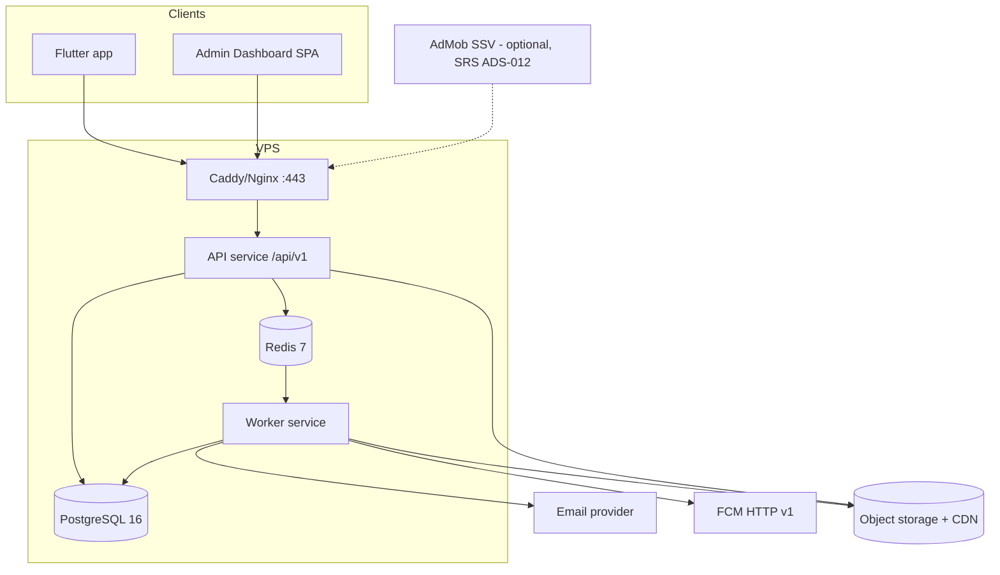
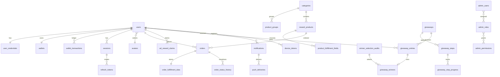

# Creative Rewards — Backend, API & Admin Dashboard Specification

| | |
|---|---|
| Document | `docs/BACKEND.md` |
| Companion | [`docs/SRS.md`](SRS.md). Requirement IDs (AUTH-xxx, ORD-xxx, …) refer to that file |
| Scope | New VPS-hosted backend, REST API `/api/v1`, PostgreSQL schema, workers, Admin Dashboard API, deployment, testing |
| Date | 2026-10-21 |
| Status | **Draft for backend handoff.** No production API contract existed before this document. All technology choices marked **[R]** are recommendations that have not been approved (§11) |
| Revision 2026-10-21 | Three product-owner decisions applied: **(1)** rewarded ads credit 10 points through a client-triggered, idempotent claim (§2.8, §3.8, §4.2, §6.7); SSV is optional; the security and policy reviews are **outstanding**. **(2)** Orders use **Immediate Deduction** with single idempotent refunds; the reserved balance and the hold/capture model were removed (§2.6, §2.7, §3.9, §4.3–4.6, §5). **(3)** All products, including social media, are **fulfilled manually** by admins, with no platform integrations (§1.1, §3.13.9, §5) |

Status tags are the same as in SRS §0.1: **[L]** legacy Supabase app, **[D]** local demo only, **[N]** new, **[R]** recommendation.

---

## 1. Recommended Architecture

### 1.1 Constraints found in the repository
- The client is Flutter. It already has `dio`-free networking via `supabase_flutter` (legacy) and **no HTTP client** for the redesign. The adapter will implement the `RewardsRepository` operations (`lib/redesign/demo_repository.dart`) on top of this API.
- The existing server-side logic is **TypeScript (Deno edge functions)** and **PostgreSQL** (Supabase): the SSV verifier (used by the legacy cosmetic frame; for points it is only an optional hardening, SRS ADS-012), participation allocation, winner selection and account deletion. Porting it is cheapest to a TypeScript plus PostgreSQL stack.
- **Fulfilment is manual (Approved by Product Owner, 2026-10-21).** Game top-ups and social-media products (Instagram, TikTok, Facebook) are fulfilled by administrators outside the system. The backend needs **no** integration with social platforms, game publishers or follower-delivery services, and this specification defines none.
- Firebase project `rewards-app-87115` is configured for Android FCM.
- AdMob app id `ca-app-pub-6633902647647422~7562449689`. The rewarded ad unit (numeric `6209750271`) is currently used for the cosmetic frame.
- The team operates a single VPS (provider and size unknown, OD-24).

### 1.2 Proposed stack [R]

| Concern | Recommendation | Alternatives | Rationale |
|---|---|---|---|
| API runtime | Node.js 22 LTS + TypeScript, **NestJS** (or Fastify with plugins) | Go, Laravel, Django | Legacy TypeScript (including the optional SSV verifier) ports directly; shared DTO types with the Dashboard; OpenAPI generation |
| Database | **PostgreSQL 16** with `citext`, `pg_trgm`, `pgcrypto` | — | Same engine as the legacy app; transactional ledger; SQL functions portable |
| Data access | Kysely or Prisma (raw SQL for ledger and draw transactions) | TypeORM | Explicit transactions and `FOR UPDATE` |
| Cache, rate limit, queue | **Redis 7** + BullMQ | PostgreSQL-based queue (graphile-worker) | Delayed jobs, retries, rate-limit buckets |
| Workers | Separate Node process from the same codebase (`worker` entrypoint) | — | Email, push, scheduler, reconciliation |
| Email | Transactional provider API or SMTP behind an `EmailSender` interface (OD-10) | — | Deliverability (SPF/DKIM/DMARC), Arabic templates |
| Push | FCM HTTP v1 with a service account | — | Already used |
| Media storage | S3-compatible object storage (external managed bucket preferred; MinIO on the VPS acceptable at launch) + `sharp` for variants; served through a CDN or Nginx cache | Local disk | Backups, scale, signed uploads |
| Reverse proxy and TLS | **Caddy** (automatic Let's Encrypt) or Nginx + certbot | — | HTTPS, HSTS, gzip/brotli, request limits |
| Process management | Docker Compose (api, worker, postgres, redis, caddy, optional minio) with restart policies | systemd units | Reproducible staging and production |
| Admin Dashboard | React SPA (Next.js static export or Vite) at `admin.<domain>` | — | Consumes `/api/v1/admin/*` |
| Observability | pino JSON logs → Loki/Grafana or a hosted log service; Prometheus metrics endpoint; Sentry for errors; external uptime check | — | NFR-011 |
| Backups | WAL-G or pgBackRest to off-site object storage + nightly `pg_dump` | — | NFR-012 |

### 1.3 Logical architecture



### 1.4 Modules (code structure) [R]
`auth`, `users`, `avatars`, `catalog` (categories, groups, products, fields), `wallet`, `ad-rewards`, `orders`, `giveaways` (giveaways, steps, entries, draws, winners), `notifications` (in-app, devices, campaigns, push), `media`, `admin` (admins, roles, sessions), `audit`, `settings`, `search`, `home`, `jobs`, `referrals` (conditional). Each module owns its tables. Cross-module writes go through service interfaces inside the same DB transaction where needed (for example orders → wallet).

### 1.5 Environments
`staging` and `production` are fully separate (database, Redis, buckets, FCM credentials can be shared by project but use separate topics or test devices, separate AdMob ad units, plus separate SSV callback URLs if the optional SSV hardening is enabled, separate email sender domains or sub-addresses). Local development uses Docker Compose. The mobile app selects the API base URL at build time (`--dart-define=API_BASE_URL`, plus the existing `DATA_MODE=api` and `APP_ENV`).

---

## 2. Database Design (PostgreSQL 16)

### 2.0 Conventions
- Primary keys: `uuid` (UUIDv7 generated by the application **[R]**, or `gen_random_uuid()`). Avatars use human-readable text ids (`char_01`).
- All timestamps are `timestamptz`, stored in UTC. Every table has `created_at default now()`, and mutable tables have `updated_at` (trigger-maintained).
- Localized text: `jsonb` shaped `{"en": "...", "ar": "..."}`, validated with the `is_localized()` check function.
- Points: `bigint` (never floating point).
- Status columns: `text` with `CHECK (... IN (...))` (easier to evolve than enums).
- Soft delete: `deleted_at` on catalog and giveaway entities referenced by history.
- Extensions: `citext`, `pg_trgm`, `pgcrypto`.
- DDL is grouped by domain for readability. Migrations must create the tables in dependency order: extensions and `is_localized` → `media_assets` (§2.12) and the admin tables (§2.13) → `avatars` → `users` and the auth tables → catalog → `wallets` and `orders` (create `wallet_adjustments` after `orders`) → ad reward claims (and optional SSV callbacks) → giveaways, entries and winners → `notification_campaigns` before `notifications` → audit, settings, idempotency and `outbox_events` (§7). The database role `app_role` is defined in §8.3.

```sql
create extension if not exists citext;
create extension if not exists pg_trgm;
create extension if not exists pgcrypto;

create or replace function is_localized(v jsonb, require_both boolean default false)
returns boolean language sql immutable as $$
  select jsonb_typeof(v) = 'object'
     and (v ? 'en' or v ? 'ar')
     and (not require_both or (coalesce(v->>'en','') <> '' and coalesce(v->>'ar','') <> ''))
     and (select bool_and(key in ('en','ar')) from jsonb_object_keys(v) as key)
$$;
```

### 2.1 Users and credentials

```sql
create table users (
  id                    uuid primary key,
  email                 citext not null unique,          -- anonymised to 'deleted-<id>@deleted.invalid' on erasure
  display_name          text not null check (char_length(display_name) between 1 and 40),
  avatar_id             text references avatars(id),
  locale                text not null default 'en' check (locale in ('en','ar')),
  status                text not null default 'ACTIVE'
                        check (status in ('ACTIVE','SUSPENDED','BANNED','PENDING_DELETION','DELETED')),
  status_reason         text,
  email_verified_at     timestamptz not null,
  ad_earning_suspended  boolean not null default false,
  referral_code         text unique,                     -- only if REF approved
  last_login_at         timestamptz,
  deletion_scheduled_for timestamptz,
  deleted_at            timestamptz,
  created_at            timestamptz not null default now(),
  updated_at            timestamptz not null default now()
);
create index users_status_idx on users(status);
create index users_created_idx on users(created_at desc);
create index users_display_name_trgm on users using gin (display_name gin_trgm_ops);

create table user_credentials (
  user_id             uuid primary key references users(id) on delete cascade,
  password_hash       text not null,                     -- Argon2id PHC string
  password_updated_at timestamptz not null default now(),
  failed_attempts     int not null default 0,
  locked_until        timestamptz
);

create table deletion_requests (
  id            uuid primary key,
  user_id       uuid not null references users(id),
  requested_at  timestamptz not null default now(),
  scheduled_for timestamptz not null,
  restored_at   timestamptz,
  completed_at  timestamptz,
  source        text not null check (source in ('APP','WEB','SUPPORT'))
);
create unique index deletion_requests_open on deletion_requests(user_id)
  where restored_at is null and completed_at is null;
```

### 2.2 OTP challenges, verification tokens, sessions

```sql
create table otp_challenges (
  id                  uuid primary key,
  email               citext not null,
  purpose             text not null check (purpose in ('REGISTER','RESET_PASSWORD','CHANGE_EMAIL')),
  code_hash           bytea,                 -- HMAC-SHA256(server_secret, challenge_id || code); null when no code is sent (enumeration-safe REGISTER on existing email)
  status              text not null default 'PENDING'
                      check (status in ('PENDING','VERIFIED','LOCKED','EXPIRED','SUPERSEDED')),
  attempts            int not null default 0,
  max_attempts        int not null default 5,
  expires_at          timestamptz not null,
  resend_available_at timestamptz not null,
  delivery_status     text not null default 'QUEUED' check (delivery_status in ('QUEUED','SENT','FAILED')),
  ip                  inet,
  user_agent          text,
  verified_at         timestamptz,
  created_at          timestamptz not null default now()
);
create index otp_challenges_lookup on otp_challenges(email, purpose, created_at desc);
create index otp_challenges_ip on otp_challenges(ip, created_at desc);

create table verification_tokens (
  id           uuid primary key,
  token_hash   bytea not null unique,        -- SHA-256 of the opaque token
  challenge_id uuid not null references otp_challenges(id),
  email        citext not null,
  purpose      text not null,
  expires_at   timestamptz not null,
  consumed_at  timestamptz
);

create table sessions (
  id                  uuid primary key,
  user_id             uuid not null references users(id) on delete cascade,
  installation_id     text,
  platform            text check (platform in ('ANDROID','IOS','WEB')),
  app_version         text,
  device_name         text,
  ip                  inet,
  user_agent          text,
  created_at          timestamptz not null default now(),
  last_seen_at        timestamptz not null default now(),
  absolute_expires_at timestamptz not null,   -- created_at + 90 days
  revoked_at          timestamptz,
  revoke_reason       text check (revoke_reason in ('LOGOUT','LOGOUT_ALL','PASSWORD_CHANGED','PASSWORD_RESET','TOKEN_REUSE','ADMIN','ACCOUNT_DELETED','SUSPENDED'))
);
create index sessions_user_active on sessions(user_id) where revoked_at is null;

create table refresh_tokens (
  id          uuid primary key,
  session_id  uuid not null references sessions(id) on delete cascade,
  family_id   uuid not null,                 -- = session_id
  parent_id   uuid references refresh_tokens(id),
  token_hash  bytea not null unique,
  issued_at   timestamptz not null default now(),
  expires_at  timestamptz not null,          -- issued_at + 30 days (sliding)
  used_at     timestamptz,                   -- set when rotated
  revoked_at  timestamptz
);
create index refresh_tokens_family on refresh_tokens(family_id);
```

### 2.3 Avatars

```sql
create table avatars (
  id             text primary key check (id ~ '^[a-z0-9_]{3,32}$'),   -- e.g. char_01 (matches bundled fallback)
  name           jsonb not null check (is_localized(name, true)),
  media_id       uuid not null references media_assets(id),
  background_hex text not null check (background_hex ~ '^#[0-9A-Fa-f]{6}$'),
  sort_order     int not null default 0,
  is_active      boolean not null default true,
  created_at     timestamptz not null default now(),
  updated_at     timestamptz not null default now()
);
create index avatars_active_order on avatars(is_active, sort_order);
```

### 2.4 Categories and product groups

```sql
create table categories (
  id                 uuid primary key,
  slug               text not null unique check (slug ~ '^[a-z0-9-]{2,48}$'),
  kind               text not null check (kind in ('GAME','SOCIAL_MEDIA','PHYSICAL_GOODS')),  -- PHYSICAL_GOODS pending OD-03; internal only
  name               jsonb not null check (is_localized(name)),
  subtitle           jsonb check (subtitle is null or is_localized(subtitle)),
  description        jsonb check (description is null or is_localized(description)),
  banner_media_id    uuid references media_assets(id),
  thumbnail_media_id uuid references media_assets(id),
  hero_media_id      uuid references media_assets(id),
  icon_media_id      uuid references media_assets(id),
  gradient           text[] not null default '{}' check (cardinality(gradient) between 0 and 4),
  text_tone          text not null default 'LIGHT' check (text_tone in ('LIGHT','DARK')),
  sort_order         int not null default 0,
  is_visible         boolean not null default false,
  is_featured        boolean not null default false,
  featured_order     int,
  created_by         uuid references admin_users(id),
  deleted_at         timestamptz,
  created_at         timestamptz not null default now(),
  updated_at         timestamptz not null default now(),
  constraint categories_visible_requires_content check (
    not is_visible or (is_localized(name, true) and banner_media_id is not null and thumbnail_media_id is not null))
);
create index categories_list on categories(is_visible, sort_order) where deleted_at is null;
create index categories_name_en_trgm on categories using gin ((name->>'en') gin_trgm_ops);
create index categories_name_ar_trgm on categories using gin ((name->>'ar') gin_trgm_ops);

create table product_groups (
  id          uuid primary key,
  category_id uuid not null references categories(id),
  name        jsonb not null check (is_localized(name, true)),
  sort_order  int not null default 0,
  is_visible  boolean not null default true,
  deleted_at  timestamptz,
  created_at  timestamptz not null default now(),
  updated_at  timestamptz not null default now()
);
create index product_groups_category on product_groups(category_id, sort_order) where deleted_at is null;
```

### 2.5 Reward products and fulfilment-field definitions

```sql
create table reward_products (
  id                    uuid primary key,
  category_id           uuid not null references categories(id),
  group_id              uuid references product_groups(id),
  sku                   text not null unique check (sku ~ '^[A-Z0-9_-]{2,40}$'),
  name                  jsonb not null check (is_localized(name)),
  description           jsonb check (description is null or is_localized(description)),
  denomination_label    jsonb check (denomination_label is null or is_localized(denomination_label)),
  image_media_id        uuid references media_assets(id),
  points_cost           bigint not null check (points_cost > 0),
  fulfillment_type      text not null check (fulfillment_type in ('DIGITAL','PHYSICAL')),
  status                text not null default 'INACTIVE' check (status in ('ACTIVE','INACTIVE')),
  stock                 int check (stock is null or stock >= 0),   -- null = unlimited
  per_user_limit_count  int check (per_user_limit_count is null or per_user_limit_count > 0),
  per_user_limit_period text check (per_user_limit_period in ('DAY','WEEK','MONTH','LIFETIME')),
  available_from        timestamptz,
  available_until       timestamptz,
  delivery_estimate     jsonb check (delivery_estimate is null or is_localized(delivery_estimate)),
  instructions          jsonb check (instructions is null or is_localized(instructions)),
  sort_order            int not null default 0,
  is_featured           boolean not null default false,
  fields_version        int not null default 1,
  deleted_at            timestamptz,
  created_at            timestamptz not null default now(),
  updated_at            timestamptz not null default now(),
  check ((per_user_limit_count is null) = (per_user_limit_period is null)),
  check (available_until is null or available_from is null or available_until > available_from),
  constraint products_active_requires_content check (
    status <> 'ACTIVE' or (is_localized(name, true) and image_media_id is not null))
);
create index products_category_list on reward_products(category_id, group_id, sort_order)
  where deleted_at is null and status = 'ACTIVE';
create index products_name_en_trgm on reward_products using gin ((name->>'en') gin_trgm_ops);
create index products_name_ar_trgm on reward_products using gin ((name->>'ar') gin_trgm_ops);

create table product_fulfillment_fields (
  id            uuid primary key,
  product_id    uuid not null references reward_products(id),
  version       int not null,
  key           text not null check (key ~ '^[a-z][a-z0-9_]{1,39}$'),
  label         jsonb not null check (is_localized(label, true)),
  placeholder   jsonb check (placeholder is null or is_localized(placeholder)),
  help_text     jsonb check (help_text is null or is_localized(help_text)),
  type          text not null check (type in ('TEXT','NUMBER','USERNAME','URL','EMAIL','PHONE','SELECT','TEXTAREA',
                                              'ADDRESS_LINE','CITY','POSTAL_CODE','COUNTRY')),
  required      boolean not null default true,
  min_length    int check (min_length is null or min_length >= 0),
  max_length    int check (max_length is null or max_length between 1 and 500),
  pattern       text,                       -- validated as a safe RE2-compatible regex on save
  options       jsonb,                      -- SELECT: [{"value":"eu","label":{"en":"Europe","ar":"أوروبا"}}]
  confirm_entry boolean not null default false,
  sensitive     boolean not null default false,
  sort_order    int not null default 0,
  created_at    timestamptz not null default now(),
  unique (product_id, version, key),
  check (type <> 'SELECT' or jsonb_typeof(options) = 'array')
);
create index product_fields_active on product_fulfillment_fields(product_id, version, sort_order);
```

Field-set changes create a **new version** (`fields_version + 1`) with a full copy of the set. Orders snapshot the definitions they were validated against (§2.7).

### 2.6 Wallets, transactions, adjustments

**Accounting model: Immediate Deduction (Approved by Product Owner, 2026-10-21).** A wallet has a single spendable balance, `available`. There is no `reserved` balance, because order holds were rejected. Order creation writes a `REDEMPTION_DEBIT`. An unsuccessful order writes at most one `REDEMPTION_REFUND`.

```sql
create table wallets (
  user_id         uuid primary key references users(id),
  available       bigint not null default 0 check (available >= 0),
  lifetime_earned bigint not null default 0 check (lifetime_earned >= 0),
  lifetime_spent  bigint not null default 0 check (lifetime_spent >= 0),   -- net of refunds
  version         bigint not null default 0,
  updated_at      timestamptz not null default now()
);

create table wallet_transactions (
  id              uuid primary key,
  user_id         uuid not null references users(id),
  type            text not null check (type in ('SIGNUP_BONUS','AD_REWARD','REDEMPTION_DEBIT','REDEMPTION_REFUND',
                                                'ADMIN_CREDIT','ADMIN_DEBIT','REFERRAL_REWARD','EXPIRY')),
  amount          bigint not null,             -- signed delta applied to `available`
  balance_after   bigint not null check (balance_after >= 0),
  reference_type  text check (reference_type in ('ORDER','AD_CLAIM','ADJUSTMENT','REFERRAL','SYSTEM')),
  reference_id    uuid,
  description     jsonb not null check (is_localized(description, true)),
  idempotency_key text not null unique,        -- order:<id>:debit, order:<id>:refund, ad:<user>:<rewardEventId>, adj:<id>, signup:<user>
  actor_type      text not null check (actor_type in ('SYSTEM','USER','ADMIN')),
  actor_id        uuid,
  metadata        jsonb not null default '{}',
  created_at      timestamptz not null default now(),
  -- sign discipline per type
  check ((type in ('SIGNUP_BONUS','AD_REWARD','REDEMPTION_REFUND','ADMIN_CREDIT','REFERRAL_REWARD') and amount > 0)
      or (type in ('REDEMPTION_DEBIT','ADMIN_DEBIT','EXPIRY') and amount < 0)),
  check (type not in ('REDEMPTION_DEBIT','REDEMPTION_REFUND') or (reference_type = 'ORDER' and reference_id is not null))
);
create index wallet_tx_user_time on wallet_transactions(user_id, created_at desc, id desc);
create index wallet_tx_reference on wallet_transactions(reference_type, reference_id);
-- at most one debit and at most one refund per order (duplicate refunds impossible at the database level)
create unique index wallet_tx_one_debit_per_order  on wallet_transactions(reference_id) where type = 'REDEMPTION_DEBIT';
create unique index wallet_tx_one_refund_per_order on wallet_transactions(reference_id) where type = 'REDEMPTION_REFUND';
-- immutability
revoke update, delete on wallet_transactions from app_role;

create table wallet_adjustments (
  id              uuid primary key,
  user_id         uuid not null references users(id),
  direction       text not null check (direction in ('CREDIT','DEBIT')),
  amount          bigint not null check (amount > 0),
  reason          text not null check (char_length(reason) between 5 and 500),
  user_message    jsonb check (user_message is null or is_localized(user_message, true)),
  related_order_id uuid references orders(id),
  status          text not null check (status in ('PENDING_APPROVAL','APPLIED','REJECTED')),
  requested_by    uuid not null references admin_users(id),
  approved_by     uuid references admin_users(id),
  transaction_id  uuid references wallet_transactions(id),
  idempotency_key text not null unique,
  created_at      timestamptz not null default now(),
  decided_at      timestamptz,
  check (approved_by is null or approved_by <> requested_by)
);
```

Semantics per type:

| Type | amount (Δ available) | lifetime_earned | lifetime_spent | When |
|---|---|---|---|---|
| SIGNUP_BONUS, AD_REWARD, ADMIN_CREDIT, REFERRAL_REWARD | +n | +n | — | Credits |
| REDEMPTION_DEBIT | −cost | — | +cost | Order creation (same transaction as the `PENDING` order) |
| REDEMPTION_REFUND (shown to users as "Refund") | +cost (the order's snapshotted `points_cost`) | — | −cost | Order → REJECTED, CANCELLED or FAILED; at most once per order |
| ADMIN_DEBIT, EXPIRY | −n | — | +n | Adjustments |

Order completion (`COMPLETED`, and `DELIVERED` for physical products) writes **no** wallet transaction.

### 2.7 Orders, status history, fulfilment data, notes

```sql
create sequence order_number_seq;

create table orders (
  id                    uuid primary key,
  order_number          text not null unique,           -- 'CR-' || to_char(now(),'YYYY') || '-' || lpad(nextval,6,'0')
  user_id               uuid not null references users(id),
  product_id            uuid not null references reward_products(id),
  status                text not null check (status in ('PENDING','PROCESSING','SHIPPED','DELIVERED','COMPLETED',
                                                          'REJECTED','CANCELLED','FAILED')),
  fulfillment_type      text not null check (fulfillment_type in ('DIGITAL','PHYSICAL')),
  points_cost           bigint not null check (points_cost > 0),   -- snapshot of the price at redemption; refunds use this value
  product_snapshot      jsonb not null,   -- {name, denominationLabel, imageUrl, categoryName, categoryKind, sku}
  debit_transaction_id  uuid not null references wallet_transactions(id) deferrable initially deferred,  -- REDEMPTION_DEBIT written in the same tx
  refund_transaction_id uuid references wallet_transactions(id),
  refunded_at           timestamptz,
  idempotency_key       text not null,
  request_hash          bytea not null,   -- SHA-256 of canonical request body
  assigned_admin_id     uuid references admin_users(id),
  rejection_code        text check (rejection_code in ('INVALID_ACCOUNT_INFO','SUSPECTED_FRAUD','PRODUCT_UNAVAILABLE','OTHER')),
  user_message          jsonb check (user_message is null or is_localized(user_message)),
  delivery_note         jsonb check (delivery_note is null or is_localized(delivery_note)),
  delivered_code_enc    bytea,            -- OD-13
  tracking_number       text,
  carrier               text,
  shipped_at            timestamptz,
  delivered_at          timestamptz,
  completed_at          timestamptz,
  closed_at             timestamptz,      -- any terminal state
  version               int not null default 0,   -- optimistic concurrency for admin transitions
  created_at            timestamptz not null default now(),
  updated_at            timestamptz not null default now(),
  unique (user_id, idempotency_key),
  unique (refund_transaction_id),
  check (fulfillment_type = 'PHYSICAL' or status not in ('SHIPPED','DELIVERED')),
  check ((refunded_at is null) = (refund_transaction_id is null)),
  check (refunded_at is null or status in ('REJECTED','CANCELLED','FAILED'))   -- only unsuccessful orders are refunded
);
create index orders_user_time on orders(user_id, created_at desc, id desc);
create index orders_status_time on orders(status, created_at);
create index orders_product_user on orders(product_id, user_id, created_at);   -- per-user limits
create index orders_assigned on orders(assigned_admin_id) where closed_at is null;

create table order_status_history (
  id           uuid primary key,
  order_id     uuid not null references orders(id),
  from_status  text,
  to_status    text not null,
  actor_type   text not null check (actor_type in ('USER','ADMIN','SYSTEM')),
  actor_id     uuid,
  reason_code  text,
  note         text,             -- internal
  user_visible boolean not null default true,
  created_at   timestamptz not null default now()
);
create index order_history_order on order_status_history(order_id, created_at);

create table order_fulfillment_data (
  order_id           uuid primary key references orders(id),
  fields_definition  jsonb not null,   -- snapshot of field defs (version) used for validation
  values_plain       jsonb not null,   -- non-sensitive values {key: value}
  values_encrypted   bytea,            -- AES-256-GCM(JSON of sensitive values)
  values_masked      jsonb not null,   -- {"player_id": "****5678"} for lists/user view
  encryption_key_id  text,
  purged_at          timestamptz
);

create table order_notes (
  id         uuid primary key,
  order_id   uuid not null references orders(id),
  admin_id   uuid not null references admin_users(id),
  body       text not null check (char_length(body) between 1 and 2000),
  created_at timestamptz not null default now()
);
```

### 2.8 Ad reward claims (client-triggered) and optional SSV callbacks

**Approved flow (Product Owner, 2026-10-21):** after the AdMob completion callback and ad dismissal, the app sends an authenticated claim, and the backend credits the configured `pointsPerCompletedAd` (10). Each row in `ad_reward_claims` records a **client assertion**. It is **not** server-verified proof that an ad was watched (§6.7, SRS ADS-004).

```sql
create table ad_reward_claims (
  id                  uuid primary key,
  user_id             uuid not null references users(id),
  reward_event_id     uuid not null,                 -- client-generated at onUserEarnedReward; idempotency id
  installation_id     text,                          -- X-Installation-Id (client-reported)
  ad_unit_id          text not null,                 -- client-reported; checked against allowlist (not proof)
  ad_response_id      text,                          -- AdMob ResponseInfo.responseId (client-reported; forensics only)
  client_completed_at timestamptz,                   -- client clock; informational only
  received_at         timestamptz not null default now(),   -- authoritative time for limits and day windows
  status              text not null check (status in ('CREDITED','REJECTED')),
  reject_reason       text check (reject_reason in ('DAILY_LIMIT_USER','DAILY_LIMIT_DEVICE','DAILY_LIMIT_IP','COOLDOWN',
                                                    'FEATURE_DISABLED','AD_EARNING_SUSPENDED','ACCOUNT_SUSPENDED',
                                                    'AD_UNIT_NOT_ALLOWED','ACCOUNT_TOO_NEW')),
  points_credited     bigint check (points_credited is null or points_credited > 0),   -- config value at acceptance
  transaction_id      uuid unique references wallet_transactions(id),
  risk_flags          text[] not null default '{}',  -- e.g. {'EXACT_COOLDOWN_INTERVALS','SHARED_INSTALLATION','NEW_ACCOUNT','INTEGRITY_FAILED','NO_SSV_MATCH'}
  ip                  inet,
  user_agent          text,
  app_version         text,
  integrity_verdict   jsonb,                         -- optional Play Integrity result (OD-16)
  ssv_matched_at      timestamptz,                   -- only if optional SSV audit/gating (§3.8.4) is enabled
  created_at          timestamptz not null default now(),
  unique (user_id, reward_event_id),
  check ((status = 'CREDITED') = (transaction_id is not null and points_credited is not null)),
  check (status <> 'REJECTED' or reject_reason is not null)
);
create index ad_claims_user_credited on ad_reward_claims(user_id, received_at desc) where status = 'CREDITED';
create index ad_claims_installation on ad_reward_claims(installation_id, received_at desc) where status = 'CREDITED';
create index ad_claims_ip on ad_reward_claims(ip, received_at desc) where status = 'CREDITED';
create index ad_claims_flagged on ad_reward_claims(received_at desc) where cardinality(risk_flags) > 0;

-- OPTIONAL (only if the SSV hardening of SRS ADS-012 is enabled; not part of the approved flow)
create table ad_ssv_callbacks (
  id               uuid primary key,
  received_at      timestamptz not null default now(),
  raw_query        text not null,
  key_id           bigint,
  signature_valid  boolean not null,
  transaction_id   text unique,
  reward_event_id  uuid,                              -- custom_data = rewardEventId
  claim_id         uuid references ad_reward_claims(id),
  outcome          text not null check (outcome in ('MATCHED','UNMATCHED','DUPLICATE','INVALID_SIGNATURE',
                                                    'INVALID_FIELDS','ERROR')),
  http_status      int not null,
  source_ip        inet
);
create index ssv_callbacks_event on ad_ssv_callbacks(reward_event_id);
```

### 2.9 Giveaways, steps, entries, step progress

```sql
create table giveaways (
  id                  uuid primary key,
  slug                text not null unique,
  title               jsonb not null check (is_localized(title)),
  description         jsonb check (description is null or is_localized(description)),
  prize_name          jsonb not null check (is_localized(prize_name)),
  prize_media_id      uuid references media_assets(id),
  gallery_media_ids   uuid[] not null default '{}',
  organizer_name      jsonb not null check (is_localized(organizer_name)),
  organizer_logo_id   uuid references media_assets(id),
  instructions        jsonb check (instructions is null or is_localized(instructions)),
  official_rules      jsonb check (official_rules is null or is_localized(official_rules)),
  starts_at           timestamptz not null,
  ends_at             timestamptz not null,
  draw_at             timestamptz,
  winners_count       int not null default 1 check (winners_count between 1 and 100),
  number_digit_width  int not null default 6 check (number_digit_width between 4 and 6),
  max_participants    int check (max_participants is null or max_participants > 0),
  participant_count   int not null default 0,
  min_account_age_days int not null default 0,
  claim_fields        jsonb not null default '[]',   -- same shape as product fulfilment field defs
  claim_period_days   int not null default 14 check (claim_period_days between 1 and 90),
  winner_disclosure   text not null default 'NUMBER_ONLY'
                      check (winner_disclosure in ('NONE','NUMBER_ONLY','FIRST_NAME_INITIAL','FULL_DISPLAY_NAME')),
  status              text not null default 'DRAFT'
                      check (status in ('DRAFT','SCHEDULED','ACTIVE','ENDED','WINNERS_SELECTED','COMPLETED','CANCELLED','ARCHIVED')),
  visibility          text not null default 'PUBLIC' check (visibility in ('PUBLIC','HIDDEN')),
  is_featured         boolean not null default false,
  sort_order          int not null default 0,
  cancel_reason       text,
  created_by          uuid references admin_users(id),
  published_at        timestamptz,
  deleted_at          timestamptz,
  created_at          timestamptz not null default now(),
  updated_at          timestamptz not null default now(),
  check (ends_at > starts_at),
  check (max_participants is null or max_participants <= (power(10, number_digit_width) * 0.9)::int),
  constraint giveaways_publish_requirements check (
    status in ('DRAFT','CANCELLED') or
    (is_localized(title, true) and is_localized(prize_name, true) and official_rules is not null
     and is_localized(official_rules, true) and prize_media_id is not null))
);
create index giveaways_public_list on giveaways(status, starts_at, ends_at)
  where deleted_at is null and visibility = 'PUBLIC';
create index giveaways_title_en_trgm on giveaways using gin ((title->>'en') gin_trgm_ops);
create index giveaways_title_ar_trgm on giveaways using gin ((title->>'ar') gin_trgm_ops);

create table giveaway_steps (
  id                  uuid primary key,
  giveaway_id         uuid not null references giveaways(id),
  title               jsonb not null check (is_localized(title, true)),
  description         jsonb check (description is null or is_localized(description)),
  action_type         text not null check (action_type in ('FOLLOW_INSTAGRAM','FOLLOW_TIKTOK','FOLLOW_FACEBOOK',
                                                         'SUBSCRIBE_YOUTUBE','JOIN_TELEGRAM','VISIT_URL','CUSTOM')),
  url                 text check (url is null or url ~ '^https://'),
  required            boolean not null default true,
  verification_method text not null check (verification_method in ('NONE','SELF_DECLARED','LINK_CLICK','MANUAL_REVIEW')),
  proof_type          text check (proof_type in ('USERNAME','SCREENSHOT','TEXT')),
  sort_order          int not null default 0,
  deleted_at          timestamptz,
  created_at          timestamptz not null default now(),
  updated_at          timestamptz not null default now(),
  check (verification_method <> 'MANUAL_REVIEW' or proof_type is not null),
  check (verification_method <> 'LINK_CLICK' or url is not null),
  check (verification_method <> 'NONE' or required = false)
);
create index giveaway_steps_order on giveaway_steps(giveaway_id, sort_order) where deleted_at is null;

create table giveaway_entries (
  id                    uuid primary key,
  giveaway_id           uuid not null references giveaways(id),
  user_id               uuid not null references users(id),
  participation_number  int not null check (participation_number >= 0),
  sequence              int not null,                      -- 1-based join order (admin "ticket #")
  status                text not null default 'ACTIVE'
                        check (status in ('ACTIVE','PENDING_VERIFICATION','DISQUALIFIED')),
  disqualified_reason   text,
  disqualified_by       uuid references admin_users(id),
  idempotency_key       text not null,
  created_at            timestamptz not null default now(),
  updated_at            timestamptz not null default now(),
  unique (giveaway_id, user_id),
  unique (giveaway_id, participation_number),
  unique (giveaway_id, sequence)
);
create index entries_user_time on giveaway_entries(user_id, created_at desc);
create index entries_giveaway_status on giveaway_entries(giveaway_id, status);

create table giveaway_step_progress (
  id               uuid primary key,
  giveaway_id      uuid not null references giveaways(id),
  step_id          uuid not null references giveaway_steps(id),
  user_id          uuid not null references users(id),
  status           text not null check (status in ('OPENED','SELF_DECLARED','CLICKED','SUBMITTED','VERIFIED','REJECTED')),
  click_token_hash bytea unique,      -- LINK_CLICK tracked redirect
  clicked_at       timestamptz,
  proof_text       text check (char_length(proof_text) <= 200),
  proof_media_id   uuid references media_assets(id),
  reviewed_by      uuid references admin_users(id),
  reviewed_at      timestamptz,
  review_note      text,
  created_at       timestamptz not null default now(),
  updated_at       timestamptz not null default now(),
  unique (step_id, user_id)
);
create index step_progress_review_queue on giveaway_step_progress(giveaway_id, status) where status = 'SUBMITTED';
```

Note on legacy: the legacy `participation_number_pool` table pre-generated all numbers. The recommended algorithm (§4.7) does not need a pool table, but a pool remains an acceptable alternative for widths ≤ 5.

### 2.10 Winners and selection audits

```sql
create table winner_selection_audits (
  id                 uuid primary key,
  giveaway_id        uuid not null references giveaways(id),
  method             text not null check (method in ('AUTOMATIC','MANUAL')),
  performed_by       uuid not null references admin_users(id),
  requested_count    int not null,
  pool_size          int not null,
  pool_hash          text not null,           -- hex SHA-256 of newline-joined sorted eligible entry ids
  seed_hex           text,                    -- 256-bit CSPRNG seed (AUTOMATIC only)
  algorithm_version  text,                    -- e.g. 'cr-draw-v1:hmac-sha256-rejection'
  selected_entry_ids uuid[] not null,
  excluded_entry_ids uuid[] not null default '{}',   -- prior winners/forfeits excluded from a redraw
  previous_audit_id  uuid references winner_selection_audits(id),
  reason             text,                    -- required for MANUAL
  created_at         timestamptz not null default now(),
  check (method = 'AUTOMATIC' and seed_hex is not null or method = 'MANUAL' and reason is not null)
);
revoke update, delete on winner_selection_audits from app_role;

create table giveaway_winners (
  id                          uuid primary key,
  giveaway_id                 uuid not null references giveaways(id),
  entry_id                    uuid not null unique references giveaway_entries(id),
  user_id                     uuid not null references users(id),
  rank                        int not null check (rank >= 1),
  status                      text not null default 'SELECTED'
                              check (status in ('SELECTED','ANNOUNCED','CLAIMED','FULFILLED','FORFEITED')),
  selection_method            text not null check (selection_method in ('AUTOMATIC','MANUAL')),
  selection_audit_id          uuid not null references winner_selection_audits(id),
  selected_by_admin_id        uuid not null references admin_users(id),
  announced_at                timestamptz,
  announced_by                uuid references admin_users(id),
  celebration_acknowledged_at timestamptz,
  claim_deadline              timestamptz,
  claimed_at                  timestamptz,
  claim_data_encrypted        bytea,
  disclosure_consent          boolean,
  fulfilled_at                timestamptz,
  fulfillment_note            text,
  tracking_number             text,
  forfeited_at                timestamptz,
  forfeit_reason              text check (forfeit_reason in ('NO_CLAIM','INELIGIBLE','DECLINED','FRAUD','OTHER')),
  replaced_by_winner_id       uuid references giveaway_winners(id),
  created_at                  timestamptz not null default now(),
  updated_at                  timestamptz not null default now()
);
create unique index winners_rank_active on giveaway_winners(giveaway_id, rank) where status <> 'FORFEITED';
create index winners_user_pending_celebration on giveaway_winners(user_id)
  where status in ('ANNOUNCED','CLAIMED','FULFILLED') and celebration_acknowledged_at is null;
```

### 2.11 Notifications, preferences, devices, campaigns, deliveries

```sql
create table notifications (
  id          uuid primary key,
  user_id     uuid not null references users(id) on delete cascade,
  type        text not null check (type in ('WINNER_ANNOUNCEMENT','GIVEAWAY_RESULT','GIVEAWAY_REMINDER','ENTRY_CONFIRMED','ENTRY_STEP_REVIEWED',
                                            'ENTRY_DISQUALIFIED','ORDER_STATUS','WALLET_CREDIT','WALLET_DEBIT',
                                            'AD_REWARD_CREDITED','ADMIN_ANNOUNCEMENT','SECURITY')),
  title       jsonb not null check (is_localized(title, true)),
  body        jsonb not null check (is_localized(body, true)),
  data        jsonb not null default '{}',     -- {"screen":"ORDER_DETAILS","id":"..."}
  campaign_id uuid references notification_campaigns(id),
  dedupe_key  text,                            -- e.g. order:<id>:status:COMPLETED
  is_read     boolean not null default false,
  read_at     timestamptz,
  created_at  timestamptz not null default now(),
  unique (user_id, dedupe_key)
);
create index notifications_user_time on notifications(user_id, created_at desc, id desc);
create index notifications_unread on notifications(user_id) where not is_read;

create table notification_preferences (
  user_id            uuid primary key references users(id) on delete cascade,
  push_orders        boolean not null default true,
  push_wallet        boolean not null default true,
  push_giveaways     boolean not null default true,
  push_announcements boolean not null default false,   -- OD-09
  updated_at         timestamptz not null default now()
);

create table device_tokens (
  id              uuid primary key,
  user_id         uuid references users(id) on delete cascade,
  installation_id text not null unique,
  fcm_token       text not null,
  platform        text not null check (platform in ('ANDROID','IOS')),
  app_version     text,
  locale          text check (locale in ('en','ar')),
  last_seen_at    timestamptz not null default now(),
  invalidated_at  timestamptz,
  created_at      timestamptz not null default now()
);
create index device_tokens_user on device_tokens(user_id) where invalidated_at is null;

create table notification_campaigns (
  id              uuid primary key,
  title           jsonb not null check (is_localized(title, true)),
  body            jsonb not null check (is_localized(body, true)),
  data            jsonb not null default '{}',
  target_type     text not null check (target_type in ('ALL','USERS','SEGMENT')),
  target_user_ids uuid[],
  segment         jsonb,           -- {"locale":"ar","registeredAfter":"...","hasOrders":true,"enteredGiveawayId":"..."}
  send_push       boolean not null default true,
  scheduled_at    timestamptz,
  status          text not null default 'DRAFT' check (status in ('DRAFT','SCHEDULED','SENDING','SENT','CANCELLED','FAILED')),
  stats           jsonb not null default '{"targeted":0,"inApp":0,"pushSent":0,"pushFailed":0}',
  created_by      uuid not null references admin_users(id),
  created_at      timestamptz not null default now(),
  sent_at         timestamptz,
  check (target_type <> 'USERS' or cardinality(target_user_ids) between 1 and 10000)
);

create table push_deliveries (
  id              uuid primary key,
  notification_id uuid not null references notifications(id) on delete cascade,
  device_token_id uuid not null references device_tokens(id) on delete cascade,
  status          text not null default 'QUEUED' check (status in ('QUEUED','SENT','FAILED','INVALID_TOKEN','SKIPPED_PREFERENCE')),
  attempts        int not null default 0,
  last_error      text,
  next_attempt_at timestamptz,
  fcm_message_id  text,
  created_at      timestamptz not null default now(),
  updated_at      timestamptz not null default now(),
  unique (notification_id, device_token_id)
);
create index push_deliveries_retry on push_deliveries(next_attempt_at) where status = 'QUEUED';
```

### 2.12 Media assets

```sql
create table media_assets (
  id                uuid primary key,
  usage             text not null check (usage in ('AVATAR','CATEGORY_BANNER','CATEGORY_THUMBNAIL','CATEGORY_HERO',
                                                   'CATEGORY_ICON','PRODUCT','GIVEAWAY_PRIZE','GIVEAWAY_GALLERY',
                                                   'ORGANIZER_LOGO','STEP_PROOF','OTHER')),
  original_filename text,
  mime_type         text not null check (mime_type in ('image/jpeg','image/png','image/webp')),
  width             int not null,
  height            int not null,
  bytes             int not null check (bytes <= 5242880),
  sha256            text not null,
  storage_key       text not null unique,              -- original
  variants          jsonb not null default '{}',       -- {"sm":{"key":"...","w":320},"md":{...},"lg":{...}} WebP
  alt_text          jsonb check (alt_text is null or is_localized(alt_text)),
  is_private        boolean not null default false,    -- STEP_PROOF: served only via signed URL to admins
  uploaded_by_admin uuid references admin_users(id),
  uploaded_by_user  uuid references users(id),
  deleted_at        timestamptz,
  created_at        timestamptz not null default now()
);
create index media_usage on media_assets(usage, created_at desc) where deleted_at is null;
```

### 2.13 Admin accounts, roles, permissions, sessions

```sql
create table admin_users (
  id                    uuid primary key,
  email                 citext not null unique,
  display_name          text not null,
  password_hash         text,                       -- null until the invitation is accepted
  totp_secret_encrypted bytea,
  totp_enabled_at       timestamptz,
  recovery_codes_hashed text[],
  status                text not null default 'INVITED' check (status in ('INVITED','ACTIVE','DEACTIVATED')),
  failed_attempts       int not null default 0,
  locked_until          timestamptz,
  last_login_at         timestamptz,
  invited_by            uuid references admin_users(id),
  created_at            timestamptz not null default now(),
  updated_at            timestamptz not null default now()
);

create table admin_roles (
  id          text primary key,   -- SUPER_ADMIN, ADMIN, CONTENT_MANAGER, FULFILLMENT_AGENT, SUPPORT_AGENT, ANALYST
  name        text not null,
  description text,
  is_system   boolean not null default true
);
create table admin_permissions (id text primary key, description text not null);   -- e.g. 'orders.transition'
create table admin_role_permissions (
  role_id       text references admin_roles(id) on delete cascade,
  permission_id text references admin_permissions(id) on delete cascade,
  primary key (role_id, permission_id)
);
create table admin_user_roles (
  admin_id uuid references admin_users(id) on delete cascade,
  role_id  text references admin_roles(id),
  primary key (admin_id, role_id)
);

create table admin_invitations (
  id          uuid primary key,
  email       citext not null,
  role_ids    text[] not null,
  token_hash  bytea not null unique,
  expires_at  timestamptz not null,   -- +48 h
  accepted_at timestamptz,
  revoked_at  timestamptz,
  created_by  uuid not null references admin_users(id),
  created_at  timestamptz not null default now()
);

create table admin_sessions (
  id                 uuid primary key,
  admin_id           uuid not null references admin_users(id),
  refresh_token_hash bytea not null unique,
  mfa_verified_at    timestamptz,
  ip                 inet,
  user_agent         text,
  created_at         timestamptz not null default now(),
  last_seen_at       timestamptz not null default now(),
  expires_at         timestamptz not null,      -- +12 h absolute
  revoked_at         timestamptz
);
```

Seeded permission ids (match SRS §4.16.1): `admins.manage`, `settings.manage`, `users.read`, `users.read_pii`, `users.suspend`, `wallet.adjust`, `wallet.adjust.large`, `wallet.adjust.approve`, `avatars.manage`, `categories.manage`, `products.manage`, `orders.read`, `orders.transition`, `orders.sensitive.read`, `orders.assign`, `giveaways.manage`, `giveaways.entries.review`, `giveaways.winners.draw`, `giveaways.winners.manual`, `giveaways.winners.manage`, `notifications.send`, `media.manage`, `audit.read`, `reports.read`, `ads.manage`.

### 2.14 Audit logs

```sql
create table audit_logs (
  id          bigint generated always as identity primary key,
  occurred_at timestamptz not null default now(),
  actor_type  text not null check (actor_type in ('ADMIN','USER','SYSTEM','WEBHOOK')),
  actor_id    uuid,
  action      text not null,          -- e.g. 'order.transition', 'wallet.adjust', 'giveaway.draw', 'auth.login_failed'
  entity_type text,
  entity_id   text,
  request_id  text,
  ip          inet,
  user_agent  text,
  before      jsonb,                  -- sensitive fields redacted ("[REDACTED]")
  after       jsonb,
  metadata    jsonb not null default '{}'
);
create index audit_entity on audit_logs(entity_type, entity_id, occurred_at desc);
create index audit_actor on audit_logs(actor_type, actor_id, occurred_at desc);
create index audit_action_time on audit_logs(action, occurred_at desc);
revoke update, delete on audit_logs from app_role;
-- Partition by month (declarative partitioning) once the volume exceeds ~10M rows [R]
```

### 2.15 Application settings and idempotency

```sql
create table app_settings (
  key        text primary key,      -- see table below
  value      jsonb not null,
  version    int not null default 1,
  updated_by uuid references admin_users(id),
  updated_at timestamptz not null default now()
);

create table idempotency_records (
  scope           text not null,     -- 'user:<id>:POST /orders' | 'admin:<id>:POST /admin/...'
  key             text not null check (char_length(key) between 8 and 100),
  request_hash    bytea not null,
  status          text not null check (status in ('IN_PROGRESS','COMPLETED')),
  response_status int,
  response_body   jsonb,
  created_at      timestamptz not null default now(),
  expires_at      timestamptz not null,   -- +24 h (orders/entries also keep their own unique keys permanently)
  primary key (scope, key)
);
```

| Setting key | Value shape (default) |
|---|---|
| `auth.otp` | `{"length":6,"ttlSeconds":600,"resendCooldownSeconds":60,"maxAttempts":5,"maxPerEmailPerHour":5,"maxPerIpPerHour":20}` |
| `auth.session` | `{"accessTtlSeconds":900,"refreshTtlDays":30,"absoluteTtlDays":90}` |
| `wallet.signupBonus` | `{"amount":0}` (OD-07) |
| `wallet.adjustment` | `{"singleCap":5000,"supportCap":500,"requireSecondApprovalAbove":5000}` |
| `ads.rewards` | `{"enabled":false,"pointsPerCompletedAd":10,"dailyLimitPerUser":10,"dailyLimitPerDevice":15,"dailyLimitPerIp":40,"cooldownSeconds":120,"allowedAdUnitIds":["ca-app-pub-6633902647647422/6209750271"],"minAccountAgeMinutes":0,"requireIntegrityVerdict":false,"ssv":{"mode":"OFF"},"dayBoundaryTimezone":"UTC"}`. **`pointsPerCompletedAd = 10` is Approved by Product Owner.** The limit values are still open (OD-01). `enabled` stays `false` in production until the security and policy reviews are signed off (SRS ADS-013). `ssv.mode` ∈ `OFF` (approved default), `AUDIT`, `REQUIRED` (optional hardening; `REQUIRED` changes the approved flow, SRS ADS-012) |
| `orders` | `{"autoCompleteDeliveredAfterDays":7,"pendingSlaHours":24,"newOrderEmailDigestMinutes":15,"fulfillmentDataRetentionDays":90}` |
| `giveaways` | `{"defaultDigitWidth":6,"defaultClaimPeriodDays":14,"allowedStepDomains":{"FOLLOW_INSTAGRAM":["instagram.com"],"FOLLOW_TIKTOK":["tiktok.com"],"FOLLOW_FACEBOOK":["facebook.com","fb.com"],"SUBSCRIBE_YOUTUBE":["youtube.com","youtu.be"],"JOIN_TELEGRAM":["t.me"]}}` |
| `app.config` | `{"minSupportedVersion":"2.0.0","latestVersion":"2.0.0","maintenance":{"enabled":false,"message":{"en":"","ar":""}},"supportEmail":"…","legalUrls":{"privacy":"…","terms":"…","deletion":"…"},"features":{"rewardedAds":false,"referrals":false,"giveaways":true}}` |
| `notifications` | `{"retentionDays":180,"pushMaxAttempts":5}` |
| `catalog` | `{"showEmptyCategories":false}` |
| `privacy` | `{"deletionGraceDays":14}` |

### 2.16 Referral (conditional — only if OD-05 approves)

```sql
create table referrals (
  id                 uuid primary key,
  referrer_user_id   uuid not null references users(id),
  referred_user_id   uuid not null unique references users(id),
  code_used          text not null,
  status             text not null check (status in ('PENDING','QUALIFIED','REWARDED','REJECTED')),
  qualified_at       timestamptz,
  reward_transaction_id uuid references wallet_transactions(id),
  created_at         timestamptz not null default now(),
  check (referrer_user_id <> referred_user_id)
);
```

### 2.17 Entity-relationship overview



---

## 3. REST API Contract (`/api/v1`)

### 3.1 Conventions

**Base URLs [R]:** `https://api.<domain>/api/v1` (production), `https://api-staging.<domain>/api/v1` (staging). The domain is not decided yet (OD-B4).

**Content type:** `application/json; charset=utf-8`. JSON keys use camelCase. Timestamps are ISO-8601 UTC (`2026-10-21T09:30:00Z`).

**Authentication:**
- User endpoints: `Authorization: Bearer <accessToken>` (JWT, `scope=user`).
- Admin endpoints: `Authorization: Bearer <adminAccessToken>` (JWT, `scope=admin`, `mfa=true`).
- Public endpoints are marked `public`.

**Common request headers:** `Accept-Language: en|ar` (optional; affects only server-resolved strings), `X-App-Version: 2.0.0+12`, `X-Installation-Id: <uuid>`, `X-Request-Id` (optional; echoed back), `Idempotency-Key` (required where stated).

**Success envelope:**
```json
{ "data": { }, "meta": { } }
```

**Error envelope (all non-2xx):**
```json
{
  "error": {
    "code": "INSUFFICIENT_POINTS",
    "message": "Available balance is lower than the product cost.",
    "details": { "available": 900, "required": 1200 },
    "fields": { "player_id": [{ "code": "PATTERN_MISMATCH" }] },
    "requestId": "01J9Z6M6Y3K2V7W8X9A0B1C2D3"
  }
}
```
`message` is for developers. The client localizes `code` (L10N-004).

**Pagination:**
- Mobile lists are cursor-based: `?limit=20&cursor=<opaque>` (limit 1–50, default 20). The response has `meta: {"nextCursor": "...", "hasMore": true}`.
- Admin lists are offset-based: `?page=1&pageSize=25&sort=-createdAt` (pageSize ≤ 100). The response has `meta: {"page":1,"pageSize":25,"total":340}`.

**Localized objects** are always returned as `{"en":"...","ar":"..."}` (L10N-002).

**Image object** (`Image`):
```json
{ "id": "6f1c…", "url": "https://media.<domain>/c/6f1c/lg.webp", "width": 1520, "height": 400,
  "variants": { "sm": "https://…/sm.webp", "md": "https://…/md.webp", "lg": "https://…/lg.webp" },
  "alt": { "en": "PUBG Mobile banner", "ar": "شعار ببجي موبايل" } }
```

**Idempotency:**
- Where stated, `Idempotency-Key` (8–100 chars, a UUID is recommended) is required.
- The server stores `(scope, key, requestHash)`.
- A repeat with the same hash returns the stored status and body plus the header `Idempotent-Replayed: true`.
- A different hash returns `409 IDEMPOTENCY_CONFLICT`.
- While the original request is still running, a repeat returns `409 REQUEST_IN_PROGRESS`.

**Rate limiting:** a 429 response carries `Retry-After` and `RateLimit-Policy` / `RateLimit` headers (draft IETF). Limits are in §6.9.

**Caching:**
- Public catalog GETs return an `ETag` and support `If-None-Match` → 304.
- `Cache-Control: private, max-age=60` for catalog and `no-store` for wallet, orders and auth.

**Versioning:** additive changes only within v1 (NFR-013). Clients must ignore unknown fields and unknown enum values (treat them as "unknown" in the UI).

### 3.2 Error code catalog

| HTTP | Code | Meaning |
|---|---|---|
| 400 | `BAD_REQUEST` | Malformed JSON, or a missing header such as `Idempotency-Key` |
| 401 | `UNAUTHENTICATED` | Missing, invalid or expired access token (the client should refresh) |
| 401 | `INVALID_CREDENTIALS` | Wrong email or password (generic) |
| 401 | `REFRESH_TOKEN_INVALID` | Refresh token is unknown, expired or revoked (the client must log in again) |
| 401 | `MFA_REQUIRED` / `MFA_INVALID` | Admin 2FA step |
| 403 | `FORBIDDEN` | Authenticated but lacks the permission or does not own the resource |
| 403 | `ACCOUNT_SUSPENDED` | User status is SUSPENDED or BANNED |
| 403 | `FEATURE_DISABLED` | Feature flag is off |
| 403 | `AD_EARNING_SUSPENDED` | Ad earning was disabled for this user by an admin |
| 404 | `NOT_FOUND` | Resource missing or not visible to the caller |
| 409 | `EMAIL_ALREADY_REGISTERED` | Returned only at `register` (after OTP) |
| 409 | `IDEMPOTENCY_CONFLICT` / `REQUEST_IN_PROGRESS` | See §3.1 |
| 409 | `INSUFFICIENT_POINTS` | details: `available`, `required` |
| 409 | `PRODUCT_UNAVAILABLE` | details: `reason` ∈ `OUT_OF_STOCK`, `NOT_STARTED`, `EXPIRED`, `INACTIVE`, `LIMIT_REACHED` |
| 409 | `INVALID_TRANSITION` | Order, giveaway or winner state change not allowed. details: `from`, `to`, `allowed[]` |
| 409 | `VERSION_CONFLICT` | `If-Match` / `version` mismatch on an admin update |
| 409 | `GIVEAWAY_NOT_OPEN` | details: `status`, `startsAt` / `endsAt` |
| 409 | `GIVEAWAY_FULL` | `max_participants` reached |
| 409 | `ALREADY_ENTERED` | details: `entry` (number) |
| 409 | `STEPS_INCOMPLETE` | details: `missingStepIds[]` |
| 409 | `NOT_ELIGIBLE` | details: `reason` ∈ `ACCOUNT_TOO_NEW`, `COUNTRY_NOT_ALLOWED`, `SUSPENDED` |
| 409 | `NUMBER_SPACE_EXHAUSTED` | Cannot allocate a number (capacity misconfiguration) |
| 409 | `DRAW_NOT_ALLOWED` | details: `reason` ∈ `NOT_ENDED`, `PENDING_REVIEWS`, `NO_ELIGIBLE_ENTRIES`, `SLOTS_FILLED` |
| 409 | `IN_USE` | Delete blocked because the resource is referenced |
| 410 | `OTP_EXPIRED` | Challenge or verification token expired |
| 410 | `CLAIM_PERIOD_ENDED` | Winner claim submitted after `claim_deadline` |
| 422 | `VALIDATION_FAILED` | `fields` map with per-field error codes: `REQUIRED`, `TOO_SHORT`, `TOO_LONG`, `PATTERN_MISMATCH`, `INVALID_FORMAT`, `NOT_IN_OPTIONS`, `CONFIRMATION_MISMATCH`, `WEAK_PASSWORD`, `BREACHED_PASSWORD` |
| 422 | `OTP_INVALID` | Wrong code. details: `attemptsRemaining` |
| 423 | `OTP_LOCKED` | Too many attempts |
| 426 | `APP_UPDATE_REQUIRED` | `X-App-Version` < `minSupportedVersion` (returned on any user endpoint) |
| 429 | `RATE_LIMITED`, `OTP_RESEND_TOO_SOON`, `AD_DAILY_LIMIT_REACHED`, `AD_COOLDOWN_ACTIVE` | details: `retryAfterSeconds` |
| 503 | `MAINTENANCE` | details: `message` (localized) |
| 500 | `INTERNAL_ERROR` | Includes `requestId` |

### 3.3 Authentication and OTP

#### 3.3.1 `POST /auth/otp/request`
- **Auth:** public. **Rate limit:** 5/email/hour, 20/IP/hour, and the 60 s cooldown per (email, purpose).
- **Request:**
```json
{ "email": "Mohamed@Example.com ", "purpose": "REGISTER", "locale": "ar" }
```
- **Validation:** `email` is required, ≤ 254 chars, valid format after trim and lower-case. `purpose` ∈ `REGISTER`, `RESET_PASSWORD`. `CHANGE_EMAIL` uses §3.4.5. `locale` ∈ `en`, `ar` (default `en`).
- **Business logic:** §4.1.
  - `REGISTER` + new email: send the code.
  - `REGISTER` + existing email: send an "account exists" email with no code (no `code_hash`).
  - `RESET_PASSWORD` + existing active user: send the code.
  - `RESET_PASSWORD` + unknown email: send nothing.
  - **The response is identical in every case.**
- **DB side effects:**
  - Earlier `PENDING` challenges for (email, purpose) → `SUPERSEDED`.
  - Insert `otp_challenges`.
  - Enqueue job `email.otp`.
  - Audit `auth.otp_requested` (email hashed).
- **Response 202:**
```json
{ "data": { "challengeId": "0192c7c4-1f3e-7a9e-b1d2-6a5f0c1e2d3b", "expiresAt": "2026-10-21T09:40:00Z",
            "resendAvailableAt": "2026-10-21T09:31:00Z", "codeLength": 6 } }
```
- **Errors:** 422 `VALIDATION_FAILED`; 429 `OTP_RESEND_TOO_SOON` (`retryAfterSeconds`); 429 `RATE_LIMITED`.
- **Idempotency:** not required. The cooldown provides natural protection.

#### 3.3.2 `POST /auth/otp/verify`
- **Auth:** public. **Rate limit:** 10/IP/minute, plus the per-challenge attempt cap (5).
- **Request:**
```json
{ "challengeId": "0192c7c4-1f3e-7a9e-b1d2-6a5f0c1e2d3b", "email": "mohamed@example.com", "code": "473921" }
```
- **Validation:** `code` must match `^\d{6}$`. The server also normalizes Arabic-Indic digits (٠–٩) to ASCII before validating. `email` must match the challenge.
- **Logic:** §4.1.
  - Constant-time HMAC compare.
  - Wrong code → `attempts + 1`. When `attempts` reaches `max_attempts` → `LOCKED`.
  - Correct code → challenge `VERIFIED`, and a `verification_tokens` row is created (10 min).
  - A challenge with no code (an existing-email REGISTER) always returns `OTP_INVALID`, so the response stays enumeration-safe.
- **Response 200:**
```json
{ "data": { "verificationToken": "vt_3q2+7w…(43 chars base64url)", "expiresAt": "2026-10-21T09:50:00Z", "purpose": "REGISTER" } }
```
- **Errors:** 404 `NOT_FOUND` (unknown challenge); 410 `OTP_EXPIRED`; 422 `OTP_INVALID` (`attemptsRemaining`); 423 `OTP_LOCKED`; 409 `INVALID_TRANSITION` (already verified or superseded).
- **Side effects:** audit `auth.otp_verified` / `auth.otp_failed`.

#### 3.3.3 `POST /auth/register`
- **Auth:** public, but requires a REGISTER `verificationToken`.
- **Request:**
```json
{ "verificationToken": "vt_3q2+7w…", "password": "Sunrise2026!", "locale": "ar",
  "displayName": null, "referralCode": null,
  "device": { "installationId": "a7f3…", "platform": "ANDROID", "appVersion": "2.0.0+12", "deviceName": "Pixel 7" } }
```
- **Validation:**
  - The token is valid, unconsumed and `purpose=REGISTER`.
  - Password per AUTH-009. `BREACHED_PASSWORD` is checked against a local list of the top 100k passwords, or k-anonymity HIBP **[R]**.
  - `displayName` is optional, 1–40 chars, default = email local-part truncated.
  - `referralCode` is accepted only if REF is enabled.
- **Logic (single transaction):**
  1. Consume the token (`UPDATE … SET consumed_at=now() WHERE consumed_at IS NULL RETURNING`). If 0 rows → 410.
  2. Insert `users` (`email_verified_at=now()`) and `user_credentials` (Argon2id). A unique violation → 409 `EMAIL_ALREADY_REGISTERED`.
  3. Insert `wallets`, `notification_preferences`, and a referral row if applicable.
  4. If `wallet.signupBonus.amount > 0`, apply a credit (§4.3) with key `signup:<userId>`.
  5. Create the session and refresh token (§4.13).
  6. Insert a `SECURITY`/welcome notification.
  7. Audit `user.registered`.
- **Response 201:**
```json
{ "data": {
  "accessToken": "eyJhbGciOiJFZERTQSIsImtpZCI6IjIwMjYtMTAifQ…", "accessTokenExpiresAt": "2026-10-21T09:47:00Z",
  "refreshToken": "rt_Q1w2e3…", "refreshTokenExpiresAt": "2026-11-20T09:32:00Z",
  "user": { "id": "0192c7c5-…", "email": "mohamed@example.com", "displayName": "mohamed", "avatar": null,
            "locale": "ar", "status": "ACTIVE", "createdAt": "2026-10-21T09:32:00Z" } } }
```
- **Errors:** 410 `OTP_EXPIRED` (token); 409 `EMAIL_ALREADY_REGISTERED`; 422 `VALIDATION_FAILED` (`password: WEAK_PASSWORD | BREACHED_PASSWORD`).
- **Idempotency:** the single-use token makes the call naturally idempotent. A retry after success returns 410. The client then uses login.

#### 3.3.4 `POST /auth/login`
- **Auth:** public. **Rate limit:** 10/IP/minute and 10 failures per account per 15 minutes. After that, return 429 `RATE_LIMITED` with an increasing `retryAfterSeconds`.
- **Request:** `{ "email": "mohamed@example.com", "password": "Sunrise2026!", "device": { … as register } }`
- **Logic:**
  - Load the user and credential. Unknown user → run a dummy Argon2 verify (timing parity) → 401.
  - Verify the hash. On failure, increment `failed_attempts`. At the threshold, set `locked_until` and enqueue a `SECURITY` email.
  - Status `SUSPENDED` / `BANNED` → 403 `ACCOUNT_SUSPENDED`.
  - Status `PENDING_DELETION` → restore the account (cancel the deletion request, set status `ACTIVE`) and return `meta.accountRestored=true` (PRIV-002).
  - Rehash if the hash parameters are outdated.
  - Create the session. Set `last_login_at`.
- **Response 200:** same shape as register, plus `"user.avatar": {"id":"char_01","image":Image}`.
- **Errors:** 401 `INVALID_CREDENTIALS`; 403 `ACCOUNT_SUSPENDED` (details: `supportEmail`); 429.
- **Side effects:** audit `auth.login_succeeded` / `auth.login_failed`.

#### 3.3.5 `POST /auth/refresh`
- **Auth:** public, with a refresh token in the body.
- **Request:** `{ "refreshToken": "rt_Q1w2e3…" }`
- **Logic:** §4.13 (rotation and reuse detection). Updates `sessions.last_seen_at`.
- **Response 200:** `{ "data": { "accessToken": "…", "accessTokenExpiresAt": "…", "refreshToken": "rt_new…", "refreshTokenExpiresAt": "…" } }`
- **Errors:** 401 `REFRESH_TOKEN_INVALID`; 403 `ACCOUNT_SUSPENDED`; 426 `APP_UPDATE_REQUIRED`.

#### 3.3.6 `POST /auth/logout`
- **Auth:** user.
- **Request:** `{ "refreshToken": "rt_…", "installationId": "a7f3…" }`. Both are optional; when omitted, the current session from the JWT `sid` is used.
- **Logic:** revoke the session (`LOGOUT`). Invalidate the device token for the installation (it remains for anonymous broadcast **[R]** only if OD-09 permits, otherwise it is deleted).
- **Response:** 204. **Errors:** 401.

#### 3.3.7 `POST /auth/logout-all`
- **Auth:** user. **Request:** `{}`.
- **Logic:** revoke all sessions (`LOGOUT_ALL`) and invalidate all device tokens of the user.
- **Response:** 204.

#### 3.3.8 `POST /auth/password/reset`
- **Auth:** public, with a `RESET_PASSWORD` verification token.
- **Request:** `{ "verificationToken": "vt_…", "newPassword": "NewSunrise2026!" }`
- **Validation:** AUTH-009. The new password must differ from the current one (`PASSWORD_REUSED` field code).
- **Logic (transaction):**
  1. Consume the token.
  2. Update the hash, reset `failed_attempts` and `locked_until`.
  3. Revoke all sessions (`PASSWORD_RESET`).
  4. Enqueue a `SECURITY` email and notification.
  5. Audit.
- **Response:** 204. **Errors:** 410, 422.

#### 3.3.9 `POST /auth/password/change`
- **Auth:** user.
- **Request:** `{ "currentPassword": "…", "newPassword": "…" }`
- **Logic:** verify the current password (401 `INVALID_CREDENTIALS` on mismatch), update the hash, revoke all **other** sessions, send a `SECURITY` notification and email.
- **Response:** 204.

#### 3.3.10 `GET /auth/sessions` and `DELETE /auth/sessions/{sessionId}`
- **Auth:** user.
- **GET response:**
```json
{ "data": [ { "id": "…", "platform": "ANDROID", "deviceName": "Pixel 7", "appVersion": "2.0.0+12",
  "createdAt": "…", "lastSeenAt": "…", "current": true } ] }
```
- **DELETE:** revokes a session that belongs to the caller (404 if it is not the caller's). Returns 204.

### 3.4 Me, profile, avatars

#### 3.4.1 `GET /me`
- **Auth:** user.
- **Response 200:**
```json
{ "data": {
  "id": "0192c7c5-…", "email": "mohamed@example.com", "displayName": "Mohamed Ali",
  "avatar": { "id": "char_01", "name": {"en":"Hoodie","ar":"هودي"}, "image": { "url": "…" }, "backgroundHex": "#E9DDFF" },
  "locale": "en", "status": "ACTIVE", "createdAt": "…",
  "wallet": { "available": 4800 },
  "stats": { "giveawayEntriesCount": 12, "ordersCount": 3, "unreadNotificationsCount": 2 },
  "onboarding": { "avatarRequired": false } } }
```
- **Logic:** a single query with subselects. `ordersCount` counts all of the user's orders in every status, so the Profile counter matches the My Orders list. `giveawayEntriesCount` counts all entries, including disqualified ones.

#### 3.4.2 `PATCH /me`
- **Auth:** user.
- **Request** (all fields optional): `{ "displayName": "Mohamed Ali", "avatarId": "char_04", "locale": "ar" }`
- **Validation:** `displayName` 1–40 chars, trimmed, no control characters. `avatarId` must exist and be active (an inactive avatar is accepted only if it is already the user's current one). `locale` ∈ `en`, `ar`.
- **Side effects:** update `users`. Update `device_tokens.locale` for the user's devices when the locale changes. Audit `user.profile_updated`.
- **Response 200:** the same body as `GET /me`.
- **Errors:** 422; 404 (`avatarId`).

#### 3.4.3 `DELETE /me`
- **Auth:** user, with recent re-authentication.
- **Request:** `{ "password": "Sunrise2026!", "reason": "optional free text ≤ 300" }`
- **Logic (transaction, PRIV-002):**
  1. Verify the password.
  2. Set user status `PENDING_DELETION`. Set `deletion_scheduled_for = now() + privacy.deletionGraceDays`.
  3. Insert `deletion_requests`.
  4. Revoke all sessions (`ACCOUNT_DELETED`) and invalidate device tokens.
  5. Cancel `PENDING` orders (each through the transition `PENDING→CANCELLED`, actor SYSTEM, which credits the idempotent `REDEMPTION_REFUND` before the wallet is forfeited at erasure). `PROCESSING` and later orders continue to be fulfilled (the user is told this in the confirmation text).
  6. Enqueue a confirmation email.
  7. The final erasure runs as job `privacy.erase` (§7).
- **Response 202:** `{ "data": { "scheduledFor": "2026-11-04T09:00:00Z", "restorable": true } }`
- **Errors:** 401 `INVALID_CREDENTIALS`.

#### 3.4.4 `GET /avatars`
- **Auth:** public. The list is not sensitive, and making it public allows CDN caching (`Cache-Control: public, max-age=300`). Selecting an avatar still requires an authenticated `PATCH /me`.
- **Response 200:**
```json
{ "data": [ { "id": "char_01", "name": {"en":"Hoodie","ar":"هودي"}, "image": { "url": "…", "variants": {…} },
              "backgroundHex": "#E9DDFF", "sortOrder": 1 } ] }
```
- Only active avatars, ordered by `sortOrder`.

#### 3.4.5 `POST /me/email-change/request` and `POST /me/email-change/confirm` (C, AUTH-021)
- **request:** `{ "newEmail": "new@example.com", "password": "…" }` → creates a `CHANGE_EMAIL` challenge for the new address → 202 `{challengeId,…}`. Returns 409 `EMAIL_ALREADY_REGISTERED` only after password verification (an authenticated context, so this is not an enumeration leak).
- **confirm:** `{ "verificationToken": "vt_…" }` → updates the email, notifies the old address, revokes other sessions → 200 with the `GET /me` body.

#### 3.4.6 `GET /me/notification-preferences` and `PUT /me/notification-preferences`
- **Body / response:** `{ "pushOrders": true, "pushWallet": true, "pushGiveaways": true, "pushAnnouncements": false }`
- PUT replaces all four booleans. Returns 422 if a field is missing.

### 3.5 App config, home, search

#### 3.5.1 `GET /app-config`
- **Auth:** public. Cache 300 s. No 426 check here, so old clients can read `minSupportedVersion`.
- **Response 200:**
```json
{ "data": {
  "minSupportedVersion": "2.0.0", "latestVersion": "2.0.1",
  "maintenance": { "enabled": false, "message": { "en": "", "ar": "" } },
  "supportEmail": "support@<domain>",
  "legalUrls": { "privacy": "https://…/privacy-policy.html", "terms": "https://…/terms.html", "deletion": "https://…/delete-account.html" },
  "features": { "rewardedAds": true, "referrals": false, "giveaways": true },
  "adRewards": { "pointsPerCompletedAd": 10, "dailyLimitPerUser": 10, "cooldownSeconds": 120, "adUnitId": "ca-app-pub-6633902647647422/6209750271" },
  "store": { "androidPackage": "com.creativehub.rewardsapp", "iosAppStoreId": null } } }
```
- `adUnitId` is the full SDK id. The claim must report it, and it must be in `allowedAdUnitIds`. `pointsPerCompletedAd` is display-only for the client. The server always credits its own configured value (10).

#### 3.5.2 `GET /home`
- **Auth:** user.
- **Response 200:**
```json
{ "data": {
  "wallet": { "available": 4800 },
  "unreadNotificationsCount": 2,
  "featuredCategories": [ { "id": "…", "slug": "pubg-mobile", "name": {"en":"PUBG Mobile","ar":"ببجي موبايل"},
       "subtitle": {"en":"UC Top-Ups","ar":"شحن UC"}, "thumbnail": {Image}, "gradient": ["#0C6AB1","#2B56B8"], "textTone": "LIGHT" } ],
  "featuredGiveaways": [ { "id": "…", "title": {…}, "prizeName": {…}, "prizeImage": {Image},
       "displayStatus": "AVAILABLE", "startsAt": "…", "endsAt": "…", "myEntry": null } ] } }
```
- **Logic:**
  - Featured categories: visible, not deleted, `is_featured`, ordered by `featured_order`, at most 12. If none are flagged, fall back to the first 8 by `sort_order`.
  - Featured giveaways: `PUBLIC` and `SCHEDULED`/`ACTIVE`/`ENDED`/`WINNERS_SELECTED` (ended ones only within 7 days), with `is_featured` first, then ACTIVE ordered by `endsAt` ascending, then SCHEDULED, then ENDED. At most 8.
  - `displayStatus` mapping: SCHEDULED→`UPCOMING`, ACTIVE→`AVAILABLE`, ENDED/WINNERS_SELECTED/COMPLETED→`ENDED`.

#### 3.5.3 `GET /search?q=uc&types=categories,products,giveaways&limit=10`
- **Auth:** user.
- **Validation:** `q` is trimmed, 2–64 chars. `types` is a subset (default all). `limit` 1–20 per type.
- **Logic:**
  - Normalize: lower-case; strip Arabic diacritics (tashkeel) and tatweel; unify alef forms (أ إ آ → ا), ta marbuta (ة → ه) and alef maqsura (ى → ي).
  - Search with `ILIKE '%q%'` plus trigram `similarity() > 0.3` on `name/title ->> 'en'` and `->> 'ar'`, using generated normalized columns **[R]**.
  - Only visible, active, non-deleted items.
  - Rank by exact prefix first, then by similarity.
- **Response 200:**
```json
{ "data": { "categories": [ {…category summary…} ], "products": [ { "id":"…","categoryId":"…","name":{…},
  "denominationLabel":{…},"image":{Image},"pointsCost":1200 } ], "giveaways": [ {…giveaway summary…} ] },
  "meta": { "q": "uc", "truncated": { "products": true } } }
```

### 3.6 Catalog

#### 3.6.1 `GET /categories`
- **Auth:** user. ETag-cached.
- **Response 200:**
```json
{ "data": [ { "id": "…", "slug": "pubg-mobile", "name": {…}, "subtitle": {…}, "banner": {Image}, "thumbnail": {Image},
              "gradient": ["#0C6AB1","#2B56B8"], "textTone": "LIGHT", "sortOrder": 1 } ] }
```
- **Logic:** visible, not deleted. Unless `catalog.showEmptyCategories` is set, only categories with at least one ACTIVE product in its availability window. Ordered by `sortOrder`. The `kind` field is **not** returned (CAT-003).

#### 3.6.2 `GET /categories/{categoryId}`
- `categoryId` accepts a UUID or a slug.
- **Response 200:**
```json
{ "data": { "id": "…", "slug": "pubg-mobile", "name": {…}, "subtitle": {…}, "description": {…},
  "hero": {Image}, "icon": {Image}, "gradient": [...], "textTone": "LIGHT",
  "groups": [ { "id": "…", "name": {"en":"UC Top-Ups","ar":"شحن UC"}, "sortOrder": 1 },
              { "id": "…", "name": {"en":"Items & Skins","ar":"العناصر والأزياء"}, "sortOrder": 2 } ] } }
```
- **Errors:** 404 if the category is hidden or deleted.

#### 3.6.3 `GET /categories/{categoryId}/products?groupId=&limit=&cursor=`
- **Response 200:**
```json
{ "data": [ { "id": "…", "sku": "PUBG_UC_60", "groupId": "…", "name": {…}, "denominationLabel": {"en":"60 UC","ar":"60 UC"},
  "image": {Image}, "pointsCost": 1200, "fulfillmentType": "DIGITAL",
  "redeemable": true, "unavailableReason": null, "stockLeft": null, "sortOrder": 1 } ],
  "meta": { "nextCursor": null, "hasMore": false } }
```
- **Logic:**
  - ACTIVE, not deleted products in the category (and group, if a `groupId` is given).
  - `redeemable` / `unavailableReason` are evaluated per caller (PRD-005, including the user's per-user limit).
  - `stockLeft` is shown only when stock is ≤ 10 **[R]** (scarcity hint), otherwise null.

#### 3.6.4 `GET /products/{productId}`
- **Response 200:**
```json
{ "data": { "id": "…", "categoryId": "…", "category": { "name": {…}, "slug": "pubg-mobile" },
  "name": {…}, "description": {…}, "denominationLabel": {…}, "image": {Image}, "pointsCost": 1200,
  "fulfillmentType": "DIGITAL", "deliveryEstimate": {"en":"Within 24 hours","ar":"خلال 24 ساعة"}, "instructions": {…},
  "redeemable": true, "unavailableReason": null,
  "fieldsVersion": 3,
  "fulfillmentFields": [ { "key": "player_id", "label": {"en":"Player ID","ar":"معرّف اللاعب"},
      "placeholder": {"en":"e.g. 5123456789","ar":"مثال 5123456789"}, "helpText": {…},
      "type": "NUMBER", "required": true, "minLength": 5, "maxLength": 12, "pattern": "^[0-9]{5,12}$",
      "options": null, "confirmEntry": true, "sensitive": false, "sortOrder": 1 } ],
  "wallet": { "available": 4800 } } }
```
- **Errors:** 404 (inactive or deleted products are hidden unless the caller has an order for them; for that history view, order details uses the snapshot instead).

### 3.7 Wallet

#### 3.7.1 `GET /wallet`
- **Response 200:** `{ "data": { "available": 4800, "lifetimeEarned": 6000, "lifetimeSpent": 1200, "updatedAt": "…" } }`. There is no reserved balance (Immediate Deduction). `lifetimeSpent` is net of refunds.
- `Cache-Control: no-store`.

#### 3.7.2 `GET /wallet/transactions?type=AD_REWARD,REDEMPTION_DEBIT,REDEMPTION_REFUND&limit=20&cursor=`
- **Response 200:**
```json
{ "data": [
  { "id": "…", "type": "REDEMPTION_REFUND", "amount": 1200, "balanceAfter": 6000,
    "description": {"en":"Refund: 60 UC","ar":"استرداد: 60 UC"},
    "reference": { "type": "ORDER", "id": "…", "orderNumber": "CR-2026-000123" }, "createdAt": "…" },
  { "id": "…", "type": "REDEMPTION_DEBIT", "amount": -1200, "balanceAfter": 4800,
    "description": {"en":"Redeemed 60 UC","ar":"استبدال 60 UC"},
    "reference": { "type": "ORDER", "id": "…", "orderNumber": "CR-2026-000123" }, "createdAt": "…" },
  { "id": "…", "type": "AD_REWARD", "amount": 10, "balanceAfter": 6000,
    "description": {"en":"Rewarded ad","ar":"إعلان بمكافأة"},
    "reference": { "type": "AD_CLAIM", "id": "…" }, "createdAt": "…" } ],
  "meta": { "nextCursor": "…", "hasMore": true } }
```
- **Logic:** ordered by `(created_at desc, id desc)`. The cursor encodes the last pair. Metadata and actor ids are never exposed.

### 3.8 Rewarded-ad points (client-triggered claim — Approved by Product Owner)

**Approved behaviour:**
1. The app shows a rewarded ad.
2. AdMob fires `onUserEarnedReward` (the completion callback).
3. The ad is dismissed.
4. The app sends **one authenticated claim**.
5. The backend identifies the user from the access token, credits **10 points** (`pointsPerCompletedAd`, server-configured), records the claim and returns the new balance.

SSV is not required.

> **Security limitation (SRS ADS-004).** The backend cannot verify that an ad was actually shown or completed. A claim is a client assertion: a modified client or a script holding a valid token can submit claims without watching ads. The controls below (idempotency, limits, cooldown, risk flags, manual review of redemptions) **limit and surface** abuse. They do **not** eliminate it, and a credited claim must not be described as proof of viewing. The **security review** (OD-02a) and the **AdMob/Google Play policy review** (OD-02) are outstanding. `ads.rewards.enabled` stays `false` in production until both are signed off.

#### 3.8.1 `GET /ad-rewards/status`
- **Auth:** user. Optional pre-check, so the app can avoid showing an ad that cannot be rewarded. It does not reserve anything.
- **Response 200:**
```json
{ "data": { "enabled": true, "pointsPerCompletedAd": 10, "remainingToday": 7,
            "nextEligibleAt": "2026-10-21T10:02:00Z", "dayResetsAt": "2026-10-22T00:00:00Z",
            "adUnitId": "ca-app-pub-6633902647647422/6209750271" } }
```
- `enabled` is false when the feature flag is off, or when the user's ad earning or account is suspended. `nextEligibleAt` is null when there is no cooldown in effect.

#### 3.8.2 `POST /ad-rewards/claims`
- **Auth:** user (Bearer access token). The user is identified **only** from the token.
- **Idempotency:** `Idempotency-Key` header is **required** and must equal `rewardEventId`. It is also stored permanently as `unique(user_id, reward_event_id)`.
- **When the client sends it (SRS ADS-002):**
  - Only after `onUserEarnedReward` has fired for that ad **and** `onAdDismissedFullScreenContent` has fired.
  - Never on load, open, show failure, or a dismissal without the completion callback.
  - The `rewardEventId` (UUID v4) is generated at the completion callback and persisted on the device until the claim reaches a terminal response.
- **Request:**
```json
{ "rewardEventId": "3f9a2c7e-5b1d-4e8a-9c0f-1a2b3c4d5e6f",
  "adUnitId": "ca-app-pub-6633902647647422/6209750271",
  "adResponseId": "CJ3u…(AdMob ResponseInfo.responseId, optional)",
  "completedAt": "2026-10-21T10:00:05Z",
  "integrityToken": null }
```
- **Validation:**
  - `rewardEventId` is a UUID.
  - `adUnitId` is required and must be in `allowedAdUnitIds`. Otherwise the claim is rejected with reason `AD_UNIT_NOT_ALLOWED` and the request returns 422 `VALIDATION_FAILED` (`fields.adUnitId`).
  - `adResponseId` is ≤ 200 chars. `completedAt` is ISO-8601 and **informational only** (client clock).
  - **Unknown fields are rejected.** In particular, `points`, `amount`, `rewardAmount` and `userId` return 422 `VALIDATION_FAILED`. The client can never choose the amount or the beneficiary.
  - `X-Installation-Id` is required (400 if missing).
- **Logic:** §4.2. In short: feature, user and suspension checks; a lock on the wallet row; limit and cooldown checks by **server receipt time**; then the claim row and the `AD_REWARD` ledger credit are written in **one transaction**.
- **Response 201 (credited):**
```json
{ "data": { "claimId": "0192c7d0-…", "rewardEventId": "3f9a2c7e-…", "status": "CREDITED",
            "pointsCredited": 10, "wallet": { "available": 4810 },
            "remainingToday": 6, "nextEligibleAt": "2026-10-21T10:02:05Z" } }
```
- **Replay** (same `rewardEventId`, same body): returns **200** with the original body and `Idempotent-Replayed: true`. The balance shown is the **current** balance (`wallet.available` re-read) **[R]**. No second credit is made.
- **Same `rewardEventId` with a different body:** 409 `IDEMPOTENCY_CONFLICT`.
- **Errors (each is recorded as a `REJECTED` claim row, so repeating the same `rewardEventId` returns the same rejection):**
  - 429 `AD_DAILY_LIMIT_REACHED` (`retryAfterSeconds` until the day boundary; per user, device or IP)
  - 429 `AD_COOLDOWN_ACTIVE` (`retryAfterSeconds`)
  - 403 `FEATURE_DISABLED`
  - 403 `AD_EARNING_SUSPENDED`
  - 403 `ACCOUNT_SUSPENDED`
  - 422 `VALIDATION_FAILED`
  - 401 `UNAUTHENTICATED` (the client refreshes the token and retries with the same id)
  - 5xx (the client retries with the same id)
- **Client retry policy (SRS ADS-007):**
  - Network error, timeout or 5xx → retry with backoff (2 s, 5 s, 15 s, 1 min, then on next app start), keeping the same `rewardEventId`.
  - 401 → refresh, then retry.
  - 429, 403 or 422 → terminal: delete the pending claim and show a message ("Daily limit reached", "Try again in 2 minutes").
  - A pending claim older than 24 h is discarded by the client **[R]**. The server cannot enforce this reliably, because client time is not trusted.
- **Side effects:**
  - On success: an `ad_reward_claims` row (`CREDITED`, `points_credited = 10`, `risk_flags`); a `wallet_transactions` `AD_REWARD +10` row (key `ad:<userId>:<rewardEventId>`, reference `AD_CLAIM`); and the in-app notification `AD_REWARD_CREDITED` (no push, because the user is in the app) **[R]**.
  - On rejection: an `ad_reward_claims` row (`REJECTED` with `reject_reason`).

#### 3.8.3 Interrupted and failed ads (no API call)
| Situation | Client behaviour | Points |
|---|---|---|
| Ad fails to load / no fill | Do not show the ad; no claim | 0 |
| Ad shown, closed before `onUserEarnedReward` | No claim | 0 |
| `onUserEarnedReward` fired, app killed before dismissal | On next launch, send the persisted claim (the completion was observed) | 10 (if within limits) |
| Ad dismissed, claim request fails | Retry with the same `rewardEventId` | 10 once |
| Ad opened then dismissed without completion | No claim | 0 |

#### 3.8.4 `GET /webhooks/admob/ssv` — **OPTIONAL hardening (not part of the approved flow; SRS ADS-012)**
- Exists only if `ads.rewards.ssv.mode` is `AUDIT` or `REQUIRED`. With the approved default (`OFF`), this endpoint is not deployed.
- **Client change if enabled:** set `ServerSideVerificationOptions(customData: rewardEventId, userId: <opaque HMAC of userId>)` before `show()`.
- **Auth:** none. The ECDSA signature against Google's keys is the gate (the legacy `verify-ad-reward` logic is ported).
- **Logic (summary):**
  1. Verify the signature, ad unit, reward item, timestamp window and unique `transaction_id`.
  2. Match `custom_data` to a claim's `reward_event_id`.
  3. `AUDIT` mode: set `ad_reward_claims.ssv_matched_at`. A daily job flags credited claims with no matching callback within 30 min (`NO_SSV_MATCH`) for admin review. **Crediting is not delayed.**
  4. `REQUIRED` mode: `POST /ad-rewards/claims` records the claim as pending, and the credit happens only on a matching callback. This would need an additional `PENDING_SSV` claim status, which is deliberately not modelled in §2.8. **It changes the approved product flow and needs a new product-owner decision.**
- **Responses:** 200 for processed, duplicate or unmatched callbacks (valid signature); 400 for malformed fields; 401 for a bad signature; 503 for a transient failure (AdMob retries).

### 3.9 Orders (redemption)

#### 3.9.1 `POST /orders`
- **Auth:** user. **Idempotency:** `Idempotency-Key` is **required**. It is stored on the order (`unique(user_id, idempotency_key)`) permanently.
- **Request:**
```json
{ "productId": "0192c6aa-…", "fieldsVersion": 3,
  "fields": { "player_id": "5123456789", "player_id__confirm": "5123456789" } }
```
- **Validation:**
  - `fieldsVersion` must equal the product's current `fields_version`. Otherwise 409 `VERSION_CONFLICT` with the new definitions in `details`, so the client re-renders the form.
  - Every field is checked per its definition. Unknown keys are rejected (`fields._unknown`). `confirmEntry` fields require `<key>__confirm` with an identical value.
  - Values are trimmed. `URL` fields must be https, `USERNAME` fields must match `^@?[A-Za-z0-9._]{1,30}$` by default, and `PHONE` fields must be E.164.
- **Logic:** §4.4.
- **Response 201:**
```json
{ "data": { "order": { "id": "…", "orderNumber": "CR-2026-000123", "status": "PENDING", "pointsCost": 1200,
    "product": { "name": {…}, "denominationLabel": {…}, "image": {Image}, "categoryName": {…} },
    "fields": [ { "key": "player_id", "label": {…}, "value": "5123456789" } ],
    "createdAt": "…", "timeline": [ { "status": "PENDING", "at": "…" } ] },
  "wallet": { "available": 3600 } } }
```
`wallet.available` is the balance **after** the immediate deduction. In this example, 4,800 − 1,200 = 3,600.
- **Errors:**
  - 409 `INSUFFICIENT_POINTS`
  - 409 `PRODUCT_UNAVAILABLE` (reason)
  - 409 `VERSION_CONFLICT`
  - 422 `VALIDATION_FAILED`
  - 403 `ACCOUNT_SUSPENDED`
  - 409 `IDEMPOTENCY_CONFLICT`
  - 404 (unknown or inactive product)
- **Side effects:** see §4.4. In one transaction: the order (`PENDING`), the `REDEMPTION_DEBIT` ledger row (key `order:<id>:debit`), the stock decrement, the history row and the fulfilment data. A single `ORDER_STATUS` notification is sent (PENDING, "We received your order. {cost} points were deducted"). No separate `WALLET_DEBIT` notification is created for redemptions, so the user is not notified twice. The admin new-order alert is a job.

#### 3.9.2 `GET /orders?statusGroup=IN_PROGRESS|COMPLETED|UNSUCCESSFUL&limit=&cursor=`
- `statusGroup` mapping:
  - IN_PROGRESS = PENDING, PROCESSING, SHIPPED, DELIVERED
  - COMPLETED = COMPLETED
  - UNSUCCESSFUL = REJECTED, CANCELLED, FAILED
- **Response 200:**
```json
{ "data": [ { "id": "…", "orderNumber": "CR-2026-000123", "status": "PROCESSING", "pointsCost": 1200,
              "product": { "name": {…}, "denominationLabel": {…}, "image": {Image} }, "createdAt": "…", "updatedAt": "…" } ],
  "meta": { "nextCursor": null, "hasMore": false } }
```

#### 3.9.3 `GET /orders/{orderId}`
- **Auth:** owner only (404 otherwise).
- **Response 200:**
```json
{ "data": { "id": "…", "orderNumber": "CR-2026-000123", "status": "REJECTED", "fulfillmentType": "DIGITAL", "pointsCost": 1200,
  "product": { … snapshot … },
  "fields": [ { "key": "player_id", "label": {…}, "value": "****6789" } ],
  "rejection": { "code": "INVALID_ACCOUNT_INFO", "message": {"en":"The Player ID was not found.","ar":"لم يتم العثور على معرّف اللاعب."} },
  "deliveryNote": null, "deliveredCode": null, "tracking": null,
  "timeline": [ { "status": "PENDING", "at": "…" }, { "status": "REJECTED", "at": "…" } ],
  "refund": { "points": 1200, "refundedAt": "…", "transactionId": "…" }, "cancellable": false } }
```
- `refund` is null unless the order is REJECTED, CANCELLED or FAILED **and** the single `REDEMPTION_REFUND` exists. Completed orders never have a refund object.
- Sensitive values are always masked. Non-sensitive values are returned in full to the owner. `deliveredCode` is decrypted only for the owner and only in this endpoint (OD-13). `timeline` includes `user_visible` history rows only.

#### 3.9.4 `POST /orders/{orderId}/cancel`
- **Auth:** owner. **Idempotency:** optional (a repeated cancel returns the current state with 200).
- **Request:** `{ "reason": "optional ≤ 200 chars" }`
- **Logic:** §4.6 with actor USER. Allowed only from `PENDING`. It credits exactly one `REDEMPTION_REFUND` for the snapshotted `points_cost`.
- **Response 200:** the order (status CANCELLED, with `refund`) and `wallet.available` (now including the refund). A repeated cancel returns the same state and does not refund again.
- **Errors:** 409 `INVALID_TRANSITION`.

### 3.10 Giveaways and participation

#### 3.10.1 `GET /giveaways?status=AVAILABLE|UPCOMING|ENDED&q=&limit=&cursor=`
- **Auth:** user.
- **Response 200:**
```json
{ "data": [ { "id": "…", "slug": "earbuds-oct", "title": {…}, "prizeName": {…}, "prizeImage": {Image},
  "organizerName": {…}, "displayStatus": "AVAILABLE", "startsAt": "…", "endsAt": "…",
  "participantCount": 1840, "maxParticipants": 5000,
  "myEntry": { "participationNumber": "042731", "status": "ACTIVE" } } ],
  "meta": { "nextCursor": "…", "hasMore": true } }
```
- **Logic:**
  - `PUBLIC`, not deleted, status not DRAFT, CANCELLED or ARCHIVED.
  - Status filter mapping as in §3.5.2.
  - Ordering: AVAILABLE by `endsAt` ascending, UPCOMING by `startsAt` ascending, ENDED by `endsAt` descending.
  - `myEntry` is filled from a left join on the caller's entry.

#### 3.10.2 `GET /giveaways/{giveawayId}`
- `giveawayId` accepts a UUID or a slug. HIDDEN giveaways are reachable by id or slug.
- **Response 200:**
```json
{ "data": { "id": "…", "title": {…}, "description": {…}, "prizeName": {…}, "prizeImage": {Image}, "gallery": [],
  "organizerName": {…}, "organizerLogo": null, "instructions": {…}, "officialRules": {…},
  "startsAt": "…", "endsAt": "…", "drawAt": "…", "winnersCount": 1, "numberDigitWidth": 6,
  "displayStatus": "AVAILABLE", "participantCount": 1840, "maxParticipants": 5000,
  "steps": [ { "id": "…", "title": {…}, "description": {…}, "actionType": "FOLLOW_INSTAGRAM",
      "url": "https://instagram.com/creativehub", "required": true, "verificationMethod": "SELF_DECLARED",
      "verificationLabel": "SELF_DECLARED", "proofType": null,
      "myProgress": { "status": "SELF_DECLARED", "reviewNote": null } } ],
  "canEnter": false, "blockingReason": "STEPS_INCOMPLETE",
  "myEntry": null, "results": null } }
```
- **`blockingReason`:** one of `NOT_OPEN`, `FULL`, `ALREADY_ENTERED`, `STEPS_INCOMPLETE`, `NOT_ELIGIBLE`, or null.
- **`results`:** filled once the giveaway is WINNERS_SELECTED or COMPLETED (same shape as §3.11.3).

#### 3.10.3 `POST /giveaways/{giveawayId}/steps/{stepId}/progress`
- **Auth:** user. **Idempotency:** naturally idempotent (one progress row per user and step).
- **Request by verification method:**
  - `SELF_DECLARED`: `{ "action": "DECLARE_DONE" }`
  - `MANUAL_REVIEW`: `{ "action": "SUBMIT_PROOF", "proofText": "@mohamed_ali" }` or `{ "action": "SUBMIT_PROOF", "proofMediaId": "…" }`. The media id comes from §3.10.4.
  - `LINK_CLICK`: `{ "action": "REQUEST_LINK" }`. The response includes `trackedUrl`.
- **Validation:**
  - The giveaway is ACTIVE.
  - The action matches the step's method (else 409 `INVALID_TRANSITION`).
  - `proofText` is ≤ 200 chars and must match the USERNAME pattern for `proofType=USERNAME`.
  - A resubmission is allowed only if the current status is `REJECTED`.
- **Logic:** upsert the progress row.
  - DECLARE_DONE → `SELF_DECLARED`.
  - SUBMIT_PROOF → `SUBMITTED`. If an entry already exists in `PENDING_VERIFICATION`, it stays there.
  - REQUEST_LINK → generate a 32-byte token, store its hash and return `https://api.<domain>/api/v1/l/<token>`.
- **Response 200:**
```json
{ "data": { "stepId": "…", "status": "SUBMITTED", "trackedUrl": null } }
```

#### 3.10.4 `POST /giveaways/{giveawayId}/steps/{stepId}/proof-upload`
- **Auth:** user. Multipart `file` (JPEG/PNG/WebP, ≤ 5 MB).
- **Logic:** stored as a private `media_assets` row (`usage=STEP_PROOF`, `is_private=true`). EXIF is stripped and the image re-encoded.
- **Response 201:** `{ "data": { "mediaId": "…" } }`
- **Rate limit:** 10 per user per hour.

#### 3.10.5 `GET /l/{token}` (tracked redirect)
- **Auth:** none. The token is the credential.
- **Logic:** look up `click_token_hash`. If found and the giveaway is ACTIVE: set `status=CLICKED` (if it was not already a later status) and `clicked_at`, then respond 302 to the step URL. Unknown or expired tokens get a 302 to the app-config support page.
- **Note:** this proves only that the link was opened (GIV-006).

#### 3.10.6 `POST /giveaways/{giveawayId}/entries`
- **Auth:** user. **Idempotency:** `Idempotency-Key` required.
- **Request:** `{}`
- **Logic:** §4.8.
- **Response 201:**
```json
{ "data": { "entry": { "id": "…", "giveawayId": "…", "participationNumber": "042731", "sequence": 1841,
  "status": "ACTIVE", "createdAt": "…" } } }
```
- `status` is `PENDING_VERIFICATION` when required MANUAL_REVIEW steps are still unapproved.
- **Errors:** 409 `GIVEAWAY_NOT_OPEN`, `GIVEAWAY_FULL`, `ALREADY_ENTERED` (with the `entry` in details, so the client can show the number), `STEPS_INCOMPLETE`, `NOT_ELIGIBLE`, `NUMBER_SPACE_EXHAUSTED`; 403 `ACCOUNT_SUSPENDED`.
- **Side effects:** an entry row, `participant_count + 1`, and an in-app notification ("You're in! Your number is 042731", `dedupe_key=entry:<id>`).

#### 3.10.7 `GET /me/entries?result=PENDING|WON|NOT_SELECTED&limit=&cursor=`
- **Response 200:**
```json
{ "data": [ { "entryId": "…", "participationNumber": "042731", "status": "ACTIVE",
  "giveaway": { "id": "…", "title": {…}, "prizeImage": {Image}, "displayStatus": "ENDED", "endsAt": "…" },
  "result": "NOT_SELECTED", "pendingSteps": 0, "createdAt": "…" } ] }
```
- **`result`:**
  - `PENDING` until the giveaway reaches WINNERS_SELECTED.
  - `WON` if a winner row exists with status ANNOUNCED, CLAIMED or FULFILLED. SELECTED is not exposed.
  - `NOT_SELECTED` otherwise.
  - `DISQUALIFIED` if the entry was disqualified.

### 3.11 Winnings and results

#### 3.11.1 `GET /me/winnings/pending-celebration`
- **Auth:** user. It is called on launch, on resume and on a `WINNER_ANNOUNCEMENT` push.
- **Response 200** (data is null when there is nothing to celebrate):
```json
{ "data": { "winnerId": "…", "giveaway": { "id": "…", "title": {…}, "prizeName": {…}, "prizeImage": {Image} },
            "participationNumber": "042731", "rank": 1, "announcedAt": "…",
            "claim": { "required": true, "deadline": "2026-11-04T09:00:00Z", "fields": [ …field defs… ] } } }
```
- **Logic:** the oldest winner row for the user with status in (ANNOUNCED, CLAIMED, FULFILLED) and `celebration_acknowledged_at IS NULL`.

#### 3.11.2 `POST /me/winnings/{winnerId}/acknowledge-celebration`
- **Auth:** owner.
- **Logic:** set `celebration_acknowledged_at = coalesce(existing, now())`. It is idempotent.
- **Response:** 204.

#### 3.11.3 `GET /giveaways/{giveawayId}/results`
- **Auth:** user.
- **Response 200:**
```json
{ "data": { "status": "WINNERS_SELECTED", "selectionMethod": "AUTOMATIC",
  "methodLabel": {"en":"Random draw","ar":"سحب عشوائي"},
  "winners": [ { "rank": 1, "participationNumber": "042731", "displayName": null } ],
  "drawnAt": "…", "verification": { "poolSize": 1840, "poolHash": "9f2c…" } } }
```
- **Logic:**
  - Only ANNOUNCED-or-later winners are listed.
  - `displayName` follows `winner_disclosure` and the winner's `disclosure_consent` (null when consent is missing).
  - For MANUAL selections, `selectionMethod` is `"MANUAL"` and the label reads "Selected by the organiser" / "اختيار المنظّم" (WIN-004).
  - `verification` is returned only for automatic draws.
- **Before announcement:** returns 200 with the current `status` and an empty `winners` list (not 404), so the client can show "Results coming soon". **Errors:** 404 for an unknown or hidden giveaway.

#### 3.11.4 `POST /me/winnings/{winnerId}/claim`
- **Auth:** owner. **Idempotency:** a repeat returns the same result.
- **Request:** `{ "fields": { "full_name": "Mohamed Ali", "phone": "+201001234567", "address_line1": "…" }, "disclosureConsent": true }`
- **Validation:**
  - The status must be `ANNOUNCED` (otherwise 409 `INVALID_TRANSITION`).
  - `now()` must be before `claim_deadline` (otherwise 410 `CLAIM_PERIOD_ENDED`).
  - Fields are validated against the giveaway's `claim_fields`.
- **Logic:** encrypt and store the claim data, set `status=CLAIMED` and `claimed_at`, notify admins, audit.
- **Response 200:** `{ "data": { "status": "CLAIMED" } }`

### 3.12 Notifications and devices

#### 3.12.1 `GET /notifications?unreadOnly=false&limit=20&cursor=`
- **Response 200:**
```json
{ "data": [ { "id": "…", "type": "ORDER_STATUS", "title": {"en":"Order completed","ar":"اكتمل الطلب"},
  "body": {"en":"60 UC was delivered to your account.","ar":"تم تسليم 60 UC إلى حسابك."},
  "data": { "screen": "ORDER_DETAILS", "id": "…" }, "isRead": false, "createdAt": "…" } ],
  "meta": { "nextCursor": null, "hasMore": false, "unreadCount": 2 } }
```

#### 3.12.2 `GET /notifications/unread-count`
- **Response:** `{ "data": { "unreadCount": 2 } }`. A lightweight query using the partial index.

#### 3.12.3 `GET /notifications/{notificationId}`
- **Auth:** owner. **Response:** a single notification object (supports the demo's notification details page).

#### 3.12.4 `POST /notifications/{notificationId}/read`
- **Logic:** set `is_read=true` and `read_at` (idempotent).
- **Response:** `{ "data": { "unreadCount": 1 } }`

#### 3.12.5 `POST /notifications/read-all`
- **Request:** `{ "before": "optional ISO timestamp" }`. Marks everything up to that time, so items that arrive mid-call are not marked.
- **Response:** `{ "data": { "unreadCount": 0 } }`

#### 3.12.6 `PUT /devices/{installationId}`
- **Auth:** user.
- **Request:** `{ "fcmToken": "e1Xy…", "platform": "ANDROID", "appVersion": "2.0.0+12", "locale": "ar" }`
- **Validation:** `installationId` is a UUID. `fcmToken` is 20–4096 chars.
- **Logic:** upsert by `installation_id`. Reassign `user_id` to the caller, because a device can change account. Set `invalidated_at=null` and `last_seen_at=now()`. If the same `fcm_token` is attached to another installation row, invalidate that row.
- **Response:** 204.

#### 3.12.7 `DELETE /devices/{installationId}`
- **Auth:** user. Sets `invalidated_at` (only for the caller's row). Returns 204.

### 3.13 Admin API (`/api/v1/admin`)

Rules that apply to every admin endpoint:
- Require an admin JWT with `mfa=true`.
- Check the listed permission. A missing permission returns 403 `FORBIDDEN`.
- Write audit rows (`action`, entity, before/after with sensitive fields redacted).
- Mutations accept an `Idempotency-Key` (required where noted).
- Updates use optimistic concurrency through a `version` field in the body or an `If-Match` header (409 `VERSION_CONFLICT`).

#### 3.13.1 Admin authentication

**`POST /admin/auth/login`**
- **Auth:** public. **Rate limit:** 5/IP/minute and 5 failures per account, then a 15-minute lock.
- **Request:** `{ "email": "ops@<domain>", "password": "…" }`
- **Logic:** verify Argon2id. Status must be ACTIVE. Issue a short-lived (5 min) `mfaToken` bound to the admin id. If TOTP is not enrolled yet (first login after an invitation), return `mfaEnrollment` data.
- **Response 200:** `{ "data": { "mfaToken": "mt_…", "mfaEnrolled": true } }`, or with `"mfaEnrollment": { "otpauthUrl": "otpauth://totp/CreativeRewards:ops@…?secret=…&issuer=CreativeRewards" }`
- **Errors:** 401 `INVALID_CREDENTIALS`; 429.

**`POST /admin/auth/mfa/verify`**
- **Request:** `{ "mfaToken": "mt_…", "code": "123456" }` (TOTP, ±1 step window) or `{ "mfaToken": "…", "recoveryCode": "XXXX-XXXX" }`
- **Logic:** on first enrolment, set `totp_enabled_at` and return 10 one-time recovery codes. Create an `admin_sessions` row (12 h absolute, 30 min idle). Issue an access JWT (10 min, `scope=admin`, `mfa=true`, `perms` hash).
- **Response 200:**
```json
{ "data": { "accessToken": "…", "accessTokenExpiresAt": "…", "refreshToken": "art_…",
  "admin": { "id": "…", "email": "…", "displayName": "Ops", "roles": ["FULFILLMENT_AGENT"], "permissions": ["orders.read","orders.transition","orders.sensitive.read","users.read"] },
  "recoveryCodes": null } }
```
- **Errors:** 401 `MFA_INVALID`; 401 `UNAUTHENTICATED` (expired mfaToken).

**`POST /admin/auth/refresh`**
- **Request:** `{ "refreshToken": "art_…" }`
- **Logic:** rotate the token. Reject if idle for more than 30 min or past the 12 h absolute limit.
- **Response:** as for mfa/verify, without `admin`.

**`POST /admin/auth/logout`**
- Revokes the session. Returns 204.

**`GET /admin/me`**
- Returns the admin profile, roles and permissions. The Dashboard builds its menu from `permissions`.

**`POST /admin/auth/invitations/accept`**
- **Auth:** public, with the invitation token.
- **Request:** `{ "token": "inv_…", "password": "…", "displayName": "Sara" }`
- **Logic:** validate the token (48 h, unused). Set the password and status ACTIVE. The response asks for MFA enrolment on the next login.
- **Response:** 204.

#### 3.13.2 Admin users and roles (`admins.manage`)

| Method & path | Request | Response | Logic / errors |
|---|---|---|---|
| `GET /admin/admins?q=&status=&page=` | — | `{data:[{id,email,displayName,roles[],status,lastLoginAt,totpEnabled}],meta}` | — |
| `POST /admin/admins/invitations` (Idempotency-Key) | `{"email":"sara@…","roleIds":["CONTENT_MANAGER"]}` | 201 `{data:{invitationId,expiresAt}}` | 409 `EMAIL_ALREADY_REGISTERED` if an active admin exists; sends the invitation email; audit `admin.invited` |
| `PATCH /admin/admins/{id}` | `{"roleIds":["ADMIN"],"status":"DEACTIVATED","version":3}` | 200 admin | Deactivation revokes the admin's sessions. 409 `INVALID_TRANSITION` when deactivating the last active SUPER_ADMIN or yourself |
| `POST /admin/admins/{id}/reset-mfa` | `{}` | 204 | Clears the TOTP secret and recovery codes; the next login re-enrols; audit |
| `GET /admin/roles` | — | `{data:[{id,name,permissions:[...]}]}` | Read-only system roles at launch **[R]** |

#### 3.13.3 Overview and reports (`reports.read`)

**`GET /admin/overview?from=2026-10-01&to=2026-10-21&tz=Africa/Cairo`**
- **Response 200:**
```json
{ "data": {
  "users": { "new": 1520, "activeDaily": [ {"date":"2026-10-20","count":830} ], "suspended": 4 },
  "points": { "creditedByType": { "AD_REWARD": 152000, "SIGNUP_BONUS": 0, "ADMIN_CREDIT": 3000 },
              "debitedForOrders": 110000, "refunded": 12000, "netSpent": 98000, "outstandingAvailable": 1420000 },
  "orders": { "byStatus": { "PENDING": 23, "PROCESSING": 8, "COMPLETED": 410, "REJECTED": 12 },
              "pendingOverSla": 3, "medianTimeToCompleteHours": 5.2 },
  "ads": { "claimsCredited": 15200, "claimsRejected": { "DAILY_LIMIT_USER": 900, "COOLDOWN": 410, "AD_UNIT_NOT_ALLOWED": 3 },
           "claimsRiskFlagged": 220, "pointsCredited": 152000 },
  "giveaways": { "active": 3, "entries": 9400, "pendingReviews": 57 } } }
```
- **Logic:** aggregates (materialised daily rollups **[R]** for ranges over 31 days). `tz` affects day bucketing only.

**`GET /admin/reports/{report}.csv?from=&to=`**
- `report` ∈ `orders`, `ledger`, `ad-claims`, `entries`, `users`.
- Streams CSV. PII columns are included only with `users.read_pii`. Sensitive fulfilment values are never included.
- Audit `report.exported`.

#### 3.13.4 Users (`users.read`, `users.suspend`)

**`GET /admin/users?q=&status=&registeredFrom=&registeredTo=&hasOrders=&page=&pageSize=&sort=-createdAt`**
- `q` matches an email prefix, a display name (trigram) or an exact id.
- **Response:** `{data:[{id,email*,displayName,status,avatarId,createdAt,lastLoginAt,wallet:{available}}],meta}`. `email` is masked (`mo****@example.com`) unless the caller has `users.read_pii`.

**`GET /admin/users/{userId}`**
- Returns the profile, wallet, counts, the last 5 orders, entries, ad claim stats (credited today and in the last 7 days, rejections, risk flags), sessions and deletion status.

**`PATCH /admin/users/{userId}`** (`users.suspend`)
- **Request:** `{ "status": "SUSPENDED", "reason": "Ad abuse", "adEarningSuspended": true, "version": 5 }`
- **Validation:** status ∈ ACTIVE, SUSPENDED, BANNED. A reason (5–500 chars) is required for any change.
- **Logic:** suspending or banning revokes the user's sessions and sends a `SECURITY` notification (localized generic text). Audit.
- **Response:** 200 user.

**`POST /admin/users/{userId}/sessions/revoke`** (`users.suspend`)
- Returns 204.

**`POST /admin/users/{userId}/password-reset-email`** (`users.suspend`)
- Creates a RESET_PASSWORD challenge for the user's email. Returns 202.

#### 3.13.5 Wallet adjustments (`wallet.adjust`, `wallet.adjust.large`, `wallet.adjust.approve`)

**`GET /admin/users/{userId}/wallet/transactions?type=&page=`**
- Like §3.7.2, but includes `actor` and `metadata`.

**`POST /admin/users/{userId}/wallet-adjustments`** (Idempotency-Key required)
- **Request:**
```json
{ "direction": "CREDIT", "amount": 500, "reason": "Compensation for delayed order CR-2026-000123",
  "userMessage": { "en": "We added 500 points for the delay.", "ar": "أضفنا 500 نقطة بسبب التأخير." },
  "relatedOrderId": "…" }
```
- **Validation:** `amount` is 1–1,000,000. A reason is required.
  - amount > `singleCap` → requires `wallet.adjust.large`.
  - amount > `requireSecondApprovalAbove` → status `PENDING_APPROVAL`.
  - SUPPORT_AGENT is limited to `supportCap`.
- **Logic:** if no approval is needed, apply immediately (§4.3: `ADMIN_CREDIT` / `ADMIN_DEBIT`, key `adj:<adjustmentId>`). A DEBIT larger than `available` returns 409 `INSUFFICIENT_POINTS`. Notification `WALLET_CREDIT` / `WALLET_DEBIT` with `userMessage`.
- **Response 201:** `{ "data": { "adjustment": { "id": "…", "status": "APPLIED", "transactionId": "…" }, "wallet": { "available": 5300 } } }`

**`POST /admin/wallet-adjustments/{id}/approve`** and **`/reject`** (`wallet.adjust.approve`)
- The approver must not be the requester (409 `FORBIDDEN`).
- Approve applies the ledger entry. Reject records the decision.
- Returns 200.

**`GET /admin/wallet-adjustments?status=PENDING_APPROVAL&page=`**
- Approval queue.

#### 3.13.6 Avatars (`avatars.manage`)

| Method & path | Request | Response | Notes |
|---|---|---|---|
| `GET /admin/avatars` | — | `{data:[{id,name,image,backgroundHex,sortOrder,isActive,usersCount}]}` | — |
| `POST /admin/avatars` | `{"id":"char_10","name":{"en":"Astronaut","ar":"رائد فضاء"},"mediaId":"…","backgroundHex":"#DCE2FF","sortOrder":10,"isActive":true}` | 201 avatar | 409 if the id exists; the media usage must be AVATAR with a square image ≥ 512×512 |
| `PATCH /admin/avatars/{id}` | any of `name`, `mediaId`, `backgroundHex`, `sortOrder`, `isActive`, plus `version` | 200 | Deactivation does not change users who already have the avatar (AVT-004) |
| `DELETE /admin/avatars/{id}` | — | 204 | 409 `IN_USE` if any user has it |
| `PUT /admin/avatars/order` | `{"ids":["char_01","char_02",…]}` | 204 | Sets `sort_order` by position in one transaction |

#### 3.13.7 Categories and groups (`categories.manage`)

**`GET /admin/categories?q=&visible=&kind=&page=`**
- Returns all categories, including hidden ones and `kind`, plus `productsCount` and `activeProductsCount`.

**`POST /admin/categories`**
- **Request:**
```json
{ "slug": "free-fire", "kind": "GAME", "name": {"en":"Free Fire","ar":"فري فاير"},
  "subtitle": {"en":"Diamonds","ar":"جواهر"}, "description": {"en":"…","ar":"…"},
  "bannerMediaId": "…", "thumbnailMediaId": "…", "heroMediaId": "…", "iconMediaId": null,
  "gradient": ["#FF7A00","#FFB347"], "textTone": "LIGHT", "sortOrder": 7, "isVisible": false, "isFeatured": false }
```
- **Validation:**
  - Slug format and uniqueness (409).
  - Each media id must have a matching `usage`.
  - Banner aspect ratio between 3.4 and 4.2; thumbnail ≥ 400 px wide; hero ≥ 1080 px wide.
  - `isVisible=true` requires the CAT-007 content (422 with field errors).
  - Gradient colours must match `^#[0-9A-Fa-f]{6}$`.
- **Response:** 201 category (admin shape). Audit `category.created`.

**`PATCH /admin/categories/{id}`**
- Partial update plus `version`. Same validation. Changing `slug` is allowed while the category is hidden; once visible it requires `confirmSlugChange: true` (deep links break).

**`DELETE /admin/categories/{id}`**
- Soft delete. 409 `IN_USE` if non-deleted products exist.

**`PUT /admin/categories/order`**
- `{"ids":[…]}`. Returns 204.

**`PUT /admin/categories/featured`**
- `{"ids":[…]}`. Sets `is_featured` and `featured_order`; categories not listed are unfeatured. Returns 204.

**`POST /admin/categories/{id}/groups`**
- `{"name":{"en":"Items & Skins","ar":"العناصر والأزياء"},"sortOrder":2,"isVisible":true}` → 201.

**`PATCH /admin/categories/{id}/groups/{groupId}`**
- Returns 200.

**`DELETE /admin/categories/{id}/groups/{groupId}`**
- 409 `IN_USE` if active products reference the group. Pass `?moveProductsTo=<groupId|null>` to reassign them.

#### 3.13.8 Products and fulfilment fields (`products.manage`)

**`GET /admin/products?categoryId=&groupId=&status=&q=&page=&sort=sortOrder`**
- Returns products with stock, sales counts (orders by status) and `fieldsVersion`.

**`POST /admin/products`**
- **Request:**
```json
{ "categoryId": "…", "groupId": "…", "sku": "PUBG_UC_60", "name": {"en":"60 UC","ar":"60 UC"},
  "description": {"en":"Top up 60 UC to your PUBG Mobile account.","ar":"اشحن 60 UC إلى حساب ببجي موبايل."},
  "denominationLabel": {"en":"60 UC","ar":"60 UC"}, "imageMediaId": "…", "pointsCost": 1200,
  "fulfillmentType": "DIGITAL", "status": "INACTIVE", "stock": null,
  "perUserLimit": { "count": 3, "period": "DAY" }, "availableFrom": null, "availableUntil": null,
  "deliveryEstimate": {"en":"Within 24 hours","ar":"خلال 24 ساعة"}, "instructions": null, "sortOrder": 1,
  "fulfillmentFields": [ { "key": "player_id", "label": {"en":"Player ID","ar":"معرّف اللاعب"}, "type": "NUMBER",
      "required": true, "minLength": 5, "maxLength": 12, "pattern": "^[0-9]{5,12}$", "confirmEntry": true, "sensitive": false } ] }
```
- **Validation:**
  - SKU uniqueness.
  - `pointsCost` is 1–10,000,000.
  - A PHYSICAL product must include address fields (warning, not error **[R]**).
  - Patterns must compile under RE2, be ≤ 200 chars and be safe (no catastrophic backtracking, enforced by RE2).
  - SELECT options must be unique and non-empty.
  - `status=ACTIVE` requires the PRD content.
- **Response:** 201 product with `fieldsVersion: 1`.

**`PATCH /admin/products/{id}`**
- Partial update plus `version`. Changes apply to new orders only (PRD-006).

**`PUT /admin/products/{id}/fulfillment-fields`**
- **Request:** `{ "fields": [ … full ordered set … ], "expectedFieldsVersion": 3 }`
- **Logic:** insert a new version, increment `fields_version`, audit with a diff.
- **Response:** 200 `{fieldsVersion: 4, fields: [...]}`. Returns 409 `VERSION_CONFLICT` if `expectedFieldsVersion` is stale.

**`POST /admin/products/{id}/fulfillment-fields/test`**
- **Request:** `{ "values": { "player_id": "12" } }`
- **Response:** the validation result per field. Does not persist anything.

**`POST /admin/products/{id}/duplicate`**
- Creates an INACTIVE copy with SKU `<sku>_COPY`. Returns 201.

**`POST /admin/products/bulk-status`**
- **Request:** `{ "ids": [...], "status": "INACTIVE" }`
- **Response:** 200 `{updated: n}`.

**`PUT /admin/categories/{id}/products/order`**
- `{ "ids": [...] }`. Returns 204.

**`DELETE /admin/products/{id}`**
- Soft delete. Products with orders are kept for history. Returns 204.

**Field templates:** `GET /admin/product-field-templates` returns the PRD-003 templates (static JSON).

#### 3.13.9 Orders (`orders.read`, `orders.transition`, `orders.sensitive.read`, `orders.assign`)

**`GET /admin/orders?status=PENDING&categoryId=&productId=&userId=&assignedTo=me|unassigned|<id>&q=CR-2026-0001&from=&to=&overSla=true&page=&sort=createdAt`**
- **Response:** `{data:[{id,orderNumber,status,user:{id,emailMasked,displayName},product:{name,sku},pointsCost,assignedAdmin,ageMinutes,createdAt}],meta}`

**`GET /admin/orders/{id}`**
- Returns the order, the user summary, the snapshot, the fields (masked), the full history with actors, notes, the allowed next transitions and `version`.

**`POST /admin/orders/{id}/reveal-fields`** (`orders.sensitive.read`)
- **Request:** `{ "purpose": "FULFILLMENT" }`
- **Response:** `{ "data": { "fields": { "player_id": "5123456789" } } }`
- **Logic:** decrypt. Audit `order.fields_revealed` with the admin and purpose. Values are never cached client-side beyond the page.

**`POST /admin/orders/{id}/transitions`** (`orders.transition`, Idempotency-Key required)
- **Request:**
```json
{ "toStatus": "REJECTED", "version": 2, "reasonCode": "INVALID_ACCOUNT_INFO",
  "userMessage": { "en": "The Player ID was not found.", "ar": "لم يتم العثور على معرّف اللاعب." },
  "internalNote": "Checked twice", "deliveryNote": null, "deliveredCode": null,
  "tracking": null }
```
- **Validation by target status (from the §5 table):**
  - `REJECTED` / `FAILED` require `reasonCode` and `userMessage` (both languages).
  - `CANCELLED` requires `userMessage`.
  - `SHIPPED` requires `tracking: {carrier, number}`.
  - `COMPLETED` allows an optional `deliveryNote` / `deliveredCode`.
- **Logic:** §4.5 / §4.6.
  - Points were already deducted at creation. `PROCESSING`, `SHIPPED`, `DELIVERED` and `COMPLETED` change no balance.
  - `REJECTED`, `CANCELLED` and `FAILED` credit exactly one `REDEMPTION_REFUND` of the snapshotted `points_cost`.
  - Fulfilment for every product, including social-media products, is performed **manually** by the admin outside the system before they submit `COMPLETED`. This endpoint calls no external service.
- **Response 200:** `{ "data": { "order": {…admin shape, including "refund": {points, refundedAt, transactionId} | null…}, "allowedTransitions": [] } }`
- **Errors:** 409 `INVALID_TRANSITION`, 409 `VERSION_CONFLICT`, 422.

**`POST /admin/orders/bulk-transitions`** (`orders.transition`)
- **Request:** `{ "orderIds": [...≤ 100], "toStatus": "PROCESSING" }`
- Only `PENDING→PROCESSING` is supported in bulk.
- **Response:** 200 `{ "results": [ { "orderId": "…", "ok": true }, { "orderId": "…", "ok": false, "error": "INVALID_TRANSITION" } ] }`. Each order runs in its own transaction.

**`POST /admin/orders/{id}/assign`** (`orders.assign`, or self-assign with `orders.transition`)
- **Request:** `{ "adminId": "…" | null }`
- **Response:** 200.

**`POST /admin/orders/{id}/notes`**
- **Request:** `{ "body": "…" }`
- **Response:** 201 note. Notes are never visible to the user.

#### 3.13.10 Giveaways and steps (`giveaways.manage`)

**`GET /admin/giveaways?status=&q=&page=`**
- Lists giveaways with counts: entries, pending reviews, winners.

**`POST /admin/giveaways`**
- **Request:**
```json
{ "slug": "earbuds-oct", "title": {"en":"Win Wireless Earbuds","ar":"اربح سماعات لاسلكية"},
  "description": {…}, "prizeName": {"en":"Wireless Earbuds Pro","ar":"سماعات لاسلكية برو"}, "prizeMediaId": "…",
  "galleryMediaIds": [], "organizerName": {"en":"Creative Hub","ar":"كرييتيف هب"}, "organizerLogoId": null,
  "instructions": {…}, "officialRules": {…}, "startsAt": "2026-11-01T10:00:00Z", "endsAt": "2026-11-10T20:00:00Z",
  "drawAt": "2026-11-11T12:00:00Z", "winnersCount": 1, "numberDigitWidth": 6, "maxParticipants": null,
  "minAccountAgeDays": 0, "claimFields": [ { "key": "full_name", "label": {…}, "type": "TEXT", "required": true, "sensitive": true } ],
  "claimPeriodDays": 14, "winnerDisclosure": "NUMBER_ONLY", "visibility": "PUBLIC", "isFeatured": true, "sortOrder": 0 }
```
- **Validation:** `endsAt > startsAt`; `drawAt ≥ endsAt`; the capacity constraint (§2.9); `slug` uniqueness; media usage.
- **Logic:** created in status `DRAFT`.
- **Response:** 201.

**`PATCH /admin/giveaways/{id}`**
- Partial update plus `version`.
- Once the status is ACTIVE or later, `startsAt`, `numberDigitWidth`, `winnersCount` and step requirements are locked. `endsAt` may only be extended, and an extension requires an `auditReason` (GIV-003).
- **Errors:** 409 `INVALID_TRANSITION` with `details.lockedFields`.

**`PUT /admin/giveaways/{id}/steps`**
- **Request:** `{ "steps": [ { "id": "existing-or-null", "title": {…}, "actionType": "FOLLOW_INSTAGRAM", "url": "https://instagram.com/creativehub", "required": true, "verificationMethod": "SELF_DECLARED", "proofType": null, "sortOrder": 1 } ], "version": 4 }`
- **Validation:**
  - The URL host must be in `allowedStepDomains[actionType]`. `VISIT_URL` and `CUSTOM` accept any https URL.
  - At most 20 steps.
  - Only allowed while DRAFT or SCHEDULED. When ACTIVE, only text edits and the addition of **optional** steps are allowed.
- **Response:** 200 steps.

**`POST /admin/giveaways/{id}/status`**
- **Request:** `{ "action": "PUBLISH" | "CANCEL" | "ARCHIVE" | "UNARCHIVE" | "COMPLETE", "reason": "required for CANCEL", "version": 5 }`
- **Logic:**
  - PUBLISH: DRAFT → SCHEDULED, or ACTIVE if `startsAt ≤ now`. Runs the publish validation (GIV-012).
  - CANCEL: any non-terminal → CANCELLED. Notifies entrants. Entries are kept.
  - ARCHIVE: any terminal state → ARCHIVED.
  - COMPLETE: WINNERS_SELECTED → COMPLETED. All winners must be FULFILLED or FORFEITED.
- **Errors:** 409 `INVALID_TRANSITION`, 422 publish validation.

**`POST /admin/giveaways/{id}/duplicate`**
- Creates a DRAFT copy with new dates set to null. Returns 201.

**`DELETE /admin/giveaways/{id}`**
- Allowed only for DRAFT giveaways with no entries (soft delete). Otherwise 409 `IN_USE`.

#### 3.13.11 Entries and step reviews (`giveaways.entries.review`)

**`GET /admin/giveaways/{id}/entries?status=&q=&page=`**
- **Response:** `{data:[{entryId,participationNumber,sequence,status,user:{id,displayName,emailMasked},steps:[{stepId,status}],createdAt}],meta}`

**`GET /admin/giveaways/{id}/step-reviews?status=SUBMITTED&page=`**
- Returns the queue. Proof media is served through short-lived signed URLs (5 min).

**`POST /admin/giveaways/{id}/step-reviews/{progressId}`**
- **Request:** `{ "decision": "APPROVE" | "REJECT", "note": "Username not following" }`
- **Logic:** set the progress to VERIFIED or REJECTED. Recompute the entry status: when all required MANUAL_REVIEW steps are VERIFIED, `PENDING_VERIFICATION → ACTIVE`. A rejection leaves the entry PENDING_VERIFICATION, and the user may resubmit until `endsAt`. Notification `ENTRY_STEP_REVIEWED`.
- **Response:** 200.

**`POST /admin/giveaways/{id}/step-reviews/bulk`**
- `{ "progressIds": [...≤ 200], "decision": "APPROVE" }` → per-item results.

**`POST /admin/giveaways/{id}/entries/{entryId}/disqualify`**
- **Request:** `{ "reason": "Duplicate accounts", "notifyUser": true }`
- **Validation:** only before the draw, or for a SELECTED winner (which forfeits it).
- **Logic:** `status=DISQUALIFIED`. Notification `ENTRY_DISQUALIFIED`. Audit.

**`POST /admin/giveaways/{id}/close-pending-reviews`**
- **Request:** `{ "action": "EXCLUDE" }`
- **Logic:** after `endsAt`, moves remaining PENDING_VERIFICATION entries to DISQUALIFIED (reason `UNVERIFIED_AT_CLOSE`). This is required before a draw when reviews remain (WIN-001).

#### 3.13.12 Draws and winners (`giveaways.winners.draw`, `giveaways.winners.manual`, `giveaways.winners.manage`)

**`POST /admin/giveaways/{id}/draws`** (Idempotency-Key required)
- **Request:** `{ "count": 1, "previousAuditId": null }`. `count` defaults to the open slots (`winnersCount − active winners`).
- **Logic:** §4.9.
- **Response 201:**
```json
{ "data": { "auditId": "…", "method": "AUTOMATIC", "poolSize": 1840, "poolHash": "9f2c…", "seedHex": "a1b2…(64 hex)",
  "algorithmVersion": "cr-draw-v1", "winners": [ { "winnerId": "…", "rank": 1, "entryId": "…", "participationNumber": "042731",
  "user": { "id": "…", "displayName": "Mohamed Ali" }, "status": "SELECTED" } ] } }
```
- **Errors:** 409 `DRAW_NOT_ALLOWED` (`NOT_ENDED`, `PENDING_REVIEWS`, `NO_ELIGIBLE_ENTRIES`, `SLOTS_FILLED`).
- The Dashboard may play the wheel animation **after** this response, as a visualisation of the already-made server decision.

**`POST /admin/giveaways/{id}/winners/manual`** (`giveaways.winners.manual`, Idempotency-Key required)
- **Request:** `{ "entryId": "…", "reason": "Sponsor-selected winner per official rules §4" }`
- **Logic:** §4.10.
- **Response 201:** `{ "data": { "auditId": "…", "method": "MANUAL", "winner": {…} } }`
- **Errors:** 409 `DRAW_NOT_ALLOWED`; 422 (reason 10–500 chars); 409 `INVALID_TRANSITION` (entry not eligible).

**`GET /admin/giveaways/{id}/winners`**
- Returns winners with status, method, claim status and fulfilment.

**`GET /admin/winner-audits/{auditId}`**
- Returns the full audit. `POST /admin/winner-audits/{auditId}/verify` recomputes the pool hash and reruns the deterministic selection from the stored seed, returning `{ "poolHashMatches": true, "selectionMatches": true }`.

**`POST /admin/winners/{winnerId}/announce`** (`giveaways.winners.manage`)
- **Request:** `{}`. Bulk form: `POST /admin/giveaways/{id}/announce` announces all SELECTED winners.
- **Logic:** §4.11.
- **Response:** 200 winner(s).

**`POST /admin/winners/{winnerId}/forfeit`**
- **Request:** `{ "reason": "NO_CLAIM", "note": "…", "redraw": "AUTO" | "MANUAL" | "NONE" }`
- **Logic:**
  - Winner → FORFEITED. Notify the user (localized, neutral wording).
  - AUTO runs §4.9 with the previous winners and forfeits excluded, and `previous_audit_id` set.
  - MANUAL returns `nextAction: "SELECT_MANUALLY"`.
- **Response:** 200 `{ "forfeited": {…}, "replacement": {…} | null }`

**`POST /admin/winners/{winnerId}/reveal-claim`**
- Decrypts the claim data. Audited. Requires `giveaways.winners.manage` **and** `orders.sensitive.read`. The second permission is reused for all sensitive-data reveals **[R]**.

**`POST /admin/winners/{winnerId}/fulfillment`**
- **Request:** `{ "status": "FULFILLED", "note": "Shipped via Aramex", "trackingNumber": "…" }`
- **Logic:** CLAIMED → FULFILLED, with a notification.

#### 3.13.13 Rewarded-ad configuration and monitoring (`ads.manage`)

**`GET /admin/settings/ad-rewards`**
- Returns the `ads.rewards` setting plus its `version`.

**`PUT /admin/settings/ad-rewards`**
- **Request:** the full object plus `version`.
- **Validation:**
  - `pointsPerCompletedAd` 1–10,000. **The approved value is 10.** Changing it is an audited product decision.
  - `dailyLimitPerUser` 0–100 (0 disables earning); `dailyLimitPerDevice` 0–200; `dailyLimitPerIp` 0–1,000; `cooldownSeconds` 0–86,400.
  - `allowedAdUnitIds` are full SDK ids (`ca-app-pub-…/…`).
  - `ssv.mode` ∈ `OFF`, `AUDIT`, `REQUIRED`. `REQUIRED` is rejected unless `allowRequiredSsv` is set by SUPER_ADMIN, because it changes the approved flow.
  - The timezone must be a valid IANA name.
  - Setting `enabled=true` in production requires SUPER_ADMIN and a mandatory `auditReason` that references the security and policy sign-off (SRS ADS-013).
- **Logic:** applies to claims received after the change (ADS-006). Audit with a diff.

**`GET /admin/ad-rewards/claims?userId=&status=&rejectReason=&flagged=true&from=&to=&page=`**
- Claim list with `rewardEventId`, `adUnitId`, `adResponseId`, installation, IP (masked), app version, risk flags and the linked ledger transaction.

**`GET /admin/ad-rewards/callbacks?outcome=UNMATCHED&from=&page=`**
- Only when the optional SSV mode is `AUDIT` or `REQUIRED`. Inspects SSV callbacks; the raw query is shown with `user_id` hashed.

**`GET /admin/ad-rewards/suspicious?from=&to=`**
- Users flagged by the heuristics (§6.7). Each row: `{userId, creditedLast7d, daysAtCap, distinctInstallations, sharedInstallationUsers, ipCount, integrityFailures, noSsvMatchCount}`.

**`POST /admin/users/{userId}/ad-rewards/reverse`** (`wallet.adjust`, Idempotency-Key required) **[R]**: a convenience wrapper around the existing wallet adjustment; it is optional
- **Request:** `{ "claimIds": ["…"], "reason": "Scripted claims" }`
- **Logic:** creates one audited `ADMIN_DEBIT` adjustment for the sum of the selected credited claims. It is capped at the current `available` (a debit cannot make the balance negative; any remainder is reported). Each claim is tagged `REVERSED` in `risk_flags`. The user is notified. This uses the existing wallet-adjustment path (§3.13.5); no new transaction type is introduced.

**`POST /admin/users/{userId}/ad-earning`**
- **Request:** `{ "suspended": true, "reason": "…" }`
- Sets the per-user flag and audits it.

#### 3.13.14 Notifications and campaigns (`notifications.send`)

**`POST /admin/notifications/campaigns`**
- **Request:**
```json
{ "title": {"en":"New rewards added","ar":"مكافآت جديدة"}, "body": {"en":"Free Fire diamonds are here!","ar":"جواهر فري فاير متاحة الآن!"},
  "data": { "screen": "CATEGORY_DETAILS", "id": "…" }, "targetType": "SEGMENT",
  "segment": { "locale": null, "registeredAfter": null, "hasOrders": true, "enteredGiveawayId": null },
  "sendPush": true, "scheduledAt": "2026-10-22T16:00:00Z" }
```
- **Validation:** both languages are required. `data.screen` must be in the NTF-004 list (and the entity must exist when an id is given). `URL` screens must use https and an allowlisted host. `scheduledAt` must be in the future or null (send immediately). `USERS` targeting accepts at most 10,000 ids.
- **Logic:** creates the campaign in status `SCHEDULED`, or `SENDING` plus the job `campaign.fanout` when sent now.
- **Response:** 201 campaign with `estimatedTargets`.

**`POST /admin/notifications/campaigns/preview-count`**
- `{targetType, segment, targetUserIds}` → `{ "count": 1234 }`

**`POST /admin/notifications/campaigns/test`**
- `{title, body, data}` → sends to the calling admin's linked test device token (configured in settings) **[R]**. Returns 202.

**`GET /admin/notifications/campaigns?status=&page=`** and **`GET /admin/notifications/campaigns/{id}`**
- Include `stats`.

**`POST /admin/notifications/campaigns/{id}/cancel`**
- Allowed only while `SCHEDULED`. Returns 409 otherwise.

**`POST /admin/users/{userId}/notifications`**
- Sends to a single user: `{title, body, data, sendPush}` → 201.

#### 3.13.15 Media (`media.manage`)

**`POST /admin/media`**
- Multipart: `file`, `usage`, `altEn?`, `altAr?`.
- **Validation:**
  - The MIME type is sniffed from the magic bytes and must be jpeg, png or webp.
  - ≤ 5 MB.
  - Maximum 6000×6000 px, minimum dimensions per usage.
  - Animated images are rejected.
- **Logic:**
  1. Strip metadata.
  2. Compute the SHA-256. A duplicate hash returns the existing asset when the usage is the same.
  3. Store the original.
  4. Generate WebP variants: `sm` 320 px, `md` 720 px, `lg` 1440 px wide (no upscaling).
- **Response 201:** `{ "data": { "id": "…", "url": "…", "width": 1520, "height": 400, "variants": {…}, "usage": "CATEGORY_BANNER" } }`

**`GET /admin/media?usage=&q=&page=`**
- Library, with `references` counts.

**`PATCH /admin/media/{id}`**
- Updates alt text.

**`DELETE /admin/media/{id}`**
- 409 `IN_USE` if referenced by any avatar, category, product or giveaway. Otherwise a soft delete; the job removes the objects after 30 days.

#### 3.13.16 Audit logs (`audit.read`)

**`GET /admin/audit-logs?actorType=&actorId=&action=&entityType=&entityId=&from=&to=&page=`**
- **Response:** `{data:[{id,occurredAt,actor:{type,id,display},action,entityType,entityId,ip,requestId,before,after}],meta}`

**`GET /admin/audit-logs/export.csv?...`**
- Same filters. The export itself is audited.

#### 3.13.17 System settings (`settings.manage`)

**`GET /admin/settings`**
- Returns all keys with value and version (except secrets, which are never stored in `app_settings`).

**`PATCH /admin/settings/{key}`**
- **Request:** `{ "value": {…}, "version": 3 }`
- **Validation:** a JSON schema per key (§2.15).
- **Logic:** `app.config` changes invalidate the `/app-config` cache. Audit.

#### 3.13.18 Localization report (`categories.manage` or `giveaways.manage`)

**`GET /admin/localization/missing?entity=all|categories|products|giveaways|avatars|steps|fields`**
- **Response:** `{ "data": [ { "entityType": "reward_product", "entityId": "…", "field": "description", "missing": ["ar"], "status": "INACTIVE" } ] }`

### 3.14 Referral (conditional, OD-05)

**`GET /me/referral`**
- **Response:** `{ "data": { "code": "K7Q2M9XA", "shareText": {"en":"Join me on Creative Rewards with code K7Q2M9XA: https://play.google.com/store/apps/details?id=com.creativehub.rewardsapp","ar":"…"}, "invitedCount": 3, "rewardedCount": 1, "rewardPerReferral": 200, "monthlyCap": 10 } }`
- Returns 403 `FEATURE_DISABLED` when referrals are off.

### 3.15 Mobile adapter mapping (demo → API)

| `RewardsRepository` (demo) | API |
|---|---|
| `restore()` | stored refresh token → `POST /auth/refresh` → `GET /me` |
| `accountExists(email)` | **removed** (anti-enumeration). The flow uses `otp/request` + `register` (409 `EMAIL_ALREADY_REGISTERED`) |
| `saveOnboarding` / `pendingStage` | client-only state. The server signals `onboarding.avatarRequired` |
| `createAccount(email, password, character)` | `otp/request` → `otp/verify` → `register` → `PATCH /me {avatarId}` |
| `login` / `logout` / `resetPassword` | §3.3.4 / §3.3.6 / §3.3.1 (RESET_PASSWORD) + §3.3.8 |
| `balance`, `name`, `character`, `email` | `GET /me` (+ `GET /wallet`) |
| `orders`, `redeem(product)` | `GET /orders`, `POST /orders` |
| `entries`, `enterGiveaway(giveaway)` | `GET /me/entries`, `POST /giveaways/{id}/entries` |
| `notifications`, `readNotification(index)` | `GET /notifications`, `POST /notifications/{id}/read` (by id, not index) |
| `updateProfile(name, character)` | `PATCH /me` |
| `demoCategories` / `demoProducts` / `demoGiveaways` constants | `GET /home`, `/categories`, `/categories/{id}`, `/categories/{id}/products`, `/products/{id}`, `/giveaways*` |

---

## 4. Critical Business Logic (transaction-safe pseudocode)

Notation: `tx { … }` is one PostgreSQL transaction at `READ COMMITTED` with explicit row locks. Any exception rolls the whole transaction back. `audit(...)` and `notify(...)` write rows **inside** the transaction. Push and email are sent by jobs enqueued **after commit** (transactional outbox: `outbox_events` rows written in the transaction and relayed to Redis by a dispatcher **[R]**, so a crash never loses a job and never sends one for a rolled-back change).

### 4.1 OTP creation and verification

```ts
async function requestOtp(emailRaw, purpose, locale, ip, ua) {
  const email = normalizeEmail(emailRaw)                      // trim, lower-case, validate
  await rateLimit(`otp:email:${email}`, 5, '1h'); await rateLimit(`otp:ip:${ip}`, 20, '1h')
  const cfg = settings('auth.otp')
  return tx(async db => {
    const last = await db.one(`select * from otp_challenges where email=$1 and purpose=$2
                               order by created_at desc limit 1 for update`, [email, purpose])
    if (last && last.status === 'PENDING' && last.resend_available_at > now())
      throw http429('OTP_RESEND_TOO_SOON', { retryAfterSeconds: secondsUntil(last.resend_available_at) })
    await db.exec(`update otp_challenges set status='SUPERSEDED' where email=$1 and purpose=$2 and status='PENDING'`, [email, purpose])
    const user = await db.maybe(`select id,status from users where email=$1`, [email])
    const id = uuidv7()
    let code = null, template
    if (purpose === 'REGISTER')       { if (user) template = 'account_exists'; else { code = randomDigits(6); template = 'otp_register' } }
    if (purpose === 'RESET_PASSWORD') { if (user?.status === 'ACTIVE') { code = randomDigits(6); template = 'otp_reset' } }
    await db.insert('otp_challenges', { id, email, purpose,
      code_hash: code ? hmacSha256(OTP_SECRET, id + ':' + code) : null,
      expires_at: now() + cfg.ttlSeconds, resend_available_at: now() + cfg.resendCooldownSeconds,
      max_attempts: cfg.maxAttempts, ip, user_agent: ua })
    if (template) outbox('email.send', { template, to: email, locale, vars: { code } })   // code lives only in the job payload; jobs encrypted at rest, TTL 15 min
    audit('auth.otp_requested', { emailHash: sha256(email), purpose })
    return { challengeId: id, expiresAt, resendAvailableAt, codeLength: 6 }               // identical shape for all branches
  })
}
// randomDigits uses crypto.randomInt(0, 1_000_000) → zero-padded; never Math.random

async function verifyOtp(challengeId, emailRaw, codeRaw) {
  const code = toAsciiDigits(codeRaw); if (!/^\d{6}$/.test(code)) throw http422('VALIDATION_FAILED', { code: 'INVALID_FORMAT' })
  return tx(async db => {
    const c = await db.one(`select * from otp_challenges where id=$1 for update`, [challengeId])
    if (!c || c.email !== normalizeEmail(emailRaw)) throw http404()
    if (c.status === 'LOCKED') throw http423('OTP_LOCKED')
    if (c.status !== 'PENDING') throw http409('INVALID_TRANSITION')
    if (c.expires_at <= now()) { await db.update(c, { status: 'EXPIRED' }); throw http410('OTP_EXPIRED') }
    const ok = c.code_hash && timingSafeEqual(c.code_hash, hmacSha256(OTP_SECRET, c.id + ':' + code))
    if (!ok) {
      const attempts = c.attempts + 1
      await db.update(c, { attempts, status: attempts >= c.max_attempts ? 'LOCKED' : 'PENDING' })
      audit('auth.otp_failed', { challengeId })
      throw attempts >= c.max_attempts ? http423('OTP_LOCKED') : http422('OTP_INVALID', { attemptsRemaining: c.max_attempts - attempts })
    }
    await db.update(c, { status: 'VERIFIED', verified_at: now() })
    const token = 'vt_' + base64url(randomBytes(32))
    await db.insert('verification_tokens', { id: uuidv7(), token_hash: sha256(token), challenge_id: c.id,
      email: c.email, purpose: c.purpose, expires_at: now() + 600 })
    return { verificationToken: token, expiresAt, purpose: c.purpose }
  })
}
```
Note that `LOCKED` / `failed` attempt updates must **commit** even though an error is returned. Implement this by committing first and then throwing outside the transaction (the code above is schematic).

### 4.2 Rewarded-ad crediting — client-triggered claim (Approved by Product Owner)

> This path credits points on a **client assertion** that an ad was completed. Nothing in it proves an ad was watched (SRS ADS-004). The controls below limit and surface abuse; they do not eliminate it.

```ts
async function claimAdReward(auth /* {userId, sessionId} from access token */, idemKey, body, ctx /* ip, ua, installationId, appVersion */) {
  if (idemKey !== body.rewardEventId) throw http400('BAD_REQUEST')            // header must equal body id
  rejectUnknownFields(body, ['rewardEventId','adUnitId','adResponseId','completedAt','integrityToken'])  // points/amount/userId → 422
  if (!ctx.installationId) throw http400('BAD_REQUEST')
  const cfg = settings('ads.rewards')
  const reqHash = sha256(canonicalJson(body))
  return idempotent(`user:${auth.userId}:POST /ad-rewards/claims`, idemKey, reqHash, () => tx(async db => {
    const prior = await db.maybe(`select * from ad_reward_claims where user_id=$1 and reward_event_id=$2`, [auth.userId, body.rewardEventId])
    if (prior) return replay(prior, await loadWallet(db, auth.userId))           // same id → same outcome, never a second credit
    const w = await db.one(`select * from wallets where user_id=$1 for update`, [auth.userId])   // serialises this user's claims
    const u = await db.one(`select status, ad_earning_suspended, created_at from users where id=$1`, [auth.userId])
    const reject = async (reason, err) => {                                     // rejected claims are persisted (idempotent rejection)
      await db.insert('ad_reward_claims', baseClaim(auth, body, ctx, { status: 'REJECTED', reject_reason: reason }))
      throw err }
    if (!cfg.enabled)                    return reject('FEATURE_DISABLED',     http403('FEATURE_DISABLED'))
    if (u.status !== 'ACTIVE')           return reject('ACCOUNT_SUSPENDED',    http403('ACCOUNT_SUSPENDED'))
    if (u.ad_earning_suspended)          return reject('AD_EARNING_SUSPENDED', http403('AD_EARNING_SUSPENDED'))
    if (!cfg.allowedAdUnitIds.includes(body.adUnitId))
                                         return reject('AD_UNIT_NOT_ALLOWED',  http422('VALIDATION_FAILED', { fields: { adUnitId: ['NOT_IN_OPTIONS'] } }))
    if (minutesSince(u.created_at) < cfg.minAccountAgeMinutes) return reject('ACCOUNT_TOO_NEW', http403('FEATURE_DISABLED'))
    const day = dayWindow(now(), cfg.dayBoundaryTimezone)                       // SERVER receipt time, never client completedAt
    const counts = await db.one(`select
        count(*) filter (where user_id=$1)          as per_user,
        count(*) filter (where installation_id=$2)  as per_device,
        count(*) filter (where ip=$3)               as per_ip,
        max(received_at) filter (where user_id=$1)  as last_credit
      from ad_reward_claims where status='CREDITED' and received_at >= $4 and received_at < $5`,
      [auth.userId, ctx.installationId, ctx.ip, day.start, day.end])
    const untilReset = secondsUntil(day.end)
    if (counts.per_user   >= cfg.dailyLimitPerUser)   return reject('DAILY_LIMIT_USER',   http429('AD_DAILY_LIMIT_REACHED', { retryAfterSeconds: untilReset }))
    if (counts.per_device >= cfg.dailyLimitPerDevice) return reject('DAILY_LIMIT_DEVICE', http429('AD_DAILY_LIMIT_REACHED', { retryAfterSeconds: untilReset }))
    if (counts.per_ip     >= cfg.dailyLimitPerIp)     return reject('DAILY_LIMIT_IP',     http429('AD_DAILY_LIMIT_REACHED', { retryAfterSeconds: untilReset }))
    const lastCredit = await lastCreditedAt(db, auth.userId)                     // across day boundary
    if (lastCredit && secondsSince(lastCredit) < cfg.cooldownSeconds)
      return reject('COOLDOWN', http429('AD_COOLDOWN_ACTIVE', { retryAfterSeconds: cfg.cooldownSeconds - secondsSince(lastCredit) }))
    const verdict = body.integrityToken ? await verifyPlayIntegrity(body.integrityToken).catch(() => null) : null   // optional, OD-16
    const flags = await riskFlags(db, auth.userId, ctx, verdict, lastCredit)    // §6.7; flags never change the amount
    const claimId = uuidv7()
    const t = await walletApply(db, auth.userId, { type: 'AD_REWARD', amount: cfg.pointsPerCompletedAd /* 10, server value */,
      ref: ['AD_CLAIM', claimId], key: `ad:${auth.userId}:${body.rewardEventId}`, actor: ['USER', auth.userId],
      description: { en: 'Rewarded ad', ar: 'إعلان بمكافأة' } })
    await db.insert('ad_reward_claims', { ...baseClaim(auth, body, ctx), id: claimId, status: 'CREDITED',
      points_credited: cfg.pointsPerCompletedAd, transaction_id: t.id, risk_flags: flags, integrity_verdict: verdict })
    notify(db, auth.userId, 'AD_REWARD_CREDITED', { points: cfg.pointsPerCompletedAd }, { dedupeKey: `ad:${body.rewardEventId}`, push: null })
    if (flags.length) outbox('ads.flagged_claim', { claimId })
    return { status: 201, body: present(claimId, t, remaining(cfg, counts)) }
  }))
}
// A rejection must COMMIT its claim row before the error is returned (commit-then-throw, as in §4.1).
// Concurrency: two parallel requests with the same rewardEventId → one wins the unique (user_id, reward_event_id) / ledger key;
// the loser's tx fails on the unique violation, is retried once and takes the `prior` (replay) branch → exactly one credit.
// Atomicity: claim row + ledger row + wallet update commit together or not at all.
```

**Optional SSV hardening (not part of the approved flow; SRS ADS-012).** If `ads.rewards.ssv.mode` is `AUDIT` or `REQUIRED`, port the legacy callback verifier unchanged in its cryptography and change only its matching step. The legacy logic is kept below for reference:

```ts
async function admobSsv(req) {
  const raw = req.rawQueryString                       // exact bytes as received
  const sigIdx = raw.lastIndexOf('&signature=')
  if (sigIdx < 0) return record(400, 'INVALID_FIELDS')
  const signed = raw.slice(0, sigIdx)                  // AdMob signs everything before &signature=
  const p = new URLSearchParams(raw)
  let valid
  try { valid = await verifyEcdsaP256Sha256(signed, base64urlDecodeDer(p.get('signature')), Number(p.get('key_id'))) }
  catch { return record(503, 'ERROR') }                // key fetch failure → AdMob retries
  if (!valid) return record(401, 'INVALID_SIGNATURE')
  const cfg = settings('ads.rewards')
  const f = { txn: p.get('transaction_id'), ssvUser: p.get('user_id'), sessionId: p.get('custom_data'),
              adUnit: p.get('ad_unit'), item: p.get('reward_item'), amount: Number(p.get('reward_amount')),
              ts: Number(p.get('timestamp')) }
  if (!f.txn || !isUuid(f.sessionId) || !cfg.ssv.allowedNumericAdUnitIds.includes(f.adUnit) ||   // SSV sends the numeric ad-unit id
      f.item !== cfg.ssv.expectedRewardItem || f.amount !== cfg.ssv.expectedRewardAmount ||       // ssv.* keys exist only when SSV is enabled
      Math.abs(Date.now() - f.ts) > 24*3600e3) return record(400, 'INVALID_FIELDS')
  return tx(async db => {
    const dup = await db.maybe(`select id from ad_ssv_callbacks where transaction_id=$1`, [f.txn])
    if (dup) return record(200, 'DUPLICATE')
    const claim = await db.maybe(`select c.* from ad_reward_claims c where c.reward_event_id=$1
                                  and c.user_id = (select id from users where ssv_hash(id) = $2) for update`, [f.sessionId /* = rewardEventId */, f.ssvUser])
    if (!claim) return record(200, 'UNMATCHED')                 // AUDIT: keep for later correlation (claim may arrive after callback)
    await db.update('ad_reward_claims', claim.id, { ssv_matched_at: now() })
    // REQUIRED mode only (not approved): credit here instead of in claimAdReward, via walletApply(... key ad:<user>:<rewardEventId>)
    return record(200, 'MATCHED')
  })
}
// record(status, outcome) inserts ad_ssv_callbacks and returns the HTTP response. Unique transaction_id prevents double processing.
// In AUDIT mode a daily job flags credited claims without a MATCHED callback within 30 min as NO_SSV_MATCH (§7).
```

### 4.3 Atomic wallet update primitive

```ts
// The ONLY function that writes wallets/wallet_transactions. Called inside an open tx.
async function walletApply(db, userId, op /* {id?, type, amount, ref, key, actor, description, metadata} */) {
  const existing = await db.maybe(`select * from wallet_transactions where idempotency_key=$1`, [op.key])
  if (existing) return existing                                   // idempotent replay
  const w = await db.one(`select * from wallets where user_id=$1 for update`, [userId])
  const available = w.available + op.amount
  if (available < 0) throw http409('INSUFFICIENT_POINTS', { available: w.available, required: -op.amount })
  const earned = ['SIGNUP_BONUS','AD_REWARD','ADMIN_CREDIT','REFERRAL_REWARD'].includes(op.type) ? op.amount : 0
  const spent  = ['REDEMPTION_DEBIT','ADMIN_DEBIT','EXPIRY'].includes(op.type) ? -op.amount     // +cost
               : op.type === 'REDEMPTION_REFUND' ? -op.amount                                   // −cost (net spent)
               : 0
  await db.exec(`update wallets set available=$2, lifetime_earned=lifetime_earned+$3,
                 lifetime_spent=lifetime_spent+$4, version=version+1, updated_at=now() where user_id=$1`,
                [userId, available, earned, spent])
  return db.insert('wallet_transactions', { id: op.id ?? uuidv7(), user_id: userId, type: op.type, amount: op.amount,
    balance_after: available, reference_type: op.ref[0], reference_id: op.ref[1], description: op.description,
    idempotency_key: op.key, actor_type: op.actor[0], actor_id: op.actor[1], metadata: op.metadata ?? {} })
  // A unique-violation on idempotency_key (or on the one-debit/one-refund-per-order indexes) under a race
  // → caller retries the whole tx once, then hits `existing`.
}
```
Lock ordering rule: when a transaction locks both an order and a wallet, it always locks the **order first, then the wallet**, to avoid deadlocks.

### 4.4 Redemption (order creation) and insufficient balance

```ts
async function createOrder(userId, idemKey, body) {
  const reqHash = sha256(canonicalJson(body))
  return idempotent(`user:${userId}:POST /orders`, idemKey, reqHash, () => tx(async db => {
    const prior = await db.maybe(`select * from orders where user_id=$1 and idempotency_key=$2`, [userId, idemKey])
    if (prior) { if (!equal(prior.request_hash, reqHash)) throw http409('IDEMPOTENCY_CONFLICT'); return present(prior) }
    const u = await db.one(`select status from users where id=$1`, [userId]); if (u.status !== 'ACTIVE') throw http403('ACCOUNT_SUSPENDED')
    const p = await db.maybe(`select p.*, c.is_visible, c.deleted_at as c_deleted from reward_products p
                              join categories c on c.id=p.category_id where p.id=$1 and p.deleted_at is null
                              for update of p`, [body.productId])                // locks stock
    if (!p) throw http404()
    const reason = unavailableReason(p, now()) ?? await perUserLimitReason(db, userId, p)
    if (reason) throw http409('PRODUCT_UNAVAILABLE', { reason })
    if (body.fieldsVersion !== p.fields_version) throw http409('VERSION_CONFLICT', { fields: await currentFields(db, p) })
    const defs = await currentFields(db, p)
    const { plain, sensitive, masked, errors } = validateFields(defs, body.fields)  // server-side, RE2 patterns
    if (errors) throw http422('VALIDATION_FAILED', { fields: errors })
    const orderId = uuidv7(), debitTxId = uuidv7()
    // order row first (lock order → wallet ordering), then the IMMEDIATE DEBIT of the full cost (no hold, no reserve)
    await db.insert('orders', { id: orderId, order_number: nextOrderNumber(db), user_id: userId, product_id: p.id,
      status: 'PENDING', fulfillment_type: p.fulfillment_type, points_cost: p.points_cost,   // cost snapshot used for any refund
      product_snapshot: snapshot(p), idempotency_key: idemKey, request_hash: reqHash,
      debit_transaction_id: debitTxId })                                                    // FK is deferred to commit
    await walletApply(db, userId, { id: debitTxId, type: 'REDEMPTION_DEBIT', amount: -p.points_cost,
      ref: ['ORDER', orderId], key: `order:${orderId}:debit`, actor: ['USER', userId],
      description: { en: `Redeemed ${p.name.en}`, ar: `استبدال ${p.name.ar}` } })
      // INSUFFICIENT_POINTS thrown here rolls back the order insert as well → nothing is created
    if (p.stock !== null) { if (p.stock < 1) throw http409('PRODUCT_UNAVAILABLE', { reason: 'OUT_OF_STOCK' })
                            await db.exec(`update reward_products set stock=stock-1 where id=$1`, [p.id]) }
    await db.insert('order_fulfillment_data', { order_id: orderId, fields_definition: defs, values_plain: plain,
      values_encrypted: sensitive ? aesGcmEncrypt(FIELD_KEY, JSON.stringify(sensitive)) : null, values_masked: masked,
      encryption_key_id: FIELD_KEY.id })
    await db.insert('order_status_history', { id: uuidv7(), order_id: orderId, from_status: null, to_status: 'PENDING',
      actor_type: 'USER', actor_id: userId })
    notify(db, userId, 'ORDER_STATUS', { orderId, status: 'PENDING' }, { dedupeKey: `order:${orderId}:PENDING`, push: 'orders' })
    outbox('admin.new_order', { orderId })
    audit('order.created', { orderId, productId: p.id, cost: p.points_cost })
    return present(await loadOrder(db, orderId), await loadWallet(db, userId))   // wallet.available already reduced
  }))
}
```
The fulfilment fields are what the admin later uses to fulfil the order **manually**. For social-media products these are the username or profile URL. No external API is called here or at any later step (SRS PRD-008).

Per-user limit check: count the user's orders for the product in the period window with status NOT IN (REJECTED, CANCELLED, FAILED). The count is consistent because the product row is locked.

### 4.5 Order approval, progression and completion

```ts
async function transitionOrder(actor, orderId, input /* toStatus, version, reasonCode, userMessage, ... */) {
  return tx(async db => {
    const o = await db.one(`select * from orders where id=$1 for update`, [orderId])
    if (input.version !== undefined && input.version !== o.version) throw http409('VERSION_CONFLICT')
    const rule = TRANSITIONS.find(r => r.from === o.status && r.to === input.toStatus && r.actors.includes(actor.type))
    if (!rule || !rule.appliesTo.includes(o.fulfillment_type))
      throw http409('INVALID_TRANSITION', { from: o.status, to: input.toStatus, allowed: allowedFor(o, actor) })
    rule.validate?.(input)                                             // e.g. tracking for SHIPPED, reason for REJECTED
    const patch = { status: input.toStatus, version: o.version + 1, updated_at: now(), ...rule.patch?.(input) }
    // Points were deducted at creation. PROCESSING / SHIPPED / DELIVERED / COMPLETED: NO wallet operation.
    if (rule.points === 'REFUND') Object.assign(patch, await refundOrder(db, o, actor))   // §4.6 (REJECTED/CANCELLED/FAILED only)
    if (TERMINAL.has(input.toStatus)) patch.closed_at = now()
    await db.update('orders', o.id, patch)
    await db.insert('order_status_history', { id: uuidv7(), order_id: o.id, from_status: o.status, to_status: input.toStatus,
      actor_type: actor.type, actor_id: actor.id, reason_code: input.reasonCode, note: input.internalNote,
      user_visible: rule.userVisible })
    if (rule.notify) notify(db, o.user_id, 'ORDER_STATUS', { orderId: o.id, status: input.toStatus, message: input.userMessage },
                            { dedupeKey: `order:${o.id}:${input.toStatus}`, push: 'orders' })
    audit(`order.transition`, { orderId: o.id, from: o.status, to: input.toStatus }, actor)
    return loadOrderAdmin(db, o.id)
  })
}
```
Auto-complete job: `DELIVERED` orders older than `autoCompleteDeliveredAfterDays` → `transitionOrder({type:'SYSTEM'}, id, {toStatus:'COMPLETED'})`.

### 4.6 Order rejection, cancellation, failure and refunds

```ts
// Called inside transitionOrder's tx with the order row already locked FOR UPDATE (order → wallet lock order).
async function refundOrder(db, o, actor) {
  if (o.refunded_at) return {}                                    // defensive: already refunded → no-op (never twice)
  const t = await walletApply(db, o.user_id, { type: 'REDEMPTION_REFUND', amount: +o.points_cost,   // snapshotted cost
    ref: ['ORDER', o.id], key: `order:${o.id}:refund`, actor: [actor.type, actor.id],
    description: { en: `Refund: ${o.product_snapshot.name.en}`, ar: `استرداد: ${o.product_snapshot.name.ar}` } })
  const p = await db.one(`select stock from reward_products where id=$1 for update`, [o.product_id])
  if (p.stock !== null) await db.exec(`update reward_products set stock=stock+1 where id=$1`, [o.product_id])
  return { refunded_at: now(), refund_transaction_id: t.id }
}
// User cancel: transitionOrder({type:'USER', id:userId}, orderId, {toStatus:'CANCELLED'}) — rule allows only from PENDING and only owner.
// Post-COMPLETED refund: NOT an order transition; admin creates ADMIN_CREDIT adjustment with relatedOrderId (ORD-017).
```
Duplicate refunds are impossible, through four independent layers:
1. The state machine allows a refund only on entering a terminal unsuccessful state, and there is no transition out of a terminal state.
2. `refunded_at` is checked under the order row lock.
3. The ledger idempotency key `order:<id>:refund` is unique.
4. The partial unique index `wallet_tx_one_refund_per_order` and `orders.unique(refund_transaction_id)` enforce one refund per order.

A concurrent second reject or cancel blocks on the order lock, then fails with `INVALID_TRANSITION`, or returns the idempotent replay for the same `Idempotency-Key`.

### 4.7 Unique giveaway number generation

```ts
// Called inside the join tx after the giveaway row is locked FOR UPDATE.
async function allocateNumber(db, g) {
  const space = 10 ** g.number_digit_width
  if (g.participant_count >= Math.floor(space * 0.9)) throw http409('NUMBER_SPACE_EXHAUSTED')
  for (let attempt = 0; attempt < 8; attempt++) {
    const n = crypto.randomInt(0, space)                          // uniform, CSPRNG
    const taken = await db.maybe(`select 1 from giveaway_entries where giveaway_id=$1 and participation_number=$2`, [g.id, n])
    if (!taken) return n
  }
  // fallback (fill ratio high): pick uniformly among free numbers
  const n = await db.one(`select n from generate_series(0,$2-1) n
                          where not exists (select 1 from giveaway_entries e where e.giveaway_id=$1 and e.participation_number=n)
                          order by random() limit 1`, [g.id, space])   // acceptable: ≤1M rows, rare path
  return n
}
```
- The unique index `(giveaway_id, participation_number)` is the final guarantee.
- Because the giveaway row is locked, joins to the **same** giveaway are serialised. That is acceptable for up to roughly 200 joins/s per giveaway (one short transaction each).
- For higher throughput **[R]**, switch to the legacy pool model: pre-shuffle the numbers into `giveaway_number_pool(giveaway_id, position, number)` and claim with `UPDATE … WHERE position = (SELECT … FOR UPDATE SKIP LOCKED LIMIT 1)`.
- Display: `n.toString().padStart(width, '0')`.

### 4.8 Join giveaway and duplicate-participation prevention

```ts
async function joinGiveaway(userId, giveawayId, idemKey) {
  return idempotent(`user:${userId}:POST /giveaways/${giveawayId}/entries`, idemKey, sha256('{}'), () => tx(async db => {
    const g = await db.one(`select * from giveaways where id=$1 and deleted_at is null for update`, [giveawayId])
    if (!g || ['DRAFT', 'ARCHIVED'].includes(g.status)) throw http404()
    const existing = await db.maybe(`select * from giveaway_entries where giveaway_id=$1 and user_id=$2`, [g.id, userId])
    if (existing) throw http409('ALREADY_ENTERED', { entry: presentEntry(existing, g) })
    if (g.status !== 'ACTIVE' || now() < g.starts_at || now() >= g.ends_at)
      throw http409('GIVEAWAY_NOT_OPEN', { status: g.status, startsAt: g.starts_at, endsAt: g.ends_at })
    const u = await db.one(`select status, created_at from users where id=$1`, [userId])
    if (u.status !== 'ACTIVE') throw http403('ACCOUNT_SUSPENDED')
    if (daysBetween(u.created_at, now()) < g.min_account_age_days) throw http409('NOT_ELIGIBLE', { reason: 'ACCOUNT_TOO_NEW' })
    if (g.max_participants !== null && g.participant_count >= g.max_participants) throw http409('GIVEAWAY_FULL')
    const { missing, needsReview } = await evaluateRequiredSteps(db, g.id, userId)
      // SELF_DECLARED→ progress in (SELF_DECLARED); LINK_CLICK→ (CLICKED); MANUAL_REVIEW→ (SUBMITTED, VERIFIED); NONE ignored
    if (missing.length) throw http409('STEPS_INCOMPLETE', { missingStepIds: missing })
    const number = await allocateNumber(db, g)
    const entry = await db.insert('giveaway_entries', { id: uuidv7(), giveaway_id: g.id, user_id: userId,
      participation_number: number, sequence: g.participant_count + 1,
      status: needsReview ? 'PENDING_VERIFICATION' : 'ACTIVE', idempotency_key: idemKey })
      // unique(giveaway_id,user_id) catches a concurrent duplicate from another key → caught → ALREADY_ENTERED
    await db.exec(`update giveaways set participant_count=participant_count+1 where id=$1`, [g.id])
    await db.exec(`update giveaway_step_progress set entry_id=$3 where giveaway_id=$1 and user_id=$2`, [g.id, userId, entry.id])
    notify(db, userId, 'ENTRY_CONFIRMED', { giveawayId: g.id, number: pad(number, g.number_digit_width) },
           { dedupeKey: `entry:${entry.id}`, push: null })
    audit('giveaway.entered', { giveawayId: g.id, entryId: entry.id })
    return { entry: presentEntry(entry, g) }
  }))
}
```
The wallet is never touched (GIV-011). The entry-confirmation notification is in-app only; no push is needed because the user is in the app.

### 4.9 Automatic random winner selection

```ts
async function automaticDraw(admin, giveawayId, count, previousAuditId) {
  return tx(async db => {
    const g = await db.one(`select * from giveaways where id=$1 for update`, [giveawayId])
    assertDrawAllowed(db, g)                                         // ENDED or WINNERS_SELECTED with open slots; no PENDING_VERIFICATION
    const openSlots = g.winners_count - await activeWinnerCount(db, g.id)
    const k = Math.min(count ?? openSlots, openSlots); if (k <= 0) throw http409('DRAW_NOT_ALLOWED', { reason: 'SLOTS_FILLED' })
    const excluded = await db.col(`select entry_id from giveaway_winners where giveaway_id=$1`, [g.id])  // winners + forfeits
    const pool = await db.col(`select e.id from giveaway_entries e join users u on u.id=e.user_id
                               where e.giveaway_id=$1 and e.status='ACTIVE' and u.status='ACTIVE'
                                 and e.id <> all($2::uuid[]) order by e.id`, [g.id, excluded])
    if (pool.length < k) throw http409('DRAW_NOT_ALLOWED', { reason: 'NO_ELIGIBLE_ENTRIES' })
    const poolHash = sha256hex(pool.join('\n'))
    const seed = randomBytes(32)
    const picked = deterministicSample(pool, k, seed)                // see below
    const audit = await db.insert('winner_selection_audits', { id: uuidv7(), giveaway_id: g.id, method: 'AUTOMATIC',
      performed_by: admin.id, requested_count: k, pool_size: pool.length, pool_hash: poolHash, seed_hex: hex(seed),
      algorithm_version: 'cr-draw-v1', selected_entry_ids: picked, excluded_entry_ids: excluded, previous_audit_id: previousAuditId })
    let rank = await nextFreeRank(db, g.id)
    for (const entryId of picked)
      await db.insert('giveaway_winners', { id: uuidv7(), giveaway_id: g.id, entry_id: entryId,
        user_id: await userOf(db, entryId), rank: rank++, status: 'SELECTED', selection_method: 'AUTOMATIC',
        selection_audit_id: audit.id, selected_by_admin_id: admin.id })
    auditLog('giveaway.draw', { giveawayId: g.id, auditId: audit.id, poolSize: pool.length }, admin)
    return present(audit)
  })
}

// cr-draw-v1: partial Fisher–Yates driven by HMAC-SHA256(seed, counter) with rejection sampling (no modulo bias)
function deterministicSample(arr, k, seed) {
  const a = arr.slice(); let counter = 0
  const rand = (n) => { // uniform integer in [0,n)
    const limit = 2n**64n - (2n**64n % BigInt(n))
    for (;;) { const x = BigInt('0x' + hmacHex(seed, String(counter++)).slice(0,16)); if (x < limit) return Number(x % BigInt(n)) } }
  for (let i = 0; i < k; i++) { const j = i + rand(a.length - i); [a[i], a[j]] = [a[j], a[i]] }
  return a.slice(0, k)
}
```
- Verification (`/admin/winner-audits/{id}/verify`): recompute the pool from `selected ∪ remaining eligible at draw time`. This is possible because entries are never deleted, only anonymised. Then compare `pool_hash` and rerun `deterministicSample(pool, k, seed)`.
- Optional public verifiability **[R]**: commit `pool_hash` publicly before the draw and derive the seed from a public randomness beacon round fixed in advance (OD-B6).

### 4.10 Manual winner selection

```ts
async function manualSelect(admin, giveawayId, entryId, reason) {
  requirePermission(admin, 'giveaways.winners.manual'); if (!(reason?.length >= 10)) throw http422(...)
  return tx(async db => {
    const g = await db.one(`select * from giveaways where id=$1 for update`, [giveawayId]); assertDrawAllowed(db, g)
    if (await activeWinnerCount(db, g.id) >= g.winners_count) throw http409('DRAW_NOT_ALLOWED', { reason: 'SLOTS_FILLED' })
    const e = await db.one(`select e.*, u.status ustatus from giveaway_entries e join users u on u.id=e.user_id
                            where e.id=$1 and e.giveaway_id=$2 for update`, [entryId, g.id])
    if (!e || e.status !== 'ACTIVE' || e.ustatus !== 'ACTIVE' || await hasWinnerRow(db, e.id)) throw http409('INVALID_TRANSITION')
    const pool = await eligiblePoolIds(db, g.id)
    const a = await db.insert('winner_selection_audits', { id: uuidv7(), giveaway_id: g.id, method: 'MANUAL',
      performed_by: admin.id, requested_count: 1, pool_size: pool.length, pool_hash: sha256hex(pool.join('\n')),
      selected_entry_ids: [e.id], reason })
    const w = await db.insert('giveaway_winners', { …, selection_method: 'MANUAL', selection_audit_id: a.id, selected_by_admin_id: admin.id })
    auditLog('giveaway.winner_manual', { giveawayId: g.id, entryId: e.id, reason }, admin)
    return present(a, w)
  })
}
```
User-facing results for `MANUAL` always read "Selected by the organiser" (WIN-004). The app's celebration may still play for the **winner**, because it does not depict a draw.

### 4.11 Winner finalisation (announce) and notification

```ts
async function announce(admin, winnerIds) {
  return tx(async db => {
    for (const id of winnerIds) {
      const w = await db.one(`select * from giveaway_winners where id=$1 for update`, [id])
      if (w.status !== 'SELECTED') continue                            // idempotent
      const g = await db.one(`select * from giveaways where id=$1 for update`, [w.giveaway_id])
      await db.update('giveaway_winners', id, { status: 'ANNOUNCED', announced_at: now(), announced_by: admin.id,
        claim_deadline: g.claim_fields.length ? now() + days(g.claim_period_days) : null })
      notify(db, w.user_id, 'WINNER_ANNOUNCEMENT', { giveawayId: g.id, winnerId: id },
             { dedupeKey: `win:${id}`, push: 'always', data: { screen: 'MY_GIVEAWAYS' } })
    }
    const g = …; if (await allSlotsAnnounced(db, g.id)) {
      await db.update('giveaways', g.id, { status: 'WINNERS_SELECTED' })
      outbox('giveaway.results_fanout', { giveawayId: g.id })          // GIVEAWAY_RESULT to non-winners, batched job
    }
    auditLog('giveaway.winners_announced', { winnerIds }, admin)
  })
}
```
Celebration flow (WIN-007): the client calls `GET /me/winnings/pending-celebration`. The server returns the oldest unacknowledged ANNOUNCED-or-later win. The client plays the animation, then calls acknowledge. Because acknowledgement is server-side, the celebration appears exactly once per account, across devices and reinstalls.

### 4.12 Push notification delivery and retries

```ts
// After commit, outbox relay enqueues push.fanout for each notification with push != null.
async function pushFanout(notificationId) {
  const n = await db.one(`select n.*, u.locale, p.* from notifications n join users u on u.id=n.user_id
                          left join notification_preferences p on p.user_id=n.user_id where n.id=$1`, [notificationId])
  if (!allowedByPreference(n)) return markSkipped(n)                   // WINNER_ANNOUNCEMENT/SECURITY bypass prefs
  const devices = await db.many(`select * from device_tokens where user_id=$1 and invalidated_at is null`, [n.user_id])
  for (const d of devices)
    await db.exec(`insert into push_deliveries(id,notification_id,device_token_id,status,next_attempt_at)
                   values ($1,$2,$3,'QUEUED',now()) on conflict do nothing`, [uuidv7(), n.id, d.id])
  enqueue('push.send', { notificationId }, { jobId: `push:${n.id}` })    // jobId dedupes
}
async function pushSend(delivery) {
  const msg = { token: d.fcm_token,
    notification: { title: n.title[d.locale ?? n.locale] || n.title.en, body: n.body[d.locale ?? n.locale] || n.body.en },
    data: { type: n.type, notificationId: n.id, ...stringify(n.data) },
    android: { priority: n.type === 'WINNER_ANNOUNCEMENT' ? 'HIGH' : 'NORMAL', notification: { channel_id: channelFor(n.type) } } }
  try { const id = await fcm.send(msg); update(delivery, { status: 'SENT', fcm_message_id: id }) }
  catch (e) {
    if (e.code in ['messaging/registration-token-not-registered','messaging/invalid-argument'] /* UNREGISTERED/INVALID */) {
      update(delivery, { status: 'INVALID_TOKEN' }); invalidateToken(d.id); return }
    const attempts = delivery.attempts + 1
    if (attempts >= settings('notifications').pushMaxAttempts || !isTransient(e)) update(delivery, { status: 'FAILED', attempts, last_error })
    else update(delivery, { attempts, next_attempt_at: now() + backoff(attempts) })   // 30s, 2m, 10m, 1h (+jitter); honour Retry-After for 429/503
  }
}
```

### 4.13 Session creation, refresh rotation, reuse detection

```ts
async function createSession(db, userId, device) {
  const s = await db.insert('sessions', { id: uuidv7(), user_id: userId, ...device, absolute_expires_at: now() + days(90) })
  const rt = 'rt_' + base64url(randomBytes(32))
  await db.insert('refresh_tokens', { id: uuidv7(), session_id: s.id, family_id: s.id, token_hash: sha256(rt), expires_at: now() + days(30) })
  return { accessToken: signJwt({ sub: userId, sid: s.id, scope: 'user' }, '15m'), refreshToken: rt }
}
async function refresh(rtRaw) {
  return tx(async db => {
    const t = await db.maybe(`select t.*, s.revoked_at s_revoked, s.absolute_expires_at, s.user_id from refresh_tokens t
                              join sessions s on s.id=t.session_id where t.token_hash=$1 for update of t, s`, [sha256(rtRaw)])
    if (!t || t.s_revoked || t.revoked_at || t.expires_at <= now() || t.absolute_expires_at <= now()) throw http401('REFRESH_TOKEN_INVALID')
    if (t.used_at) {                                                   // reuse of a rotated token ⇒ theft suspected
      await db.exec(`update sessions set revoked_at=now(), revoke_reason='TOKEN_REUSE' where id=$1`, [t.session_id])
      audit('auth.refresh_reuse_detected', { sessionId: t.session_id }); outbox('email.send', { template: 'security_alert', … })
      throw http401('REFRESH_TOKEN_INVALID') }
    await assertUserActive(db, t.user_id)
    await db.update('refresh_tokens', t.id, { used_at: now() })
    const next = 'rt_' + base64url(randomBytes(32))
    await db.insert('refresh_tokens', { id: uuidv7(), session_id: t.session_id, family_id: t.family_id, parent_id: t.id,
      token_hash: sha256(next), expires_at: min(now() + days(30), t.absolute_expires_at) })
    await db.update('sessions', t.session_id, { last_seen_at: now() })
    return { accessToken: signJwt({ sub: t.user_id, sid: t.session_id, scope: 'user' }, '15m'), refreshToken: next }
  })
}
```
A grace window of 30 s is allowed for a concurrent double refresh from the same device **[R]**: if `used_at` is less than 30 s ago and the child token has not been used, return the child token instead of flagging reuse. This avoids logging users out because of mobile network retries.

---

## 5. Order State Machine (transition table)

**Accounting model: Immediate Deduction (Approved by Product Owner, 2026-10-21).** `D` = digital (game top-ups **and social-media products**, all fulfilled manually), `P` = physical. Points: **D−** full debit at creation; **R+** one idempotent refund (`REDEMPTION_REFUND`, snapshotted cost); **—** no wallet change.

| # | From | To | Actor | Applies | Preconditions / required input | Points | User notification (ORDER_STATUS) | Audit event |
|---|---|---|---|---|---|---|---|---|
| 0 | — | PENDING | USER | D,P | §4.4 checks pass (balance ≥ cost, fields valid, product redeemable) | **D−** (`REDEMPTION_DEBIT`, same transaction as the order) | "We received your order. {cost} points were deducted." | `order.created` |
| 1 | PENDING | PROCESSING | ADMIN (`orders.transition`) | D,P | — | — | "Your order is being processed" | `order.transition` |
| 2 | PENDING | REJECTED | ADMIN | D,P | `reasonCode`, localized `userMessage` | **R+** | "Order rejected: {message}. Points refunded." | `order.transition` + `order.refunded` |
| 3 | PENDING | CANCELLED | USER (owner) | D,P | — | **R+** | "Order cancelled. Points refunded." | `order.cancelled_by_user` + `order.refunded` |
| 4 | PENDING | CANCELLED | ADMIN / SYSTEM (account deletion) | D,P | `userMessage` (admin) | **R+** | "Order cancelled: {message}. Points refunded." | `order.transition` + `order.refunded` |
| 5 | PROCESSING | COMPLETED | ADMIN (after manual fulfilment) | D | optional `deliveryNote`, `deliveredCode` | **—** (never deducts again) | "Your reward was delivered" | `order.transition` |
| 6 | PROCESSING | SHIPPED | ADMIN | P | `tracking.carrier`, `tracking.number` | — | "Your order has shipped" (+tracking) | `order.transition` |
| 7 | PROCESSING | CANCELLED | ADMIN | D,P | `userMessage` | **R+** | "Order cancelled: {message}. Points refunded." | `order.transition` + `order.refunded` |
| 8 | PROCESSING | FAILED | ADMIN | D,P | `reasonCode`, `userMessage` | **R+** | "We couldn't complete your order: {message}. Points refunded." | `order.transition` + `order.refunded` |
| 9 | SHIPPED | DELIVERED | ADMIN (or carrier webhook, future) | P | optional `deliveredAt` | — | "Your order was delivered" | `order.transition` |
| 10 | SHIPPED | FAILED | ADMIN | P | `reasonCode` (e.g. lost/returned), `userMessage` | **R+** | as #8 | `order.transition` + `order.refunded` |
| 11 | DELIVERED | COMPLETED | ADMIN or SYSTEM (auto after N days) | P | — | **—** | none (silent) **[R]** | `order.transition` / `order.auto_completed` |

Rules:
- Terminal states: COMPLETED, REJECTED, CANCELLED, FAILED. Transitions out of a terminal state are never allowed, so a refunded order can never be refunded again or completed.
- A refund after COMPLETED goes through a wallet adjustment (ORD-017). It is not an order transition.
- Every transition increments `orders.version`. Concurrent admin actions are resolved with `VERSION_CONFLICT`.
- Stock: decremented at creation; each **R+** transition restores it.
- No transition calls an external fulfilment provider. Admins fulfil every product manually, including Instagram, TikTok and Facebook products.
- History `user_visible = true` for every row in this table. Internal notes and assignments are not user-visible.

---

## 6. Security and Fraud Prevention

### 6.1 Passwords
- Argon2id (`m=19456 KiB, t=2, p=1` minimum; tune for ≈ 50–100 ms on the VPS), stored as a PHC string. Rehash on login when the parameters change.
- Breached and common password check at set time (AUTH-009).
- No maximum below 128 chars. Unicode is NFKC-normalised before hashing.
- Login responses are generic. A dummy hash verify on an unknown email keeps the timing equal.

### 6.2 OTP
- 6 digits from a CSPRNG. Stored as HMAC with a server secret (`OTP_HMAC_SECRET`, rotated with versioned keys). 10-minute TTL, 5 attempts, lock, per-email and per-IP limits, 60 s resend.
- Codes are never logged. The email job payload is encrypted at rest in Redis, or only the challenge id is passed and the job regenerates the content from a short-lived encrypted field **[R]**.
- Enumeration-safe responses (§4.1).
- The demo bypass ("accept any 6-digit code") must not exist in the server codebase at all. No "test code" in production. Staging may use a configured fixed code **only** when `ENV=staging` and `OTP_TEST_EMAIL_DOMAIN` matches (for example `@test.creativerewards.dev`) **[R]**. A unit test asserts that this branch is unreachable when `ENV=production`.

### 6.3 Tokens and sessions
- Access JWT: EdDSA (Ed25519) or ES256 **[R]**, `kid` header, 15-minute expiry. Claims: `iss`, `aud` (`cr-mobile` / `cr-admin`), `sub`, `sid`, `scope`, `iat`, `exp`, `jti`.
- Two active signing keys during rotation. The public keys are cached server-side.
- Each request checks that the session (`sid`) is not revoked. This is a Redis-cached lookup with a 60 s TTL, so a revocation propagates within 60 s.
- Refresh tokens are opaque, hashed (SHA-256), rotated and reuse-detected (§4.13).
- Admin tokens have a separate audience, a 10-minute access TTL, a 30-minute idle and 12-hour absolute session, mandatory TOTP and an optional IP allowlist (`ADMIN_IP_ALLOWLIST`).

### 6.4 Admin RBAC
- Permissions are checked server-side per endpoint (§3.13). Dashboard hiding is cosmetic only.
- Least privilege: separation of duties (requester ≠ approver for large adjustments). Manual winner selection is restricted to SUPER_ADMIN.
- Every admin mutation is audited. Revealing sensitive data is audited with its purpose.

### 6.5 Input validation
- A schema per endpoint (zod or class-validator). Reject unknown fields on mutations. String length caps. UUID format checks. Enum checks.
- Admin-provided regexes run under RE2 (linear time) and have a length cap.
- URLs: https only, parsed with WHATWG URL, host checked against allowlists, `javascript:` and data URLs rejected.
- Localized objects are validated with `is_localized`. HTML is never accepted. Text is rendered as plain text in the app and the Dashboard (React escaping).
- SQL access is parameterised only.

### 6.6 Transport
- HTTPS only (TLS 1.2+, preferably 1.3) and HSTS (`max-age=31536000; includeSubDomains`).
- The API is behind the reverse proxy. The database and Redis are bound to the private network or localhost, never exposed.
- CORS: only the Dashboard origin for `/admin`. Mobile clients do not need CORS.
- Security headers on the Dashboard (CSP, `frame-ancestors 'none'`, `X-Content-Type-Options`).

### 6.7 Ad-reward claims: limitation, controls and abuse

**Accepted limitation (must not be overstated).** In the approved client-triggered flow, the only evidence that an ad was completed is the client's own claim. The server **cannot distinguish** a genuine claim from one sent by:
- a modified APK,
- an instrumented device, or
- a script replaying the authenticated HTTP request.

Every field in the claim (`adUnitId`, `adResponseId`, `completedAt`, `X-Installation-Id`) is client-controlled and forgeable. **This flow is not secure proof of viewing.** Its fraud exposure is bounded only by the controls below. Even with them, an attacker can earn up to the daily cap per account, multiplied by the number of accounts they can create. The security review (SRS OD-02a) must explicitly accept or reject this residual risk.

Controls that **limit** (not prevent) abuse:
- **Server-decided amount.** The amount is always `pointsPerCompletedAd` (10). Any client amount or beneficiary field is rejected. The user comes only from the access token.
- **Idempotency.** `unique(user_id, reward_event_id)` and the ledger key `ad:<user>:<rewardEventId>`, so a replayed request never credits twice. Distinct fabricated ids are still accepted, subject to the limits.
- **Limits by server time.** Per-user, per-installation and per-IP daily caps, plus a cooldown between credits.
- **Optional entry gate.** `minAccountAgeMinutes` **[R]**, and an optional Play Integrity verdict (OD-16), which raises the cost of scripting but proves nothing about ad completion.
- **Risk flags** stored on each claim:
  - `EXACT_COOLDOWN_INTERVALS`: claims at near-constant intervals
  - `AT_CAP_STREAK`: at the cap for ≥ 5 of the last 7 days
  - `SHARED_INSTALLATION` / `SHARED_IP`: ≥ 3 accounts in 30 days
  - `NEW_ACCOUNT`
  - `INTEGRITY_FAILED`
  - `UNKNOWN_AD_RESPONSE`: missing `adResponseId`
  - `OLD_APP_VERSION`
  - `NO_SSV_MATCH`: only in the optional SSV audit mode
- **Response tools.** The suspicious-user list; per-user ad-earning suspension; reversal of credited claims through an audited `ADMIN_DEBIT`.
- **Business backstop.** Every redemption is **reviewed manually** before fulfilment. Points farmed through forged claims can be detected (via the flags on the user's claims) before any reward is delivered. Admins should check the claim flags when reviewing orders from flagged users.
- **Optional hardening.** AdMob SSV `AUDIT` mode adds after-the-fact detection. Only SSV `REQUIRED` mode turns the claim into server-verifiable proof, and it changes the approved flow (SRS ADS-012).

**Outstanding:** the security review (OD-02a) and the AdMob/Google Play policy review (OD-02). The feature flag stays off in production until both are signed off (SRS ADS-013).

### 6.8 Uploads
- Magic-byte MIME sniffing, size and dimension caps, re-encode through `sharp` (removes payloads and EXIF), random storage keys, no user-controlled paths.
- Private assets (step proofs) are served only through signed URLs with a 5-minute TTL.
- Optional malware scanning is unnecessary for re-encoded images **[R]**.

### 6.9 Rate limiting (Redis token buckets) [R]

| Scope | Limit |
|---|---|
| Global per IP (unauthenticated) | 60 req/min |
| Per user (authenticated) | 120 req/min |
| `POST /auth/otp/request` | 5/email/h, 20/IP/h, 60 s cooldown |
| `POST /auth/otp/verify` | 10/IP/min + 5 attempts/challenge |
| `POST /auth/login` | 10/IP/min; 10 failures/account/15 min, then a progressive lock |
| `POST /orders` | 10/user/min |
| `POST /giveaways/*/entries` | 20/user/min |
| `POST /ad-rewards/claims` | 30 requests/user/h (transport limit; replays included) + the business limits `dailyLimitPerUser/Device/Ip` and `cooldownSeconds` |
| Proof uploads | 10/user/h |
| Admin login | 5/IP/min |
| SSV webhook (only if the optional SSV mode is enabled) | 300/min from Google IP ranges **[R]** (no auth; the signature is the real gate) |

### 6.10 Sensitive data
- Fulfilment and claim values flagged `sensitive` use AES-256-GCM envelope encryption. The data key is wrapped by a master key from the environment or a KMS, and the key id is stored for rotation.
- Values are masked in lists and in the user view.
- Fulfilment data is purged `fulfillmentDataRetentionDays` after closure (job).
- Logs pass through a redaction middleware: passwords, tokens, OTP codes, `fields.*`, emails (hashed) and FCM tokens are removed.

### 6.11 Wallet abuse and duplicate requests
- Clients cannot specify amounts or beneficiaries. All credits come from server rules: signup bonus; the rewarded-ad claim at the server-configured 10 points (its trigger is client-asserted, §6.7); admin; referral.
- Orders debit the full cost immediately in the creation transaction. Refunds are single, idempotent ledger entries, enforced by the unique key, the partial unique index and the order lock (§4.6).
- Idempotency at three layers: the HTTP `Idempotency-Key`, unique business keys (`orders.unique(user_id, idempotency_key)`, entries `unique(giveaway_id, user_id)`, `ad_network_txn_id` unique) and ledger `idempotency_key` unique.
- Row locks on the wallet and product. The database `CHECK available >= 0` is the last line of defence.
- Nightly reconciliation (§7) alerts on any drift.
- Per-user product limits deter farming. Suspicious-user review covers multiple accounts.

### 6.12 Audit logging
- Append-only table (no UPDATE or DELETE grants for the app role), exported daily to cold storage **[R]**.
- Audited: every admin mutation and data reveal; auth events (login success and failure, OTP lock, refresh reuse, password change and reset); wallet operations; draw and selection events; settings changes; report exports.

---

## 7. Background Jobs

All jobs run in the worker service (BullMQ on Redis **[R]**).

- **Enqueueing:** API transactions write `outbox_events`; a relay moves committed events to queues every 500 ms.
- **Idempotency:** each job is safe to run twice (a deterministic `jobId` plus database-side unique keys or status guards).
- **Failure handling:** exhausted retries land in a dead-letter queue. A DLQ above 0 for 15 minutes raises an alert, and a Dashboard ops page lists the dead letters for manual retry **[R]**.

| Job | Trigger | Work | Retries / backoff | Idempotency | Failure handling |
|---|---|---|---|---|---|
| `email.send` (OTP, account exists, security alert, deletion confirmation, admin invitation, new-order digest) | outbox | Render the localized template, send via the provider, update `otp_challenges.delivery_status` | 5 tries: 10 s, 30 s, 2 m, 10 m, 30 m; OTP emails stop after `expires_at` | `jobId = email:<challengeId or event id>` | Mark `FAILED`; alert if the OTP failure rate exceeds 5% in 10 min |
| `push.fanout` / `push.send` | outbox (notification with push) | §4.12 | 5 tries: 30 s, 2 m, 10 m, 1 h, 6 h (+jitter); honour Retry-After | `push_deliveries` unique (notification, device) | Delivery `FAILED`; invalid tokens are invalidated |
| `campaign.fanout` | campaign send time (delayed job) | Resolve targets in batches of 1,000; insert `notifications` (dedupe `campaign:<id>`); enqueue pushes; update stats; set status SENT | per batch 3 tries | `unique(user_id, dedupe_key)` | Campaign `FAILED` with partial stats; resumable from the last batch cursor |
| `giveaway.scheduler` | every minute (cron) | SCHEDULED→ACTIVE when `starts_at ≤ now`; ACTIVE→ENDED when `ends_at ≤ now`; notify admins "ready for draw" | idempotent cron | `UPDATE … WHERE status = 'SCHEDULED' AND starts_at <= now()` guards | Logged; alert if any giveaway is past `ends_at` and still ACTIVE for more than 5 min |
| `giveaway.reminders` | hourly | ACTIVE giveaways ending within 24 h: users with incomplete required steps (`GIVEAWAY_REMINDER`) | 3 | dedupe `reminder:<giveaway>:<user>` | — |
| `giveaway.results_fanout` | announce outbox | `GIVEAWAY_RESULT` to non-winning entrants in batches | 3 per batch | dedupe `result:<giveaway>:<user>` | Resumable |
| `winner.claim_expiry` | hourly | ANNOUNCED winners past `claim_deadline` → notify admins (no auto-forfeit by default **[R]**, OD-B7) | 3 | status guard | — |
| `orders.auto_complete` | hourly | DELIVERED older than N days → COMPLETED (§4.5) | 3 | transition rules | Per-order failures are logged |
| `orders.sla_alerts` | every 15 min | PENDING older than `pendingSlaHours` → admin email digest and Dashboard badge | 3 | dedupe per order per day | — |
| `admin.new_order` | outbox | Increment the Dashboard queue counter (Redis); add to the digest buffer | 3 | `order:<id>` | — |
| `ads.flagged_claim` | outbox (claim credited with risk flags) | Recompute the user's suspicious-list score; add to the admin review list; alert on spikes | 3 | `claim:<id>` | — |
| `ads.ssv_audit` (only if optional SSV `AUDIT` mode is enabled) | every 15 min | Tag credited claims older than 30 min with no matched callback as `NO_SSV_MATCH` | 3 | flag guard | — |
| `wallet.reconcile` | nightly 03:00 UTC | For each wallet: `available = Σ amount`; `lifetime_spent = Σ(−amount of REDEMPTION_DEBIT, ADMIN_DEBIT, EXPIRY) − Σ(REDEMPTION_REFUND)`; `lifetime_earned` consistent. For each order: exactly one `REDEMPTION_DEBIT` equal to −`points_cost`; at most one `REDEMPTION_REFUND` equal to +`points_cost`; a refund exists **iff** status ∈ {REJECTED, CANCELLED, FAILED} and `refunded_at` is set; no refund on COMPLETED orders. For each credited ad claim: exactly one `AD_REWARD` of `points_credited` | — | read-only | **Page on any mismatch**; freeze affected wallets **[R]**. A REJECTED, CANCELLED or FAILED order with no refund is re-driven through `refundOrder` (idempotent) |
| `privacy.erase` | daily | Users with `deletion_scheduled_for ≤ now` and status PENDING_DELETION: anonymise email/name, delete credentials, sessions, devices, notifications, step proofs, fulfilment data; keep anonymised orders, ledger and entries; status DELETED | 3 | status guard | Alert on failure (legal obligation) |
| `privacy.purge_fulfillment` | daily | `order_fulfillment_data` for orders closed more than N days ago: null the encrypted values, keep the masked ones, set `purged_at` | 3 | `purged_at` guard | — |
| `cleanup.auth` | daily | Delete OTP challenges older than 7 days, consumed or expired verification tokens older than 7 days, refresh tokens of sessions revoked more than 30 days ago, expired idempotency records | — | — | — |
| `cleanup.notifications` | daily | Delete notifications older than `retentionDays`; delete push_deliveries older than 30 days | — | — | — |
| `cleanup.media` | daily | Purge objects for media soft-deleted more than 30 days ago and unreferenced | — | — | — |
| `reports.rollup` | nightly | Daily KPI aggregates for the Overview | 3 | upsert per date | — |
| `ssv.keys_refresh` (only if optional SSV mode is enabled) | every 12 h | Prefetch AdMob verifier keys | 5 | — | Keep the last good keys; alert after 24 h of failures |

```sql
create table outbox_events (
  id           bigint generated always as identity primary key,
  topic        text not null,           -- 'email.send', 'push.fanout', 'admin.new_order', ...
  payload      jsonb not null,          -- never contains plaintext secrets except the OTP job, which is encrypted (§6.2)
  created_at   timestamptz not null default now(),
  dispatched_at timestamptz
);
create index outbox_pending on outbox_events(id) where dispatched_at is null;
```

---

## 8. VPS Deployment

No server credentials, IP addresses, provider or sizing are assumed. Everything below is a recommendation to fill in (OD-24, OD-B1…B5).

### 8.1 Topology
- One VPS each for **staging** and **production** (production may later move the database to a managed or second VM).
- Docker Compose services: `caddy`, `api` (2 replicas behind Caddy), `worker` (1–2), `postgres` (16, with a persistent volume), `redis` (7, AOF on), `minio` (optional; prefer an external bucket).
- Subdomains: `api.<domain>`, `admin.<domain>` (static SPA), `media.<domain>` (CDN or bucket origin). In staging, the same with a `-staging` suffix.
- Firewall: allow 80/443 inbound and SSH (key-only, non-standard user, fail2ban); deny everything else. PostgreSQL and Redis listen only on the Docker network.

### 8.2 Environment variables

| Variable | Purpose |
|---|---|
| `NODE_ENV`, `APP_ENV` (`staging`/`production`) | Mode (OTP test bypass is impossible when `production`) |
| `PORT`, `PUBLIC_API_BASE_URL`, `ADMIN_ORIGIN`, `MEDIA_BASE_URL` | URLs |
| `DATABASE_URL`, `DATABASE_POOL_MAX` | PostgreSQL |
| `REDIS_URL` | Redis |
| `JWT_PRIVATE_KEYS` (JSON array of `{kid, pem}`), `JWT_ACTIVE_KID`, `JWT_ISSUER` | Token signing |
| `OTP_HMAC_SECRET` (versioned), `SSV_USER_HMAC_SECRET` (only for optional SSV) | HMAC secrets |
| `FIELD_ENCRYPTION_MASTER_KEY` (base64 32 bytes, versioned) | Sensitive data encryption |
| `EMAIL_PROVIDER`, `EMAIL_API_KEY` or `SMTP_*`, `EMAIL_FROM`, `EMAIL_REPLY_TO` | Email |
| `FCM_PROJECT_ID` (`rewards-app-87115`), `FCM_SERVICE_ACCOUNT_JSON` (base64) | Push |
| `S3_ENDPOINT`, `S3_BUCKET`, `S3_ACCESS_KEY`, `S3_SECRET_KEY`, `S3_REGION`, `S3_PRIVATE_BUCKET` | Media |
| `ADMOB_SSV_KEYS_URL` (default Google URL) | Optional SSV hardening only |
| `PLAY_INTEGRITY_*` (optional) | Integrity |
| `ADMIN_IP_ALLOWLIST` (optional CIDRs) | Dashboard hardening |
| `SENTRY_DSN`, `LOG_LEVEL`, `METRICS_TOKEN` | Observability |
| `STAGING_OTP_TEST_DOMAIN`, `STAGING_OTP_TEST_CODE` (staging only) | QA |

Secrets live in a root-only `.env` on the server or a secrets manager. They are never committed. Rotation steps are documented in a runbook.

### 8.3 Database setup and migrations
- Create the database role `app_role` (DML only on application tables; no UPDATE or DELETE on the append-only tables) and a `migrator` role (DDL).
- Migrations use a versioned tool (Kysely migrations, Prisma Migrate, or `node-pg-migrate`) and run as a one-off container **before** the new API version starts. They must be backward-compatible (expand → migrate → contract).
- The seed script (non-production) creates roles and permissions, the `SUPER_ADMIN` invitation, the default settings and the 9 avatars (`char_01`…`char_09` from the bundled app assets).
- Tuning: `max_connections` sized to the pools, `shared_buffers` ≈ 25% RAM, `pg_stat_statements` enabled.

### 8.4 Reverse proxy and TLS
- Caddy with automatic certificates (Let's Encrypt), HTTP→HTTPS redirect, HSTS, a 10 MB body limit (`/admin/media` and proof uploads) and 1 MB elsewhere.
- Timeouts: 30 s for requests, 60 s for uploads. The real client IP is forwarded with `X-Forwarded-For` (the API trusts only the proxy).
- If the optional SSV mode is enabled, the SSV webhook path is exempt from global per-IP limits but has its own limit.

### 8.5 Process management and health checks
- Compose `restart: unless-stopped`. The api runs as a non-root user. Containers use a read-only filesystem where possible.
- `GET /health/live` → 200 when the process is up.
- `GET /health/ready` → checks PostgreSQL (`select 1`), Redis ping and migration version. Caddy uses it to route only to ready replicas.
- `GET /metrics` (token-protected) → Prometheus: HTTP RED metrics; queue depth and lag; DLQ size; ledger operations; ad claims credited, rejected (by reason) and risk-flagged; refunds; SSV outcomes (optional mode only); OTP sends and failures; order backlog.
- Rolling deploy: pull images → run migrations → start new api containers → wait for ready → stop the old ones.

### 8.6 Monitoring and alerting [R]
Alerts:
- 5xx rate > 2% for 5 minutes
- p95 latency over the NFR target
- `/health/ready` failing
- queue lag > 60 s
- DLQ > 0
- reconciliation mismatch
- Ad claims: credited-claims rate above 3× the 7-day baseline, or a share of risk-flagged claims above 20%
- Any duplicate-refund attempt blocked by the unique index (it indicates a logic bug)
- SSV `INVALID_SIGNATURE` spike or `ERROR` > 1% (optional SSV mode only)
- OTP email failures
- disk > 80%
- certificate expiry < 14 days
- backup job failure

Also: an external uptime probe on `/health/live` and `/app-config`.

### 8.7 Backups
- Continuous WAL archiving (WAL-G or pgBackRest) to an off-site encrypted bucket; RPO ≤ 15 minutes.
- Nightly full backup, 30-day retention; monthly backups kept for 12 months.
- Weekly logical `pg_dump` for portability.
- Redis holds only the queue and cache. AOF is on, but the queue is rebuildable from the outbox.
- Media bucket versioning, or a nightly sync to a second bucket.
- **Monthly restore drill** into staging, with a documented RTO (≤ 4 h).

### 8.8 Staging and production separation
- Separate databases, Redis, buckets, secrets and email sender.
- Staging uses AdMob test ad units, and `allowedAdUnitIds` lists only those. If optional SSV is enabled, staging uses its own SSV callback URL (AdMob allows a callback URL per ad unit, so use a separate staging rewarded unit **[R]**).
- The FCM staging app or test devices only.
- Production data is never copied to staging without anonymisation.
- The mobile app: staging builds use `API_BASE_URL=https://api-staging…`.

### 8.9 CI/CD [R]
- On pull requests: lint, typecheck, unit tests, integration tests (Testcontainers PostgreSQL + Redis), OpenAPI diff check (breaking-change gate), migration dry run, dependency audit.
- On the main branch: build and sign images → push to a registry → deploy to staging automatically → smoke tests (health, `/app-config`, register flow with the staging OTP test domain) → manual approval → deploy to production.
- The OpenAPI spec is published as an artifact for the Flutter and Dashboard teams, who generate clients from it.

---

## 9. Testing Strategy

### 9.1 Levels
- **Unit:** validators (email, password, fields, regex safety), the price and limit evaluator, the state-machine table, `deterministicSample`, number allocation, ad-claim validation and risk-flag rules, refund idempotency guards, optional SSV signature verification (fixtures with Google test vectors and self-signed keys), localization fallback.
- **Integration** (real PostgreSQL and Redis via Testcontainers): every endpoint's success and error contract against the OpenAPI schema; database side effects; audit rows; outbox events.
- **Contract:** the OpenAPI schema is validated against responses in the integration tests. The Flutter adapter is tested against recorded fixtures generated from the same suite.
- **End-to-end:** the staging smoke flow (§8.9) and mobile integration tests against staging.

### 9.2 Critical test cases

| Area | Test |
|---|---|
| OTP | 5 wrong attempts → LOCKED, and the correct code is rejected afterwards; expiry at 10 min (fake clock); resend cooldown 429; superseded challenge rejected; identical responses and timing for existing and new emails; the production build cannot reach the staging test-code path |
| Auth | Register consumes the token once (two parallel registers → one 201 and one 410/409); refresh rotation; reuse detection revokes the session; the grace window for a concurrent refresh; a suspended user cannot refresh; password reset revokes all sessions |
| Wallet concurrency | 50 parallel redemptions costing 1,000 with a balance of 10,000 → exactly 10 orders, 10 `REDEMPTION_DEBIT` rows, available 0, 40 × `INSUFFICIENT_POINTS` with nothing created; no deadlocks (lock ordering) under mixed redeem, cancel, reject, ad-claim and admin-credit load; reconciliation is clean after 10k random operations (property-based) |
| Immediate deduction & refunds | Create → the response balance is reduced by the cost, with one debit row; PROCESSING and COMPLETED (digital) and SHIPPED → DELIVERED → COMPLETED (physical) leave the balance unchanged and add no ledger rows; REJECTED, CANCELLED (user and admin) and FAILED each add exactly one `REDEMPTION_REFUND` of the **snapshotted** cost (after a price change too); 10 parallel reject calls → one refund (unique index and lock), the rest return `INVALID_TRANSITION` or a replay; a retried job or request never double-refunds; inserting a second refund row directly fails on `wallet_tx_one_refund_per_order`; a refund on a COMPLETED order is impossible (CHECK); stock is restored once |
| Manual fulfilment (social media) | A SOCIAL_MEDIA product with a required `instagram_username` field: missing or invalid → 422 and no debit; a valid one → order PENDING with the masked value; an admin with `orders.sensitive.read` reveals it (audit row), transitions PROCESSING → COMPLETED and the user receives `ORDER_STATUS`; network egress assertion: no outbound HTTP call is made during any order transition |
| Idempotency | The same key and body → the same response with `Idempotent-Replayed`; the same key and a different body → 409; a crash mid-request (simulated) → the retry completes once |
| Redemption | Every PRODUCT_UNAVAILABLE reason; per-user limit boundaries; a stale fields version → 409 with the new definitions; sensitive values are encrypted in the database and masked in responses; stock decrement and restore |
| Order state machine | Table-driven: every (from, to, actor, type) combination → allowed or 409 matches §5 exactly; points effects; history and notification rows; version conflict |
| Ad reward claims | A valid claim → 201, +10 (the server value even if the config changes mid-test for later claims), one claim row and one `AD_REWARD` row; the same `rewardEventId` again (sequential and 10 concurrent) → one credit, replays return 200 with `Idempotent-Replayed`; the same id with a different body → 409; a body with `points`, `amount` or `userId` → 422; no token → 401; a header/body id mismatch → 400; an unknown ad unit → 422 and a rejected row; per-user, per-device and per-IP daily caps at the boundary time zone (by server receipt time; a forged `completedAt` has no effect) → 429 with a rejected row; cooldown → 429; feature off, suspended user or ad earning suspended → 403; atomicity (a fault injected after the ledger insert → neither row exists); risk flags are set per rule; **accepted-risk test**: a scripted claim with no ad inside the limits is credited and flagged (documents ADS-004; it does not show prevention) |
| Ad SSV (optional mode only) | Valid callback → MATCHED and sets `ssv_matched_at`; replay → DUPLICATE; tampered query → 401; unmatched → 200 UNMATCHED; audit job flags `NO_SSV_MATCH`; key-fetch outage → 503 |
| Ad client (Flutter) | No claim is sent when the ad is closed before `onUserEarnedReward`, when load fails, or on dismissal alone; a claim is sent once after completion and dismissal; a pending claim survives an app restart and is retried with the same id; terminal 429/403/422 discard the pending claim |
| Giveaways | 10k concurrent joins → unique numbers within the width; same user twice → one entry; capacity full; window boundaries (`starts_at` inclusive, `ends_at` exclusive); required step methods; a manual review transitions the entry status; the wallet is unchanged after a join |
| Draws | A draw is blocked while reviews are pending; the pool excludes disqualified, suspended and prior winners; audit reproducibility (verify endpoint); a statistical uniformity test (χ² over 100k simulated draws on a small pool); manual selection requires the permission and a reason; results label manual selections; a redraw links the audits |
| Celebration | Pending-celebration returns once; acknowledgement is idempotent; it does not show for SELECTED (unannounced) winners |
| Notifications | Preference filtering; invalid-token cleanup; the retry schedule; campaign fan-out resumes after a crash; locale selection in the push |
| Admin authorization | For **every** admin route: an unauthenticated call → 401; without MFA → 401; each role without the permission → 403 (generated matrix test from the permission map); IDOR tests on user routes (another user's order, entry, session, notification, ad session → 404) |
| Privacy | Deletion → login restores within the grace period; after erasure no PII remains (scan all tables for the email); orders and ledger remain consistent; numbers in ended giveaways are preserved |
| Security | Rate limits; regex DoS (RE2); upload polyglots rejected; JWT `alg=none` and wrong `kid` rejected; SQL injection fuzzing of search; log redaction (assert that no OTP, password or token appears in captured logs) |
| Performance | k6 load tests: 200 RPS mixed read profile within the NFR-006 latency; a burst of 1,000 joins/min on one giveaway; 100 ad claims/s across users |

### 9.3 Acceptance tests (mapped to SRS)
AC-AUTH-1…6, AC-ORD-1…9, AC-WAL-1…3, AC-ADS-1…6, AC-GIV-1…4, AC-WIN-1…3, AC-ADM-1…3 and the SRS §8 system scenarios are executed in staging before every production release candidate. The results are attached to the release.

---

## 10. Repository-Based Gap Analysis (backend view)

Confirmed requirements implied by existing Flutter features or legacy code. All of them are reflected in SRS §6 and in the sections referenced here.

| Gap | Evidence in repository | Backend capability | Section |
|---|---|---|---|
| Home featured content | Hard-coded rails in `lib/redesign/redesign_app.dart` (`HomePanel`) | `is_featured` / `featured_order` + `GET /home` | §2.4, §3.5.2 |
| Search and filtering | Legacy `browse_title_search_index` (pg_trgm on titles); demo has none | Bilingual normalised trigram search across 3 entity types | §3.5.3 |
| User statistics | Profile counters (points, giveaways, orders) | `GET /me.stats` | §3.4.1 |
| Referral | `ReferralPage` copies a code; no backend | Conditional referral module | §2.16, §3.14 |
| Unread counts | Bell dots on Home and Wallet, profile badge | Partial index + `GET /notifications/unread-count` | §2.11, §3.12.2 |
| Avatar sync | Character stored as int 1–9 locally | `avatars` table with stable ids `char_01…09` and seeding from bundled assets | §2.3, §8.3 |
| Product availability | No stock or limits in the demo | stock, per-user limits, windows, `unavailableReason` | §2.5, §3.6.3 |
| Product groups (tabs) | `DemoProduct.group` ("Top-Ups", "Items & Skins") | `product_groups` | §2.4 |
| Physical goods | "Phones" category | `PHYSICAL_GOODS` kind, SHIPPED/DELIVERED, shipping fields | §2.4, §5 |
| Order history | `OrdersPage`, `OrderDetailsPage` with free-text status | Snapshot, timeline, masked fields | §2.7, §3.9 |
| Notification details | `NotificationDetailsPage` | `GET /notifications/{id}` | §3.12.3 |
| Giveaway results | Legacy "Winner / Not selected" chips; winners page | `GET /me/entries.result`, `GET /giveaways/{id}/results` | §3.10.7, §3.11.3 |
| Winner celebration trigger | Legacy realtime channel on `notifications` + `celebration_acknowledged_at` | Pending-celebration + ack endpoints; push hint | §3.11.1–2 |
| Manual winner wheel | Legacy `winner_wheel_overlay.dart` used for manual picks | Wheel permitted only after automatic draws; method disclosure | §3.13.12, §4.10 |
| Participation numbers | Legacy pool + digit width 4–6; demo 6-digit | Configurable width, CSPRNG allocation, no reuse | §4.7 |
| SSV | Legacy `verify-ad-reward` (frame only) | Points use the approved client-triggered claim. The verifier is retained only as the optional SSV hardening (audit or gating) | §3.8, §4.2 |
| Social-media products | Demo categories Instagram, TikTok, Facebook ("Followers & Likes") | Manual admin fulfilment via fulfilment fields + an audited reveal; no platform APIs (approved) | §2.5, §3.13.9, §5 |
| Media management | Legacy `StorageRepository` (5 MB, jpg/png/webp, bucket `giveaway-images`) | Media service with variants and usage validation | §2.12, §3.13.15 |
| Account deletion | Legacy `fn_delete_own_account`; missing in the redesign | `DELETE /me` + grace + erase job | §3.4.3, §7 |
| Admin reporting | Legacy dashboard KPIs, analysis charts, growth chart | Overview + CSV reports + rollups | §3.13.3 |
| Admin accounts | Legacy sign-up with access code and WhatsApp contact | Invite-only admins + TOTP | §3.13.1–2 |
| Rate limiting | Legacy `fn_check_rate_limit` | Redis token buckets | §6.9 |
| Error and offline handling | API mode shows only a placeholder; the demo has no network errors | Error envelope + code catalog + 426/503 gates + caching headers | §3.1–3.2 |
| App version gate / maintenance | None | `GET /app-config` + 426 `APP_UPDATE_REQUIRED` | §3.5.1 |
| UMP privacy choices | Legacy Settings row; missing in redesign Account Settings | Client-only (no backend), tracked in SRS ADS-011 | — |
| Demo plaintext passwords | `redesign_password:<email>` in secure storage | Server-side Argon2id only; the adapter must delete the demo keys on first API login | §6.1 |

---

## 11. Open Decisions / Questions for the Product Owner

The product decisions OD-01…OD-25 are listed in **SRS §9** and apply here unchanged. These are the most relevant to the backend:

| ID | Topic | Proposed default |
|---|---|---|
| OD-01 | ~~Points per ad~~ (**approved: 10**). Still open: daily limits, cooldown, day boundary | 10/day per user, 15/day per device, 40/day per IP, 120 s, UTC |
| OD-02 | Policy compliance of redeemable points for rewarded ads (**not reviewed; not approved by Google**) | Feature flag off until reviewed |
| OD-02a | Security sign-off for the approved client-triggered claim (forgeable, §6.7) | Accept with mitigations and SSV `AUDIT` mode **[R]**; flag off until signed |
| OD-04 | ~~Fulfilment model~~ (**approved: manual**). Still open: platform-terms and Play compliance of follower/engagement products | Legal review before publishing social products |
| OD-05 | Referral program | Off at launch |
| OD-06 | Order points model | **Resolved — Immediate Deduction with idempotent refunds (Approved by Product Owner)** |
| OD-07 | Signup bonus | 0 |
| OD-08 | Point expiry | None |
| OD-11 | Deletion grace period, retention periods, number reuse | 14 d, 5 y anonymised ledger, 90 d fulfilment data, no reuse |
| OD-13 | Delivered gift codes | Supported, encrypted, owner-only |
| OD-14 | SLA and auto-complete days | 24 h, 7 d |
| OD-15 | Winner disclosure and giveaway legal | NUMBER_ONLY; counsel review |
| OD-16 | Play Integrity | Soft (flag only) at launch |
| OD-20 | Legacy data migration | None |
| OD-24 | Backend stack | Node.js/TS + PostgreSQL 16 + Redis 7 |

Backend and infrastructure-specific questions:

| ID | Question | Proposed default |
|---|---|---|
| OD-B1 | VPS provider, region (latency to the user base), size for staging and production | 4 vCPU / 8 GB RAM / 160 GB SSD for production at launch; 2/4/80 for staging; region closest to users |
| OD-B2 | Object storage: external managed bucket vs MinIO on the VPS; CDN | External S3-compatible bucket + CDN |
| OD-B3 | Email provider and sending domain (SPF/DKIM/DMARC) | Any transactional provider; `no-reply@<domain>` |
| OD-B4 | Domain names for api, admin and media | `api.`, `admin.`, `media.` subdomains of the product domain |
| OD-B5 | Monitoring and logging vendor (self-hosted Grafana stack vs hosted) | Sentry (errors) + hosted logs, or Loki; Prometheus + Grafana |
| OD-B6 | Publicly verifiable draws (pre-committed pool hash + public randomness beacon)? | Not at launch; the internal audit + verify endpoint is enough |
| OD-B7 | Auto-forfeit winners after the claim deadline, or admin decision | Admin decision (job only alerts) |
| OD-B8 | JWT algorithm (EdDSA vs ES256) and key management (env vs KMS) | EdDSA, keys in env with versioning |
| OD-B9 | Admin IP allowlist | Optional; enabled if the operators have static IPs |
| OD-B10 | ~~Late SSV callbacks after session TTL~~ | **Obsolete**: the approved flow has no ad sessions; SSV is optional (§3.8.4) |
| OD-B11 | Data residency or legal jurisdiction requirements for user data | To be confirmed by counsel |

---

## 12. Consistency Notes

- **Statuses:**
  - Orders: `PENDING, PROCESSING, SHIPPED, DELIVERED, COMPLETED, REJECTED, CANCELLED, FAILED`
  - Giveaways: `DRAFT, SCHEDULED, ACTIVE, ENDED, WINNERS_SELECTED, COMPLETED, CANCELLED, ARCHIVED`
  - Entries: `ACTIVE, PENDING_VERIFICATION, DISQUALIFIED`
  - Winners: `SELECTED, ANNOUNCED, CLAIMED, FULFILLED, FORFEITED`
  - Ad reward claims: `CREDITED, REJECTED`

  These are the same in SRS §4 and this document.
- **Wallet transaction types:** identical in SRS WAL-004, §2.6 and §4.3.
- **Notification types:** identical in SRS NTF-003 and §2.11.
- **Permissions:** SRS §4.16.1 roles map to the permission ids in §2.13.
- **Every SRS requirement area maps to backend sections** (SRS §7 traceability matrix).

