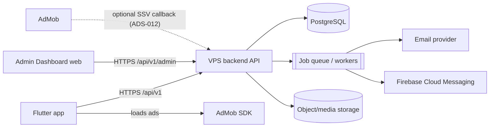
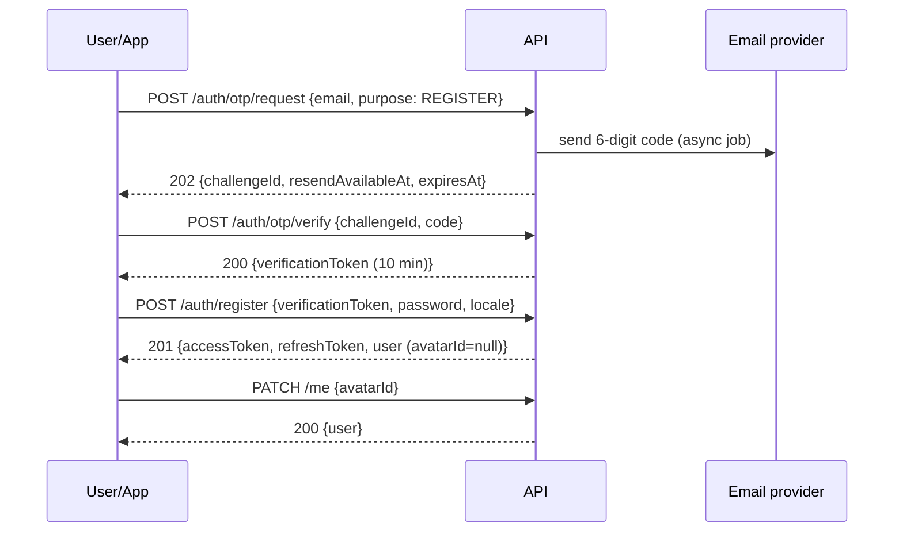
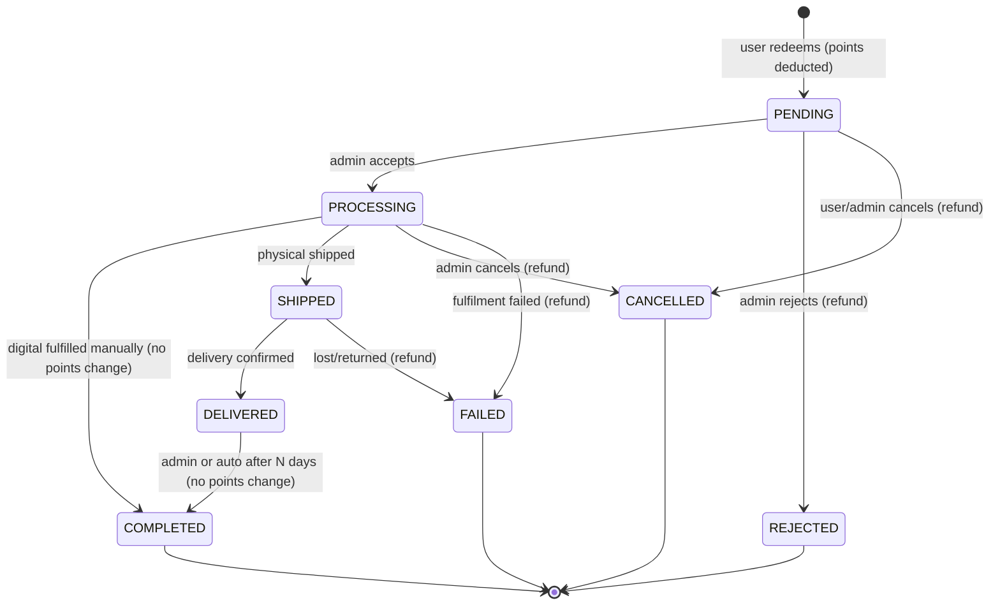

# Creative Rewards — Software Requirements Specification (SRS)

| | |
|---|---|
| Document | `docs/SRS.md` |
| Companion | [`docs/BACKEND.md`](BACKEND.md): backend architecture, database, REST API, business logic, deployment |
| Product | Creative Rewards mobile app (Flutter, Android first, iOS later) + Admin Dashboard (web) + VPS-hosted backend |
| Repository analysed | `D:\creative_hub\rewards app\app\rewardsapp` (Flutter 3.44.8, app version `1.1.1+5`, package `com.creativehub.rewardsapp`) |
| Date | 2026-10-21 |
| Status | **Draft for product-owner review.** Section 9 lists the decisions still needed. |
| Revision 2026-10-21 | Three product-owner decisions applied (§9.1): client-triggered rewarded-ad points (10 per completed ad; security and policy review **outstanding**), Immediate Deduction for orders (hold/capture removed), and manual admin fulfilment for all products including social media (no platform APIs; the compliance review stays open). |

---

## 0. How to read this document

### 0.1 Status tags

Every requirement carries one status tag. The tag says what exists **today**. Nothing tagged **[D]** or **[L]** should be treated as production-ready for the new VPS backend.

| Tag | Meaning |
|---|---|
| **[L] Legacy** | Implemented in the current Supabase-backed app (`DATA_MODE=legacy` in debug builds). It works against Supabase, but the new backend must re-implement it. |
| **[D] Demo** | Exists only as a **local simulation** in `lib/redesign/` (`DATA_MODE=demo`). There is no server, no security and no real data. It shows the intended UX only. |
| **[N] New** | Required and implemented nowhere yet. |
| **[R] Recommendation** | A proposed design choice. It is not approved and is listed in §9. |

### 0.2 Priority

**M** = Must (launch blocker) · **S** = Should (launch if feasible) · **C** = Could (post-launch).

### 0.3 Requirement ID scheme

`<AREA>-<NNN>`, for example `AUTH-012`. Areas: AUTH, USR, AVT, APP, HOME, SRCH, CAT, PRD, ORD, WAL, ADS, GIV, WIN, NTF, REF, PRIV, L10N, ADM, NFR, GAP.

### 0.4 Glossary

| Term | Definition |
|---|---|
| Points / PTS | The app's virtual currency. Its value is set only by the backend ledger. Points are not money and cannot be cashed out (§9 OD-21). |
| Reward product | An admin-managed catalog item that users redeem with points (for example "PUBG Mobile 60 UC"). |
| Giveaway | A free prize draw. Entering never costs points (confirmed in the existing apps). |
| Entry / participation | A user's single registration in a giveaway. It carries a unique **participation number** within that giveaway. |
| Step | An action a giveaway asks the user to perform (follow, subscribe, visit). It has a verification method. |
| Immediate Deduction | The approved order-accounting model: an order's full points cost is debited when the order is created. Unsuccessful orders receive a separate, single refund transaction. There is no hold or reserved balance. |
| Ad reward claim | The approved client-triggered request that asks the backend to credit points after the app observed a rewarded ad's completion callback. It is a client assertion, not server-verified proof (ADS-004). |
| SSV | AdMob Server-Side Verification: a signed callback from Google to the backend confirming a rewarded-ad completion. It is used by the legacy cosmetic frame **[L]**. It is an **optional** hardening for points (ADS-012), not part of the approved flow. |
| Admin | A Dashboard operator with role-based permissions. |
| Celebration | The full-screen winner animation in the app (legacy `WinnerCelebrationPage`, Lottie and confetti). |

---

## 1. Introduction

### 1.1 Purpose
Specify the complete functional and non-functional requirements for the production Creative Rewards system: the Flutter mobile app, the new VPS backend and the Admin Dashboard. Every requirement here maps to backend capabilities in `docs/BACKEND.md` (traceability in §7).

### 1.2 Scope
In scope:
- Email accounts with backend OTP, sessions, profiles and avatars.
- A dynamic catalog of categories and products, redemption orders and fulfilment.
- An authoritative points wallet, with points credited for rewarded ads.
- Giveaways with steps, unique participation numbers and automatic or manual winner selection.
- Notifications (in-app and FCM).
- Arabic and English.
- An Admin Dashboard covering all of the above.

Out of scope: payments, cash-out, a public website (except legal pages), and an iOS App Store listing (§9 OD-19).

### 1.3 References
- `IMPLEMENTATION_PLAN.md`, `TASKS.md`: the mobile redesign plan (2026-10-19).
- `docs/redesign-demo-status.md`, `docs/redesign-asset-manifest.md`: demo implementation status.
- `design_references/*.png`: target UI (11 phone mockups).
- `supabase/migrations/*`, `supabase/functions/*`: legacy schema fragments and edge functions.
- `legal/*.html`: current privacy policy, terms and account deletion pages. They describe the **legacy** processing.

---

## 2. Current State Analysis (repository findings)

### 2.1 Runtime modes (`lib/main.dart`)

| Mode | How it starts | What it runs | Production? |
|---|---|---|---|
| `demo` (default in debug) | `flutter run` / `--dart-define=DATA_MODE=demo` | `RedesignApp` + `LocalRewardsRepository` (Hive box `redesign_demo_v1` + secure storage) | **No.** Release builds refuse to run it ("Release requires the production API mode.") |
| `api` | `--dart-define=DATA_MODE=api` | A single static screen: "Creative Rewards is unavailable until the new service is connected." | No. It is a placeholder until the VPS API exists |
| `legacy` | `--dart-define=DATA_MODE=legacy` (debug) | The original Supabase app (Splash → Role Selection → User shell or in-app Admin) | It is the app published as `1.1.1+5`. The new mode switch prevents it from running in release builds |

### 2.2 Legacy (Supabase) capabilities **[L]**
- **Identity**: Supabase *anonymous* auth per device, plus a name and phone registration (`register-or-link-user` edge function) at the first giveaway entry. There are no email accounts and no passwords for users.
- **Giveaways**: title, organiser, prize description, rules text, image, UTC start/end, status (`draft/scheduled/active/ended/archived`), `number_digit_width` (4–6), `max_participants`, category, requirements (display-only steps: `follow/share/tag_friends/custom` with an external URL), a trigram title search index, and a schedule edit lock after start.
- **Participation**: server-allocated `participation_number` from a pre-generated `participation_number_pool` per giveaway (unique, bounded by digit width), `participation_sequence`, one entry per user per giveaway, and `GiveawayFull` / `GiveawayEnded` / `Duplicate` failures.
- **Winners**: `winners` table (rank, selected_at, `celebration_acknowledged_at`); `select-winner` edge function. The Admin Analytics screen picks a participant **manually**, with a spinning wheel animation. The user celebration fires once, triggered by realtime `notifications` inserts or a push.
- **Rewarded ads**: AdMob SSV is implemented (`verify-ad-reward`, ECDSA signature verification against Google keys, `ad_reward_events` with pending/verified/consumed states). It unlocks only a **cosmetic participation frame**. It never grants entries or points. The current client treats the frame as a device-local flag.
- **Notifications**: `notifications` table, FCM token in `user_devices`, types `winner_announcement` and `giveaway_reminder`.
- **Admin (in-app)**: email/password sign-in, sign-up via an access code (`admin_signup_codes`), dashboard KPIs, analysis, category management, giveaway create/edit/delete, image upload (5 MB, bucket `giveaway-images`), winner selection.
- **Account deletion**: `fn_delete_own_account` RPC, which releases pool numbers, plus `legal/delete-account.html`.
- **Ads**: UMP consent, banner, app-open and rewarded ads; a "Privacy choices" entry.
- **Rate limiting**: `fn_check_rate_limit` with `rate_limit_hits`.

### 2.3 Demo (local) capabilities **[D]** (`lib/redesign/`)
- **Onboarding**: Splash → Welcome → Email → OTP → Password → Character (9 bundled portraits, stored as an integer 1–9) → Home. Login, reset password, logout, 30-day local session.
- **OTP**: accepts **any** 6-digit code except the fixture `000000`. No email is sent.
- **Passwords**: stored **in plaintext** in platform secure storage under `redesign_password:<email>`. This is acceptable only as a local simulation. **The production system must never store or compare plaintext passwords** (AUTH-020).
- **Wallet**: a single integer balance. New accounts get 6,000 demo points. There is no transaction history.
- **Catalog**: 6 hard-coded categories (PUBG Mobile, Valorant, Instagram, TikTok, Facebook, **Phones**) and 13 hard-coded products with groups ("Top-Ups", "Items & Skins").
- **Orders**: redemption deducts points and creates an order with the free-text status "Demo order • no fulfillment". There is an order details page. No account-information fields are collected.
- **Giveaways**: 4 hard-coded items. Entering creates a random 6-digit number (100000–999999) and is idempotent per giveaway. No steps, no draws, no winners.
- **Notifications**: a local list with read flags and a notification details page.
- **Wallet actions**: "Fast, Earn" opens an Earn page that shows only the demo starting balance. "Write a Review" opens the store listing URL. "Refer a Friend" shows a copyable code; there is no backend or reward.
- **Profile**: name, email, avatar, counters (points, giveaways, orders), edit name and avatar, language (en/ar via inline `tr()` strings), legal and info pages, sign out. Account Settings has sign-out only. **There is no account deletion.**
- **Tests**: 350 Flutter tests pass. `test/redesign/demo_repository_test.dart` covers session restore, concurrent redemption and entry idempotency.

### 2.4 Missing everywhere **[N]**
Email delivery and OTP verification, real password hashing, access/refresh tokens, a points ledger, points for rewarded ads, a product fulfilment-field configuration, an order workflow, giveaway steps with verification, automatic random draws with audit, admin RBAC, a web Admin Dashboard, notification campaigns and preferences, managed avatars, media management, audit logs, app configuration (minimum version, maintenance), a referral program, and production legal content for the new processing.

### 2.5 Migration constraints
- The client contract for the redesign is `RewardsRepository` (`lib/redesign/demo_repository.dart`). The future VPS adapter must implement equivalent operations. BACKEND.md §3 gives the endpoint for each.
- Legacy users are anonymous Supabase identities with name and phone. Whether to migrate their entries is an open decision (OD-20). This SRS assumes **new accounts** are required on the VPS backend.

---

## 3. Overall Description

### 3.1 Actors

| Actor | Description |
|---|---|
| Visitor | App installed, not signed in |
| User | Registered, email-verified account |
| Winner | A User selected for a giveaway prize |
| Admin roles | `SUPER_ADMIN`, `ADMIN`, `CONTENT_MANAGER`, `FULFILLMENT_AGENT`, `SUPPORT_AGENT`, `ANALYST` (§4.16, BACKEND §2.13) **[R]** |
| AdMob | Google ad network. The SDK in the app reports rewarded-ad completion to the app. SSV callbacks to the backend are used only if the optional hardening ADS-012 is enabled |
| FCM | Firebase Cloud Messaging push delivery (project `rewards-app-87115` exists for Android) |
| Email provider | Transactional email delivery (vendor not chosen, OD-10) |

### 3.2 Context



### 3.3 Constraints
- C-01: The client must work in Arabic (RTL) and English.
- C-02: The backend is authoritative for identity, balances, orders, entries and winners. The client is never trusted for amounts, numbers or outcomes.
- C-03: The Android package id `com.creativehub.rewardsapp` and the AdMob app id are fixed.
- C-04: Release builds run only `DATA_MODE=api` (already enforced in `main.dart`).
- C-05: Google Play policies apply: account deletion, ads, contest and sweepstakes rules, and no incentivised ratings.

### 3.4 Assumptions
- A-01: Users are 13+ or the local age of digital consent. The age gate policy is OD-17.
- A-02: Prize fulfilment and digital top-ups are performed **manually by staff**. No integration with game publishers or social platforms is assumed.
- A-03: One account per email address. The backend has no phone number unless a product or step requires one.

---

## 4. Functional Requirements

### 4.1 Authentication and Sessions (AUTH)

#### 4.1.1 Registration workflow (fixed order)



| ID | Requirement | Status | Pri |
|---|---|---|---|
| AUTH-001 | The app collects the email on the Email screen. The client validates the format; the server re-validates it (RFC 5322 practical subset, max 254 chars), trims it and lower-cases it for uniqueness. | [D] client only | M |
| AUTH-002 | `POST /auth/otp/request` creates an OTP challenge (purpose `REGISTER`, `RESET_PASSWORD` or `CHANGE_EMAIL`) and queues an email in the user's locale. The response does **not** reveal whether the email is registered (anti-enumeration). For `REGISTER` with an existing email, the email sent says "You already have an account. Log in or reset your password" instead of containing a code. | [N] | M |
| AUTH-003 | The OTP is 6 numeric digits from a CSPRNG. It is stored only as a keyed hash (HMAC-SHA-256 with a server secret), never in plaintext. | [N] | M |
| AUTH-004 | An OTP expires 10 minutes after issue **[R]**. A verified challenge cannot be reused. Issuing a new code for the same email and purpose invalidates earlier codes. | [N] | M |
| AUTH-005 | Resend is allowed after a 60-second cooldown **[R]**. The app shows the countdown using `resendAvailableAt` from the server (the demo uses 30 s). | [D] timer only | M |
| AUTH-006 | Rate limits **[R]**: at most 5 OTP requests per email per hour, 20 per IP per hour, 5 verify attempts per challenge. After 5 wrong attempts the challenge is locked (`OTP_LOCKED`) and a new code must be requested. | [N] | M |
| AUTH-007 | A successful verify returns a single-use **verification token** (opaque, 10 min) bound to the email and purpose. It is required by `register`, `password/reset` and `email change`. | [N] | M |
| AUTH-008 | **Production OTP verification happens only on the backend.** The client never decides validity. Any demo bypass (accept-any-code) must be impossible in release builds; this is already enforced by `main.dart` and must be kept. | [D] demo bypass exists; must stay demo-only | M |
| AUTH-009 | Password rules (client and server): 8–128 characters; at least one letter and one digit; rejected if it matches a breached or common-password list or contains the email local-part. The client shows the three live rules from the design ("At least 8 characters", "Include letters and numbers", "Use a strong password"). | [D] client rules | M |
| AUTH-010 | `register` creates the user (email verified), credential (Argon2id hash), wallet, optional signup bonus (WAL-010) and session. It returns tokens. `avatarId` is null until the Character step. | [N] | M |
| AUTH-011 | Character selection happens **after** password creation. A user with `avatarId = null` is routed to Character on every launch until one is chosen. | [D] | M |
| AUTH-012 | Login: `POST /auth/login {email, password, device}` returns tokens on success. Wrong credentials return a generic `INVALID_CREDENTIALS`. After 10 failures per account in 15 minutes there is a progressive delay or lock **[R]**, with an email alert to the account holder. | [D] (plaintext compare) | M |
| AUTH-013 | Forgot password: OTP purpose `RESET_PASSWORD` → verify → `POST /auth/password/reset {verificationToken, newPassword}`. This revokes **all** sessions and notifies the user by email. | [D] | M |
| AUTH-014 | Change password (signed in): requires the current password, revokes the other sessions and sends a security notification. | [N] | S |
| AUTH-015 | Tokens **[R]**: a JWT access token (15 min, contains `sub`, `sid`, `scope=user`) and an opaque refresh token (30-day sliding, 90-day absolute). Refresh tokens are stored hashed, **rotated on every use**, with reuse detection that revokes the whole token family. | [N] | M |
| AUTH-016 | The app stores the refresh token in platform secure storage only (Keystore/Keychain), never in Hive or logs. | [D] analogue | M |
| AUTH-017 | Session list and revocation: logout revokes the current session; "log out of all devices" revokes all sessions. | [N] | S |
| AUTH-018 | A suspended or banned user gets `ACCOUNT_SUSPENDED` on login and refresh. The app shows a support contact. | [N] | M |
| AUTH-019 | When a session expires (refresh fails), the app shows "Your session has expired" and goes to Login with the email prefilled. Local demo data is never mixed with server data. | [D] | M |
| AUTH-020 | Passwords are never logged, never returned and never stored reversibly. The demo's plaintext storage is **prohibited** in the API adapter. | [N] | M |
| AUTH-021 | Email change (optional): OTP to the new address, then confirm. The old address is notified. | [N] | C |
| AUTH-022 | Social sign-in (Google/Apple) is **not** in scope (OD-18). | — | — |

**Edge cases.** Mixed-case or whitespace emails normalise to one account. The user can go back from the OTP screen to edit the email, which invalidates the challenge. The app may be killed after registration but before Character; the next launch routes to Character (AUTH-011). Two devices may register the same email concurrently; the unique constraint wins and the second gets `EMAIL_ALREADY_REGISTERED` at `register` (the verification token is consumed atomically). Clock skew: the server is the source for all expiry times.

**Acceptance criteria (AUTH).**
- AC-AUTH-1: A wrong code 5 times locks the challenge, and a 6th correct code is rejected until a new code is requested.
- AC-AUTH-2: An OTP older than 10 minutes is rejected with `OTP_EXPIRED`.
- AC-AUTH-3: The database contains no plaintext OTP or password (inspection test).
- AC-AUTH-4: A reused refresh token revokes the family, and the next refresh with any token of that family fails.
- AC-AUTH-5: Registration followed by relaunch without an avatar lands on Character. Choosing one lands on Home.
- AC-AUTH-6: Requesting OTPs for registered and unregistered emails returns indistinguishable responses (same status and timing within ±50 ms on average).

### 4.2 Users, Profile and Statistics (USR)

| ID | Requirement | Status | Pri |
|---|---|---|---|
| USR-001 | Profile fields: `id`, `email`, `displayName` (1–40 chars, default = email local-part), `avatarId`, `locale` (`en`/`ar`), `createdAt`, `status`. | [D] | M |
| USR-002 | `GET /me` returns the profile, the wallet summary (`available`) and statistics: `giveawayEntriesCount`, `ordersCount`, `unreadNotificationsCount`. These feed the Profile counters (Points, Giveaways, Orders). | [D] local counts | M |
| USR-003 | `PATCH /me` edits `displayName`, `avatarId` and `locale`. The locale drives the language of server-generated push and email. | [D] name/avatar | M |
| USR-004 | The user's language choice in the app is sent to the server (`PATCH /me {locale}`) on change and on login. | [N] | M |
| USR-005 | Profile screen links: My Giveaways, My Orders, Notifications, Language, About, Privacy Policy, Terms & Conditions, Sign Out. There is no Wallet row (Wallet is a tab). | [D] | M |
| USR-006 | Account deletion is available from Account Settings (PRIV-001). | [N] (demo lacks it) | M |

**AC-USR-1:** After a redemption, `GET /me` reflects the new `available` balance and `ordersCount + 1` in the same response that follows the order creation.

### 4.3 Avatars (AVT)

| ID | Requirement | Status | Pri |
|---|---|---|---|
| AVT-001 | Avatars are admin-managed: `id` (stable slug, for example `char_01`), localized name, image (media asset), background colour, sort order, active flag. | [N] (9 bundled in app) | M |
| AVT-002 | `GET /avatars` returns the active avatars in order. The app shows them in a 3-column grid with a selection border and check badge. | [D] | M |
| AVT-003 | Bundled fallback: the app ships the 9 current portraits mapped to `char_01`…`char_09` so onboarding works offline. The server list wins when available. A missing remote image falls back to the bundled one with the same id, otherwise to a default avatar. | [N] | S |
| AVT-004 | Deactivating an avatar hides it from selection. Users who already have it keep it (the image is still served). Deleting an avatar is blocked while it is in use. | [N] | M |
| AVT-005 | The selected avatar appears in the Profile header and as the 4th bottom-navigation icon, and updates immediately after change (avatar synchronisation across devices happens on `GET /me`). | [D] | M |

### 4.4 App Configuration, Home and Search (APP, HOME, SRCH)

| ID | Requirement | Status | Pri |
|---|---|---|---|
| APP-001 | `GET /app-config` (public, cacheable 5 min) returns: `minSupportedVersion`, `latestVersion`, `maintenance {enabled, message}`, `supportEmail`, `legalUrls {privacy, terms, deletion}`, `features {rewardedAds, referrals, giveaways}`, `adRewards {pointsPerCompletedAd, dailyLimitPerUser, cooldownSeconds, adUnitId}` (display only; the server always credits its own configured value). | [N] | M |
| APP-002 | If the app version is below `minSupportedVersion`, the app shows a blocking "Update required" screen with a store link. During maintenance it shows the message and a retry. | [N] | M |
| HOME-001 | `GET /home` returns in one call: the wallet `available` balance, `unreadNotificationsCount`, `featuredCategories` (admin-flagged, ordered, the "Available Rewards" rail) and `featuredGiveaways` (admin-flagged or the next N active/upcoming, the "Giveaways" grid). | [D] hard-coded | M |
| HOME-002 | The Home header shows "Your Points" with the balance. There is no separate points card. | [D] | M |
| HOME-003 | Giveaway cards show a status chip (Available, Upcoming, Ended) and never show a points price. | [D] partial | M |
| SRCH-001 | `GET /search?q=` (2–64 chars) searches categories, products and giveaways by localized name and description in **both** languages: case-insensitive, diacritic-insensitive and typo-tolerant (trigram). Results are grouped by type, up to 10 per type, with "more" pagination per type. | [L] title trigram for giveaways only; [D] none | M |
| SRCH-002 | Search returns only visible and active items. | [N] | M |

### 4.5 Dynamic Categories (CAT)

| ID | Requirement | Status | Pri |
|---|---|---|---|
| CAT-001 | Admins create, edit, reorder, show/hide and delete categories in the Dashboard. | [L] (giveaway categories: name_en/ar, icon, order, active) / [D] hard-coded catalog | M |
| CAT-002 | Category fields: `id`, `slug` (unique, URL-safe), `kind` (internal: `GAME`, `SOCIAL_MEDIA`, plus the proposed `PHYSICAL_GOODS` for the existing "Phones" category, OD-03), `name {en, ar}`, `subtitle {en, ar}`, `description {en, ar}`, `bannerImage` (wide, Categories list), `thumbnailImage` (Home rail tile), `heroImage` (details header), `iconImage` (optional square), `gradient` (2–4 hex colours used under or behind art), `textTone` (`LIGHT`/`DARK`), `sortOrder`, `isVisible`, `isFeatured`, timestamps. | [N] | M |
| CAT-003 | **Admin-created categories appear directly in the app's Categories screen.** There is no visible "Games" or "Social Media" parent level. `kind` is internal only (validation defaults, reporting). | [N] | M |
| CAT-004 | A category is shown in the app only if `isVisible = true` **and** it has at least one active product **[R]** (configurable: "show empty categories" setting). | [N] | S |
| CAT-005 | **Product groups** inside a category (for example "UC Top-Ups", "Items & Skins") drive the segmented tabs on Category Details: `id`, `name {en, ar}`, `sortOrder`, `isVisible`. Tabs are hidden when only one visible group exists. | [D] (`group` string) | M |
| CAT-006 | Deleting a category is allowed only when it has no products. Otherwise the Dashboard offers "hide". Products referenced by orders are never hard-deleted (soft delete). | [N] | M |
| CAT-007 | Publishing validation: both `en` and `ar` names are required. The banner and thumbnail are required before `isVisible` can be true. | [N] | M |

**AC-CAT-1:** An admin creates "Free Fire" with images, makes it visible and adds an active product. Within the cache TTL (≤ 60 s) it appears in the app's Categories list and Home rail (if featured), with no app update.

### 4.6 Reward Products (PRD)

| ID | Requirement | Status | Pri |
|---|---|---|---|
| PRD-001 | Fields: `id` (UUID), `categoryId`, `groupId` (nullable), `sku` (unique, admin-defined), `name {en, ar}`, `description {en, ar}`, `denominationLabel {en, ar}` (for example "60 UC"), `image`, `pointsCost` (integer > 0), `fulfillmentType` (`DIGITAL`/`PHYSICAL`), `sortOrder`, `status` (`ACTIVE`, `INACTIVE`), `stock` (nullable = unlimited), `perUserLimit {count, period: DAY/WEEK/MONTH/LIFETIME}` (nullable), `availableFrom` / `availableUntil` (nullable), `deliveryEstimate {en, ar}`, `instructions {en, ar}`, timestamps. | [D] partial, hard-coded | M |
| PRD-002 | **Fulfilment-field definitions** per product (ordered list). Each field has: `key` (snake_case, unique per product), `label {en, ar}`, `placeholder {en, ar}`, `helpText {en, ar}`, `type` (`TEXT`, `NUMBER`, `USERNAME`, `URL`, `EMAIL`, `PHONE`, `SELECT`, `TEXTAREA`, `ADDRESS_LINE`, `CITY`, `POSTAL_CODE`, `COUNTRY`), `required`, `minLength`, `maxLength`, `pattern` (regex, server-validated), `options` (for SELECT: `value` + `label {en, ar}`), `confirmEntry` (the user types it twice), `sensitive` (encrypted at rest, masked in lists), `sortOrder`. | [N] | M |
| PRD-003 | Field templates by kind **[R]** (the admin can copy them, then edit): PUBG `player_id` (NUMBER, 5–12 digits, confirmEntry); Valorant `riot_id` (TEXT, pattern `^.{3,16}#[A-Za-z0-9]{3,5}$`); Instagram, TikTok and Facebook `profile` (USERNAME or URL); physical products a shipping address (`full_name`, `phone`, `address_line1`, `address_line2?`, `city`, `postal_code?`, `country`). | [N] | S |
| PRD-004 | Products, images, prices and fields are always delivered by the API. **No catalog data is hard-coded in Flutter** (the demo catalog constants are removed in the API adapter). | [N] | M |
| PRD-005 | A product is redeemable only if it is `ACTIVE`, inside its availability window, has stock left (or unlimited), its category is visible, and the user is within `perUserLimit`. The API returns `redeemable: false` with `unavailableReason` (`OUT_OF_STOCK`, `NOT_STARTED`, `EXPIRED`, `LIMIT_REACHED`, `INACTIVE`) so the UI can disable the Redeem button with a reason. | [N] | M |
| PRD-006 | Changing `pointsCost` or fields affects only **new** orders. Existing orders keep a snapshot (ORD-006). | [N] | M |
| PRD-007 | Social-media "followers or engagement" products (category kind `SOCIAL_MEDIA`) are configurable like any other product: localized names and images, points cost and fulfilment fields such as `instagram_username`, `tiktok_username` or `facebook_profile_url`. Their **fulfilment model is approved** (manual, PRD-008). **Publication remains subject to a platform-terms and Play-policy compliance review (OD-04).** That review is a business and legal gate, not a technical dependency. | [N] | M |
| PRD-008 | **Manual fulfilment (Approved by Product Owner, 2026-10-21).** Every product, of every category kind, is fulfilled manually by administrators outside the system (§4.7.1a). The backend stores catalog data, account identifiers, points, orders, statuses and notifications only. **No integration with Instagram, TikTok, Facebook or game-publisher APIs, and no automated follower-delivery service, is required or permitted by this specification.** Admins view the submitted account details through the permission-gated, audited fields view (ADM-009). | [N] | M |

### 4.7 Redemption and Orders (ORD)

#### 4.7.1 Redemption flow — Immediate Deduction (**Approved by Product Owner**, 2026-10-21)

The product owner rejected the earlier hold/reserve/capture proposal. Points are **deducted in full when the order is created**. Rejected, cancelled and failed orders are compensated with a **separate, idempotent refund transaction**. Completing an order has no points effect.

```mermaid
sequenceDiagram
  participant App
  participant API
  participant DB
  participant Admin as Admin Dashboard
  App->>API: GET /products/{id} (price, fulfilment fields, redeemable)
  App->>App: user enters required account details, confirms (sees balance before/after)
  App->>API: POST /orders {productId, fieldsVersion, fields}  (Idempotency-Key)
  API->>DB: BEGIN; lock product + wallet; validate product/limits/stock/fields;<br/>available>=cost?; insert order PENDING + history;<br/>debit wallet (REDEMPTION_DEBIT); decrement stock; COMMIT
  API-->>App: 201 {order PENDING, wallet.available (already reduced)}
  API-)Admin: new-order alert (dashboard queue + optional email)
  App->>App: show success + new balance → My Orders
  Admin->>API: accept (PENDING→PROCESSING)
  Admin->>Admin: fulfil manually (outside the system)
  Admin->>API: complete (PROCESSING→COMPLETED; physical: …→DELIVERED→COMPLETED)
  API-)App: ORDER_STATUS notification "Your reward was delivered" (no points change)
  Note over Admin,API: Reject / cancel / fail → REDEMPTION_REFUND credited once (idempotent)
```

#### 4.7.1a Manual fulfilment of all reward products, including social media (**Approved by Product Owner**, 2026-10-21)

Every reward product, including Instagram, TikTok and Facebook follower or engagement products, is **fulfilled manually by administrators** through their own operational process:

1. An admin creates a category (internal kind `SOCIAL_MEDIA` for social products).
2. The admin creates products with localized names and images, points costs and fulfilment fields (for example `instagram_username` or `profile_url`).
3. The user selects a product, enters the requested account identifier, username or profile URL, and confirms.
4. The backend deducts the points and creates a `PENDING` order.
5. An admin reviews the order and the submitted account details through the secure fields view.
6. The admin performs the fulfilment manually.
7. The admin marks the order `COMPLETED`, and the user is notified.

The backend manages only catalog data, account identifiers, points, orders, statuses and notifications. **No Instagram, TikTok or Facebook API integration and no automated follower-delivery service is required or specified** (PRD-008).

**Manual fulfilment is not platform compliance.** Fulfilling orders by hand does not make follower, like or engagement services compliant with the third-party platforms' terms, or with Google Play's policies. The compliance review in PRD-007 / OD-04 remains a **business and legal launch gate**. It is not a technical or API dependency.

| ID | Requirement | Status | Pri |
|---|---|---|---|
| ORD-001 | Before confirming, the app shows the product, price, current balance, balance after redemption and the required fields (PRD-002). It validates the fields client-side with the same rules the server sends. | [D] confirm dialog, no fields | M |
| ORD-002 | `POST /orders` requires an `Idempotency-Key` header (UUID). Repeating the same key with the same body returns the original result. The same key with a different body returns `409 IDEMPOTENCY_CONFLICT`. | [N] | M |
| ORD-003 | The server re-validates every field (required, type, pattern, length, options). It returns `422 VALIDATION_FAILED` with per-field errors keyed by `key`. | [N] | M |
| ORD-004 | The balance check, the **full points deduction** and the order creation (status `PENDING`) happen **in one database transaction**, with the product and wallet rows locked. Insufficient balance returns `409 INSUFFICIENT_POINTS {available, required}` and creates nothing (no order, no ledger row, no stock change). The response returns the already-reduced balance. | [D] local check | M |
| ORD-005 | **Points model: Immediate Deduction (Approved by Product Owner).** Order creation debits `pointsCost` from `available` (ledger `REDEMPTION_DEBIT`, key `order:<id>:debit`). There is no reservation or hold. `PROCESSING`, `SHIPPED`, `DELIVERED` and `COMPLETED` have **no points effect**, so completing an order never deducts again. `REJECTED`, `CANCELLED` and `FAILED` credit a **separate** refund transaction (ledger `REDEMPTION_REFUND`, key `order:<id>:refund`) for exactly the snapshotted `pointsCost`. The unique key plus a one-refund-per-order database constraint make a duplicate refund impossible. *(Refunding `FAILED` orders carries over the prior specification: the reward was not delivered.)* | [N] | M |
| ORD-006 | The order stores a snapshot of the product: name, denomination, image URL, **original points cost**, category name, fulfilment type and field definitions with the submitted values. Refunds always use the snapshotted cost, even if the product price later changes. Sensitive values are encrypted. | [N] | M |
| ORD-007 | New orders create an admin alert: the Dashboard unread queue count, plus optionally an email to the fulfilment mailbox (OD-12). | [N] | M |
| ORD-008 | My Orders lists the user's orders (newest first, cursor pagination, filter by status group: in progress / completed / unsuccessful). Order Details shows the snapshot, masked identifier, status timeline and support contact. | [D] | M |
| ORD-009 | Statuses: `PENDING`, `PROCESSING`, `SHIPPED`, `DELIVERED`, `COMPLETED`, `REJECTED`, `CANCELLED`, `FAILED`. Allowed transitions are in §4.7.2. Any other transition returns `409 INVALID_TRANSITION`. | [N] | M |
| ORD-010 | The user may cancel only while the order is `PENDING` (`POST /orders/{id}/cancel`). Admins may cancel `PENDING` or `PROCESSING` orders with a reason. | [N] | M |
| ORD-011 | `REJECTED` requires a reason code (`INVALID_ACCOUNT_INFO`, `SUSPECTED_FRAUD`, `PRODUCT_UNAVAILABLE`, `OTHER`) and a localized user-facing message. The message is shown in Order Details and the notification. | [N] | M |
| ORD-012 | Every transition is stored in `order_status_history` (from, to, actor type and id, reason, note, timestamp) and the audit log. The user sees the user-visible subset of the timeline. | [N] | M |
| ORD-013 | Every user-visible transition sends a localized in-app notification, and a push if the user's preferences allow it. | [N] | M |
| ORD-014 | Physical orders support `trackingNumber`, `carrier` and `shippedAt`. Digital orders support an optional `deliveryNote` to the user (for example "Delivered to Player ID ****5678"). Gift codes are revealed only to the owner (OD-13). | [N] | S |
| ORD-015 | Stock is decremented at creation and restored on `REJECTED`, `CANCELLED` and `FAILED` (for products with stock). | [N] | M |
| ORD-016 | Admins can add internal notes, which are never visible to the user, and assign an order to a fulfilment agent. | [N] | S |
| ORD-017 | A refund after `COMPLETED` (for example a top-up later reversed by the platform) is done only as a manual **wallet adjustment** (WAL-008) linked to the order, with a reason. It does not change the order status. | [N] | S |
| ORD-018 | The SLA timer is visible to admins (age of `PENDING` orders). An alert fires when an order has been pending for more than N hours (OD-14). | [N] | C |
| ORD-019 | Refunds are idempotent and are recorded as their own wallet transaction, linked to the order (`refundTransactionId`, `refundedAt`) and to a history row. A repeated reject, cancel or fail request, or a retried job, never creates a second refund. | [N] | M |
| ORD-020 | Concurrent redemptions are serialised on the wallet row. Duplicate requests are absorbed by the `Idempotency-Key` and by `unique(user_id, idempotency_key)` on orders. Concurrent admin transitions are resolved by the order `version` (`409 VERSION_CONFLICT`). | [N] | M |

#### 4.7.2 Order states and applicability

| Status | Meaning | Digital | Physical | Terminal | Points effect on entering this status |
|---|---|---|---|---|---|
| PENDING | Created; **points already deducted**; awaiting admin review | ✔ | ✔ | — | **debit** (at creation, same transaction) |
| PROCESSING | Accepted by an admin; manual fulfilment in progress | ✔ | ✔ | — | none |
| SHIPPED | Handed to a carrier | ✖ | ✔ | — | none |
| DELIVERED | Carrier confirmed delivery | ✖ | ✔ | — | none |
| COMPLETED | Fulfilment finished and confirmed by an admin | ✔ | ✔ | ✔ | none (never deducts again) |
| REJECTED | Refused by an admin before fulfilment | ✔ | ✔ | ✔ | **refund** (separate transaction, once) |
| CANCELLED | Cancelled by the user (PENDING) or an admin (PENDING/PROCESSING) | ✔ | ✔ | ✔ | **refund** (separate transaction, once) |
| FAILED | Fulfilment attempted and failed (wrong ID, carrier loss) | ✔ | ✔ | ✔ | **refund** (separate transaction, once) |

Allowed transitions: digital `PENDING→PROCESSING→COMPLETED`; physical `PENDING→PROCESSING→SHIPPED→DELIVERED→COMPLETED`; `PENDING→REJECTED`; `PENDING→CANCELLED` (user or admin); `PROCESSING→CANCELLED` (admin); `PROCESSING→FAILED`; `SHIPPED→FAILED`. A `DELIVERED` order auto-completes after N days (default 7 **[R]**, OD-14) unless the user has reported a problem. The full actor, precondition and notification table is in BACKEND §5.



**Acceptance criteria (ORD).**
- AC-ORD-1: With 6,000 available, redeeming a 1,200-point product returns 201 with `wallet.available = 4,800`, order `PENDING` and one `REDEMPTION_DEBIT −1,200` ledger row. Rejecting it gives available 6,000 and a separate `REDEMPTION_REFUND +1,200` row ("Refund: 60 UC"). Completing a different order of the same product leaves the balance unchanged.
- AC-ORD-2: Twenty concurrent redemptions of a 1,000-point product with a balance of 5,000 create exactly 5 orders and 5 debit rows, and the balance never goes negative.
- AC-ORD-3: The same Idempotency-Key sent twice creates one order and one debit, and returns the same order id and balance both times.
- AC-ORD-4: An invalid Player ID pattern returns 422 with `fields.player_id`, and no order, no debit and no stock change occur.
- AC-ORD-5: The user cannot cancel a PROCESSING order (`409 INVALID_TRANSITION`).
- AC-ORD-6: Each transition creates a history row, an audit row and the specified notification.
- AC-ORD-7: Sending a reject (or cancel) twice, concurrently or sequentially, produces exactly one `REDEMPTION_REFUND`. The second call returns `409 INVALID_TRANSITION` or the idempotent replay, and the balance increases only once.
- AC-ORD-8: After an admin changes the product price from 1,200 to 1,500, rejecting an order created at 1,200 refunds exactly 1,200.
- AC-ORD-9: A `SOCIAL_MEDIA` product with a required `instagram_username` field cannot be redeemed without it. An admin with `orders.sensitive.read` can view the value (the view is audited), complete the order manually and the user receives the completion notification. No external platform call occurs.

### 4.8 Wallet and Points (WAL)

| ID | Requirement | Status | Pri |
|---|---|---|---|
| WAL-001 | The backend is the **only** authority for balances. The client displays server values and never computes or sends an amount for crediting. | [D] local | M |
| WAL-002 | Wallet summary: `available` (the single spendable balance; there is **no reserved balance**), `lifetimeEarned` (sum of `SIGNUP_BONUS`, `AD_REWARD`, `ADMIN_CREDIT` and `REFERRAL_REWARD` credits; refunds are not earnings), `lifetimeSpent` (net: `REDEMPTION_DEBIT` + `ADMIN_DEBIT` + `EXPIRY` − `REDEMPTION_REFUND`). | [N] | M |
| WAL-003 | Every balance change is an immutable **ledger** row: `type`, `amount` (signed delta to `available`), `balanceAfter`, reference (order, ad reward claim, admin adjustment), localized description, `idempotencyKey` (unique), actor, timestamp. | [N] | M |
| WAL-004 | Transaction types: `SIGNUP_BONUS`, `AD_REWARD`, `REDEMPTION_DEBIT` (order creation, Immediate Deduction), `REDEMPTION_REFUND` (rejected, cancelled or failed order; at most one per order), `ADMIN_CREDIT`, `ADMIN_DEBIT`, `REFERRAL_REWARD` (only if REF is approved), `EXPIRY` (only if expiry is approved, OD-08). | [N] | M |
| WAL-005 | `GET /wallet/transactions` returns cursor-paginated history with type filters. The user sees localized descriptions (for example "Redeemed 60 UC", "Refund: 60 UC", "Rewarded ad"). | [N] (the demo has no "Recent Activity" row, by design) | S |
| WAL-006 | Invariants are enforced in the database: `available ≥ 0` and `lifetimeSpent ≥ 0`. For each wallet, `available` equals the sum of ledger amounts. For each order, at most one debit and at most one refund exist, and a refund exists only for REJECTED, CANCELLED or FAILED orders. A reconciliation job checks all of this (BACKEND §7). | [N] | M |
| WAL-007 | Concurrency: every mutation locks the wallet row (`SELECT … FOR UPDATE`) inside one transaction. Duplicate requests are absorbed by unique idempotency keys. | [N] | M |
| WAL-008 | Admin adjustments (credit or debit) require the `wallet.adjust` permission, a reason, an amount ≤ the configured single-adjustment cap (above the cap requires SUPER_ADMIN) and an idempotency key. They notify the user and are audited. A debit cannot make `available` negative. | [N] | M |
| WAL-009 | The Wallet screen shows the balance card, "Fast, Earn" (opens the Earn hub listing only the enabled earning methods from `app-config`), "Place an Order" (opens Categories), "Write a Review" (opens the store listing; **no points, ever**) and "Refer a Friend" (REF). | [D] | M |
| WAL-010 | Signup bonus: configurable amount (default **0** in production **[R]**, OD-07), credited once per account at registration with the idempotency key `signup:<userId>`. | [D] 6,000 demo | S |
| WAL-011 | Writing a store review never grants points and is never a condition for anything (Google Play policy). | [D] compliant | M |

**Acceptance criteria (WAL).**
- AC-WAL-1: No API accepts a client-supplied credit amount for users (including the rewarded-ad claim, ADS-003). Penetration test: tampering with any request body cannot change the credited amount. *(Note: the approved client-triggered ad claim can still be called without watching an ad. That is an accepted, documented risk (ADS-004), not a breach of this criterion.)*
- AC-WAL-2: The nightly reconciliation finds zero mismatches on a dataset of 10,000 random concurrent operations.
- AC-WAL-3: An admin credit of 500 creates exactly one ledger row, one audit row and one notification, even when the request is retried.

### 4.9 Rewarded Advertisements for Points (ADS)

> The legacy app uses rewarded ads **only** for a cosmetic frame, with AdMob SSV verification **[L]**. This section is a **new** feature: completed rewarded ads credit points.
>
> **Approved by Product Owner (2026-10-21):** a **client-triggered** reward flow that credits **10 points per completed ad** (the amount is configured server-side). AdMob SSV is **not** a mandatory dependency of this flow.
>
> **Still outstanding (launch gates, not approved):**
> 1. A **security review**. The client-triggered claim cannot be verified by the server (ADS-004).
> 2. A **policy review** against current AdMob and Google Play policies for rewards that can be exchanged for real-world items (OD-02).
>
> Nothing in this document states or implies that Google has approved this reward model, or that it is production-safe.

```mermaid
sequenceDiagram
  participant App
  participant AdMob as AdMob SDK
  participant API
  participant DB
  App->>API: GET /ad-rewards/status (optional pre-check: enabled, remainingToday, nextEligibleAt)
  App->>AdMob: load + show rewarded ad
  AdMob-->>App: onUserEarnedReward (completion callback) → app records rewardEventId locally
  AdMob-->>App: onAdDismissedFullScreenContent
  App->>API: POST /ad-rewards/claims {rewardEventId, adUnitId, …} (Bearer token, Idempotency-Key = rewardEventId)
  API->>DB: BEGIN; identify user from token; check feature/limits/cooldown;<br/>insert claim; credit 10 pts (AD_REWARD, key ad:<user>:<rewardEventId>); COMMIT
  API-->>App: 201 {pointsCredited: 10, wallet.available, remainingToday}
  App->>App: show new balance
  Note over App,API: Retry with the SAME rewardEventId → 200 replay, no second credit
```

| ID | Requirement | Status | Pri |
|---|---|---|---|
| ADS-001 | Configuration (Dashboard, `ads.rewards` setting): `enabled`, **`pointsPerCompletedAd` = 10 (Approved by Product Owner; integer > 0, server-side only)**, `dailyLimitPerUser`, `dailyLimitPerDevice`, `cooldownSeconds`, `allowedAdUnitIds`, `minAccountAgeMinutes` **[R]**, `dayBoundaryTimezone` (default `UTC`). The limit and cooldown values are still open (OD-01). | [N] | M |
| ADS-002 | **Client trigger rule (Approved).** The app sends a claim **only** after the AdMob completion callback (`onUserEarnedReward`) has fired for that ad **and** the ad has been dismissed. Opening, loading, failing to load, or dismissing an ad **without** the completion callback must never send a claim. The app generates one `rewardEventId` (UUID v4) at the completion callback and persists it locally until the claim succeeds or is terminally rejected. | [N] | M |
| ADS-003 | `POST /ad-rewards/claims` is authenticated. The backend identifies the user **only** from the access token. The request carries **no amount**. Any `points`, `amount` or `userId` field is rejected with `422 VALIDATION_FAILED`. The server credits the configured `pointsPerCompletedAd` (10) and returns the updated balance. | [N] | M |
| ADS-004 | **Security limitation (must be stated, not hidden).** The completion signal comes from the client and **cannot be independently verified by the server** without SSV. A modified app or a script with a valid access token can call the claim endpoint without any ad being shown, and the server cannot tell the difference. Rate limits, cooldowns, idempotency and abuse detection **limit and surface** such fraud, but they **do not prevent or eliminate it**. A successful claim is a **record of a client assertion, not proof of viewing**. Owner: security review (OD-02a). | [N] | M |
| ADS-005 | Idempotency: `rewardEventId` is unique per user (`unique(user_id, reward_event_id)`), and the ledger key is `ad:<userId>:<rewardEventId>`. A retried claim with the same id returns the original result (`Idempotent-Replayed: true`) and never credits twice. The claim row and the `AD_REWARD` ledger row are written **in one database transaction** with the wallet row locked. Either both exist or neither does. | [N] | M |
| ADS-006 | The credited amount is the configured value **at the time the claim is accepted**. It is stored on the claim (`pointsCredited`) and in the ledger, so later configuration changes do not alter past credits. | [N] | M |
| ADS-007 | Failures and retries. Network failure or timeout → the app retries with the **same** `rewardEventId` (exponential backoff, kept across app restarts). `5xx` → retry. `401` → refresh the token, then retry. `429` limit or cooldown, `403` feature disabled, ad earning suspended or account suspended → **terminal**: discard the pending claim and tell the user. Interrupted ads (closed early, no fill, load error, app killed before the completion callback) → no claim is sent and no points are awarded. | [N] | M |
| ADS-008 | Rate limits (server-side, counted by **server receipt time** in the day window): `dailyLimitPerUser`, `dailyLimitPerDevice` (by `X-Installation-Id`), a per-IP daily cap, and `cooldownSeconds` between credited claims. Requests over a limit get `429 AD_DAILY_LIMIT_REACHED` / `AD_COOLDOWN_ACTIVE {retryAfterSeconds}` and are recorded as rejected claims, with no credit. | [N] | M |
| ADS-009 | Abuse detection and response **[R]**: risk flags on each claim (claims at exact cooldown intervals, cap reached daily for N days, many accounts per installation or IP, very new accounts, a missing or unknown ad unit id, an app version below the minimum, a failed optional Play Integrity verdict, OD-16); an admin suspicious-user list; per-user ad-earning suspension; reversal of fraudulent credits via audited `ADMIN_DEBIT`. Because every redemption is **reviewed manually** (§4.7.1a), farmed points can be caught before any reward is fulfilled. This is a mitigation, not a prevention. | [N] | S |
| ADS-010 | Rewarded ads never create giveaway entries, never change odds and are never required to enter a giveaway (preserves the existing policy). | [L] | M |
| ADS-011 | Ad consent (UMP) and "Privacy choices" remain available in Account Settings. Non-personalised ads remain the default. | [L] | M |
| ADS-012 | **Optional hardening (recommendation, not required, not approved) [R]:** AdMob SSV can be added later without changing the client-claim contract. The app passes `customData = rewardEventId` in the SSV options, and the backend records signed Google callbacks (the legacy `verify-ad-reward` logic can be ported) to (a) **audit**, by flagging claims with no matching callback, or (b) **gate** crediting on a matching callback. Only (b) provides server-verifiable proof of completion. It would need a product-owner decision because it changes the approved flow. | [L] verifier exists (frame only) | C |
| ADS-013 | **Launch gate:** the feature flag `ads.rewards.enabled` stays `false` in production until the security review (ADS-004) and the AdMob/Google Play policy review (OD-02) are signed off. | [N] | M |

**Acceptance criteria (ADS).**
- AC-ADS-1: Two claims with the same `rewardEventId` (sequential or concurrent) produce exactly one `AD_REWARD +10` ledger row and one claim row. Both responses report the same `pointsCredited` and resulting balance.
- AC-ADS-2: With `dailyLimitPerUser = 10`, the 11th distinct claim on the same server day returns `429 AD_DAILY_LIMIT_REACHED` and credits nothing. A claim inside `cooldownSeconds` returns `429 AD_COOLDOWN_ACTIVE`.
- AC-ADS-3: A claim body containing `points`, `amount` or `userId` returns 422. An unauthenticated claim returns 401. The credited amount is always the server-configured 10.
- AC-ADS-4: A database failure injected after the ledger insert leaves neither the claim nor the ledger row (atomicity).
- AC-ADS-5: The client sends no claim when an ad is closed before `onUserEarnedReward` (Flutter widget/integration test with a fake ad).
- AC-ADS-6 *(documents the accepted risk)*: a scripted claim sent without any ad being shown **is credited** when inside the limits, and it receives the configured risk flags. The test proves that the limits and flags behave as specified. It does **not** prove that fraud is prevented.

### 4.10 Giveaways, Steps and Participation (GIV)

| ID | Requirement | Status | Pri |
|---|---|---|---|
| GIV-001 | Giveaway fields: `id`, `slug`, `title {en, ar}`, `description {en, ar}`, `prizeName {en, ar}`, `prizeImage`, `gallery[]` (optional), `organizerName {en, ar}` (person or company), `organizerLogo?`, `startsAt`, `endsAt` (UTC), `drawAt?` (planned draw time), `winnersCount` (≥ 1), `numberDigitWidth` (4–6, default 6 **[R]**; legacy default 4), `maxParticipants?` (≤ 10^width × 0.9 **[R]**), `eligibility` (GIV-004), `instructions {en, ar}`, `officialRules {en, ar}` (required to publish, GIV-012), `status`, `visibility` (`PUBLIC`/`HIDDEN`), `isFeatured`, `sortOrder`, `winnerDisclosure` (WIN-010), timestamps. | [L] subset | M |
| GIV-002 | Statuses: `DRAFT` → `SCHEDULED` (published, before start) → `ACTIVE` → `ENDED` (entries closed) → `WINNERS_SELECTED` → `COMPLETED` (prizes fulfilled), plus `CANCELLED` (from any non-terminal state, with a reason). `ARCHIVED` hides it from the app. Time-based transitions run in a scheduler (BACKEND §7). The app shows Available (ACTIVE), Upcoming (SCHEDULED) and Ended (ENDED and later). | [L] (draft/scheduled/active/ended/archived) | M |
| GIV-003 | Schedule edits are locked once the giveaway has started (port the legacy `fn_guard_giveaway_schedule_edit`), except extending `endsAt` with an audit reason. | [L] | M |
| GIV-004 | Eligibility rules (configurable per giveaway): `requiresVerifiedEmail` (always true), `minAccountAgeDays` (default 0), `allowedCountries` (only if country is collected, OD-17), `excludeSuspended` (always), `maxEntriesPerUser` (fixed at **1**, kept as a field for future use). | [N] | M |
| GIV-005 | **Steps** (ordered, 0–20 per giveaway): `id`, `title {en, ar}`, `description {en, ar}`, `actionType` (`FOLLOW_INSTAGRAM`, `FOLLOW_TIKTOK`, `FOLLOW_FACEBOOK`, `SUBSCRIBE_YOUTUBE`, `JOIN_TELEGRAM`, `VISIT_URL`, `CUSTOM`), `url` (https only, allowlisted domains per action type **[R]**), `required`, `sortOrder`, `verificationMethod`. | [L] display-only requirements | M |
| GIV-006 | Verification methods, and what each one proves:<br>• `NONE`: informational; never blocks entry.<br>• `SELF_DECLARED`: the user taps "I've done this" after opening the link. It is recorded as **self-declared, not verified**.<br>• `LINK_CLICK`: the server records the click through a tracked redirect. It proves **only** that the link was opened.<br>• `MANUAL_REVIEW`: the user submits proof (username or screenshot, per step config). An admin approves or rejects it. Until then the entry is `PENDING_VERIFICATION`.<br>• `API_VERIFIED`: **reserved, not supported.** Follow and subscription verification through Instagram/TikTok/Facebook APIs is generally unavailable to third parties, so it must not be claimed. | [N] | M |
| GIV-007 | The app labels the steps honestly: "Self-declared" steps are not described as "verified", and the official rules state which steps are verified (GIV-012). | [N] | M |
| GIV-008 | Join workflow (`POST /giveaways/{id}/entries`, Idempotency-Key):<br>1. The giveaway is `ACTIVE`, `now ∈ [startsAt, endsAt)`, visibility PUBLIC (or the user has the link for HIDDEN).<br>2. The user is eligible (GIV-004).<br>3. Every **required** step meets its method's completion condition (`SELF_DECLARED` declared, `LINK_CLICK` clicked, `MANUAL_REVIEW` submitted, which makes the entry pending).<br>4. No existing entry for (giveaway, user).<br>5. Capacity is available.<br>6. Allocate a unique number within the giveaway (GIV-009).<br>7. Persist the entry.<br>8. Return `{entryId, participationNumber (zero-padded string), status}`.<br>9. Notify in-app. | [L] steps 1, 4–8 | M |
| GIV-009 | The participation number is unique within the giveaway, uniformly random over `[0, 10^width)` (the display is zero-padded to `width`), and allocated by the server. Allocation uses a unique constraint with retry, or the legacy pre-generated pool (BACKEND §4.7). Numbers are never reused within a giveaway, even after account deletion **[R]** (the legacy deletion released pool numbers; this changes that, see OD-11). | [L] | M |
| GIV-010 | Duplicate prevention: a unique constraint on (giveaway_id, user_id), plus the idempotency key. A repeat attempt returns `409 ALREADY_ENTERED` with the existing number, and the app shows "You're in — #042731". | [L] | M |
| GIV-011 | Entering a giveaway **never** reads or writes the wallet. Giveaway prizes never show a points price. | [L][D] | M |
| GIV-012 | Publishing requires official rules (both languages) that include: organiser identity, eligibility, entry period, how winners are chosen (random or organiser selection), number of prizes, prize description, how winners are notified, the claim period, privacy, and a statement that Google/Apple are not sponsors. No purchase or point spend is necessary. Local legal review is required (OD-15). | [N] | M |
| GIV-013 | My Giveaways lists the user's entries with the number, giveaway status, step-review status (if any) and result (Not selected / You won / Pending draw). | [L][D] | M |
| GIV-014 | Admins can disqualify an entry with a reason before the draw (`DISQUALIFIED`). The user is notified. Disqualified entries are excluded from draws. | [N] | M |
| GIV-015 | Reminder notifications **[R]**: "Ends in 24 h" to users with pending required steps or a started but unjoined giveaway (`giveaway_reminder` type exists in legacy). | [L] partial | C |

**Acceptance criteria (GIV).**
- AC-GIV-1: 10,000 concurrent join requests from distinct users produce 10,000 entries with unique numbers, all within the width.
- AC-GIV-2: The same user joining twice gets the same number and one row.
- AC-GIV-3: Joining with a required `MANUAL_REVIEW` step gives entry status `PENDING_VERIFICATION`. Admin approval makes it `ACTIVE` (draw-eligible). Rejection makes it `DISQUALIFIED`, with a notification.
- AC-GIV-4: Joining at or after `endsAt` returns `409 GIVEAWAY_CLOSED`.

### 4.11 Winner Selection, Finalisation and Celebration (WIN)

| ID | Requirement | Status | Pri |
|---|---|---|---|
| WIN-001 | Draws are allowed only when the giveaway is `ENDED` and has no unresolved `PENDING_VERIFICATION` entries (the admin must resolve them or explicitly exclude them). | [N] | M |
| WIN-002 | **Automatic** draw (`POST /admin/giveaways/{id}/draws`): the server builds the eligible set (status `ACTIVE`, not disqualified, not already a winner, user not suspended or deleted), orders it by entry id, computes `poolHash = SHA-256(sorted ids)`, draws `winnersCount` entries without replacement using a CSPRNG with rejection sampling (no modulo bias), and stores the seed, algorithm version, pool size, pool hash and result in `winner_selection_audits`. | [N] | M |
| WIN-003 | **Manual** selection (`POST /admin/giveaways/{id}/winners/manual`): an admin with `giveaways.winners.manual` picks an eligible entry and must enter a reason. It is recorded as method `MANUAL` with the admin id. | [L] (manual, wheel UI) | M |
| WIN-004 | Manual selections must **never** be presented as random. The Dashboard's spinning-wheel animation may be used **only** for automatic draws (the legacy in-app Admin uses the wheel for manual picks; this must change). The public results show the method (WIN-010). | [N] | M |
| WIN-005 | Winner states: `SELECTED` (internal; not visible to users) → `ANNOUNCED` (finalised; user notified; celebration enabled) → `CLAIMED` (the winner confirmed contact and delivery details) → `FULFILLED` (prize delivered). From `SELECTED`, `ANNOUNCED` or `CLAIMED` a winner can become `FORFEITED` (no claim within the claim period, ineligible, or declined). | [L] (selected + acknowledged) | M |
| WIN-006 | Finalise (`POST /admin/winners/{id}/announce`, or bulk per giveaway): sets `ANNOUNCED`, writes a `WINNER_ANNOUNCEMENT` notification, sends a push (locale-aware), enables `GET /me/winnings/pending-celebration`, and moves the giveaway to `WINNERS_SELECTED` when all slots are announced. Non-winners get a `GIVEAWAY_RESULT` notification **[R]**. | [L] partial | M |
| WIN-007 | **Celebration is backend-authoritative.** On app launch and resume, and on receiving a `WINNER_ANNOUNCEMENT` push, the app calls `GET /me/winnings/pending-celebration`. If one is returned, it shows the existing celebration animation once, then `POST /me/winnings/{id}/acknowledge-celebration`. A push alone never triggers the celebration without the server confirming. | [L] (realtime + ack) | M |
| WIN-008 | Claim: the winner submits the claim fields configured on the giveaway (for example full name, phone, address, or game ID) within `claimPeriodDays` (default 14 **[R]**). The fields are encrypted. | [N] | S |
| WIN-009 | Redraw: when a winner is forfeited, the admin chooses `AUTO` (a new automatic draw excluding all previous winners and forfeits, recorded as a new audit linked to the previous one), `MANUAL`, or `NONE`. Every redraw is audited and the public results show only the final winners **[R]**. | [N] | M |
| WIN-010 | Winner disclosure options per giveaway: `NONE`, `NUMBER_ONLY` (participation number), `FIRST_NAME_INITIAL` (for example "Mohamed A."), `FULL_DISPLAY_NAME`. The user must consent to name disclosure in the claim step **[R]** (OD-15). `GET /giveaways/{id}/results` returns the disclosed data and the selection method. | [N] | M |
| WIN-011 | Prize fulfilment for winners is tracked like orders, with a simplified status in the winner record (`CLAIMED → FULFILLED`) and optional tracking info. | [N] | S |

**AC-WIN-1:** Given the same seed and pool, the audit reproduces the same winners (deterministic verification tool in the Dashboard). The pool hash matches the recomputed hash.
**AC-WIN-2:** A manual selection appears in results as "Selected by the organiser" and never triggers the wheel UI.
**AC-WIN-3:** The celebration shows exactly once per winner across reinstalls (the server acknowledgement is the source of truth).

### 4.12 Notifications (NTF)

| ID | Requirement | Status | Pri |
|---|---|---|---|
| NTF-001 | In-app notification history per user: `id`, `type`, `title {en, ar}` (rendered or stored per locale, BACKEND §2.11), `body`, `data` (deep link), `isRead`, `createdAt`. The app gets cursor pagination, a details page, mark read and mark all read. | [L][D] | M |
| NTF-002 | `GET /notifications/unread-count` feeds the Home bell dot, the Wallet bell and the Profile badge. It is lightweight and polled on resume (no realtime required) **[R]**. | [L][D] | M |
| NTF-003 | Types: `WINNER_ANNOUNCEMENT`, `GIVEAWAY_RESULT`, `GIVEAWAY_REMINDER`, `ENTRY_CONFIRMED` (in-app only), `ENTRY_STEP_REVIEWED`, `ENTRY_DISQUALIFIED`, `ORDER_STATUS`, `WALLET_CREDIT`, `WALLET_DEBIT`, `AD_REWARD_CREDITED`, `ADMIN_ANNOUNCEMENT`, `SECURITY`. | [L] 2 types | M |
| NTF-004 | Deep links use a structured payload `{ "screen": "<SCREEN>", "id": "<uuid?>" }` where SCREEN ∈ `HOME`, `GIVEAWAY_DETAILS`, `MY_GIVEAWAYS`, `ORDER_DETAILS`, `MY_ORDERS`, `WALLET`, `CATEGORY_DETAILS`, `PRODUCT_DETAILS`, `NOTIFICATIONS`, `NOTIFICATION_DETAILS`, `URL` (https, allowlisted). Unknown screens open Notifications. | [L] type-based routing | M |
| NTF-005 | FCM push: device tokens are registered per installation (`PUT /devices/{installationId}`), refreshed on token rotation and removed on logout. Pushes are sent in the user's locale. Invalid tokens (FCM `UNREGISTERED`) are deleted. | [L] | M |
| NTF-006 | Preferences per channel and category: `push.orders`, `push.wallet`, `push.giveaways`, `push.announcements` (default on; announcements off if OD-09 decides so). `SECURITY` and `WINNER_ANNOUNCEMENT` are always delivered in-app. | [N] | S |
| NTF-007 | Admin announcements: target `ALL`, `USERS` (a list of ids, ≤ 10,000) or `SEGMENT` **[R]** (filters: locale, registered before/after, has orders, has entries in a giveaway). Schedule time optional. Both languages required. Preview, test send to self, cancel before send, delivery statistics (targeted, in-app created, push sent, failed). | [N] | M |
| NTF-008 | Push retries: exponential backoff for transient FCM errors (BACKEND §7). The in-app record is created even if the push fails. | [N] | M |
| NTF-009 | Notifications are retained for 180 days **[R]**, then deleted by a cleanup job. | [N] | C |

### 4.13 Referral (REF) — conditional

> The demo shows a "Refer a Friend" page with a copyable code but **no backend logic or reward** **[D]**. Whether a referral program launches is OD-05. If it is approved:

| ID | Requirement | Status | Pri |
|---|---|---|---|
| REF-001 | Each user has a unique referral code (8 chars, unambiguous alphabet). The share text and link are localized and use the store URL. | [D] code only | C |
| REF-002 | A new user may enter a code during registration (optional field, validated server-side). Self-referral and an existing account are rejected. | [N] | C |
| REF-003 | The reward is granted server-side only when a qualifying event occurs (for example the referred user's first verified ad or completed order **[R]**), with caps per referrer per month, ledger type `REFERRAL_REWARD` and idempotency `referral:<referredUserId>`. | [N] | C |
| REF-004 | If REF is not approved, the app's "Refer a Friend" shares the store link only, with no code and no promise of points. | [D] | M |

### 4.14 Privacy, Account Deletion and Legal (PRIV)

| ID | Requirement | Status | Pri |
|---|---|---|---|
| PRIV-001 | In-app account deletion (Google Play requirement): Account Settings → Delete account → re-authenticate (password) → confirmation text explaining consequences (points forfeited, pending orders cancelled with their points refunded to the (then forfeited) wallet, entries in active giveaways withdrawn, winners with unfulfilled prizes must contact support) → `DELETE /me`. | [L] RPC; [D] missing | M |
| PRIV-002 | Deletion processing **[R]**: the account is disabled immediately and sessions revoked; a 14-day grace period allows restoring by logging in (OD-11); then PII is erased or anonymised (email hashed, name removed, fulfilment data purged). Orders and ledger are kept anonymised for accounting and fraud records for the retention period (OD-11). Participation numbers in finished giveaways are kept anonymised so results stay valid. | [N] | M |
| PRIV-003 | The web deletion request page (`legal/delete-account.html`) must be updated for the new backend (an email-verified request form or instructions). | [L] (legacy text) | M |
| PRIV-004 | Data export on request (support process, within 30 days) **[R]**. | [N] | C |
| PRIV-005 | The Privacy Policy and Terms must be rewritten for the VPS processing (email, ad rewards, fulfilment data, FCM, AdMob) before the production release. The app reads the URLs from `app-config`. | [L] outdated | M |
| PRIV-006 | Sensitive fulfilment and claim data is encrypted at rest and visible only to roles with `orders.sensitive.read` (each view audited). It is purged N days after order completion (OD-11). | [N] | M |

### 4.15 Localization (L10N)

| ID | Requirement | Status | Pri |
|---|---|---|---|
| L10N-001 | All backend-managed text (categories, groups, products, field labels and options, giveaways, steps, rules, avatars, notifications, rejection messages, wallet descriptions) is stored for `en` and `ar` as a localized object `{ "en": "...", "ar": "..." }`. | [L] categories only | M |
| L10N-002 | The API returns the **full localized object** by default, so the app can switch language without refetching. `?lang=` or `Accept-Language` may be used to return resolved strings for push, email and server-rendered text **[R]**. | [N] | M |
| L10N-003 | Fallback: if `ar` is empty the client uses `en` and vice versa. Publishing requires both languages for user-visible entities (CAT-007, GIV-012). | [N] | M |
| L10N-004 | Status values and error codes are stable machine codes (UPPER_SNAKE). The client localizes them. The server's `message` field is for logs and debugging only. | [N] | M |
| L10N-005 | Numbers are sent as JSON numbers and dates as ISO-8601 UTC. The client formats them per locale. Participation numbers are sent as zero-padded **strings**. | [N] | M |
| L10N-006 | The mobile UI supports RTL for Arabic. Identifiers (participation numbers, order ids, codes, usernames) are rendered LTR. | [D] | M |
| L10N-007 | The Dashboard shows a "missing translation" report and blocks publishing incomplete records. | [N] | S |
| L10N-008 | The demo's inline `tr(context, en, ar)` strings must move to ARB files in the API version (client task, recorded here for traceability). | [D] | S |

### 4.16 Admin Dashboard (ADM)

The Dashboard is a separate web application **[N]**. It replaces the legacy in-app Admin area (OD-22).

#### 4.16.1 Roles and permissions [R]

| Permission ↓ / Role → | SUPER_ADMIN | ADMIN | CONTENT_MANAGER | FULFILLMENT_AGENT | SUPPORT_AGENT | ANALYST |
|---|---|---|---|---|---|---|
| admins.manage | ✔ | | | | | |
| settings.manage (ads, OTP, bonus) | ✔ | ✔ | | | | |
| users.read | ✔ | ✔ | | ✔ | ✔ | ✔ (no PII) |
| users.suspend | ✔ | ✔ | | | ✔ | |
| wallet.adjust | ✔ | ✔ (≤ cap) | | | ✔ (≤ small cap) | |
| avatars/categories/products.manage | ✔ | ✔ | ✔ | | | |
| orders.read | ✔ | ✔ | | ✔ | ✔ | ✔ |
| orders.transition | ✔ | ✔ | | ✔ | | |
| orders.sensitive.read | ✔ | ✔ | | ✔ | | |
| giveaways.manage | ✔ | ✔ | ✔ | | | |
| giveaways.entries.review | ✔ | ✔ | ✔ | | ✔ | |
| giveaways.winners.draw | ✔ | ✔ | | | | |
| giveaways.winners.manual | ✔ | | | | | |
| notifications.send | ✔ | ✔ | ✔ | | | |
| media.manage | ✔ | ✔ | ✔ | | | |
| audit.read | ✔ | ✔ | | | | ✔ |
| reports.read | ✔ | ✔ | | | | ✔ |

#### 4.16.2 Module requirements

| ID | Module | Requirement | Pri |
|---|---|---|---|
| ADM-001 | Login & security | Email + password + **mandatory TOTP 2FA** **[R]**; invite-only accounts (no self-sign-up; the legacy access-code sign-up is retired); 12-hour session with idle timeout 30 min; IP and device shown in session list; lockout after 5 failures. | M |
| ADM-002 | Admin management | SUPER_ADMIN invites admins (email link, 48 h), assigns roles, deactivates (sessions revoked), resets 2FA. A last-SUPER_ADMIN deactivation is blocked. | M |
| ADM-003 | Overview | KPIs for a date range: new users, DAU (from token refreshes), points credited (by type) and spent, orders by status and SLA, ad reward claims credited and rejected (by reason) and risk-flagged claims, giveaway entries, pending reviews; charts; links to queues. | M |
| ADM-004 | Users | Search by email, name or id; profile; wallet and ledger; orders; entries; ad reward claims (with risk flags); notifications; suspend or ban (reason, notification); revoke sessions; trigger password-reset email; mark as fraud-reviewed. PII is visible only per permission. | M |
| ADM-005 | Avatars | CRUD, upload, reorder, activate or deactivate (AVT-001…004). | M |
| ADM-006 | Categories | CRUD with localized fields, kind, images (banner, thumbnail, hero, icon), gradient picker with live mobile preview (en/ar, LTR/RTL), groups, reorder, visibility, featured. | M |
| ADM-007 | Products | CRUD, image, price, status, stock, limits, availability window, sort; duplicate product; bulk activate or deactivate; preview card. | M |
| ADM-008 | Fulfilment fields | Field builder per product (PRD-002): add from templates, reorder, test the validation pattern against sample values, preview in en and ar. Changes are versioned. | M |
| ADM-009 | Orders | Queue views (Pending, Processing, Shipped, Delivered, Done, Unsuccessful); filters (status, category, product, date, agent, user); order page with snapshot, decrypted fields (audited, copy button), history, notes, assignment; transition buttons only for allowed transitions; reject with reason codes and localized message templates; tracking info; bulk accept; CSV export (sensitive fields excluded). | M |
| ADM-010 | Giveaways | CRUD, localized content, images, schedule (time-zone aware picker, stored UTC), eligibility, steps builder, rules, disclosure, claim fields, publish validation, status actions (schedule, cancel, archive, extend end), duplicate. | M |
| ADM-011 | Participants | Entries list with number, user, status, step progress and proofs; approve or reject manual proofs (bulk); disqualify; CSV export (no PII by default). | M |
| ADM-012 | Winner selection | Automatic draw with a confirmation dialog showing pool size and hash (the animation is allowed here); manual selection with a reason (no animation); audit viewer with a reproduce button; announce; forfeit and redraw; claim data; fulfilment status. | M |
| ADM-013 | Wallet adjustments | Credit or debit with a reason, two-person approval above the cap **[R]**, history. | M |
| ADM-014 | Rewarded-ad config | Settings ADS-001; live counters; suspicious-user list; per-user ad-earning suspension. | M |
| ADM-015 | Notifications | Compose (en and ar, deep-link picker), target, schedule, preview, test, send, statistics, cancel. | M |
| ADM-016 | Media | Upload (JPEG, PNG, WebP; ≤ 5 MB; dimension checks per usage), automatic WebP variants, alt text (en/ar), usage references, delete blocked while referenced. | M |
| ADM-017 | Localization | Missing-translation report, side-by-side editor, RTL preview. | S |
| ADM-018 | Audit logs | Searchable, filterable, immutable log of all admin actions and security events, with before/after diffs (sensitive values redacted); export. | M |
| ADM-019 | System settings | OTP parameters, signup bonus, order auto-complete days, SLA thresholds, app-config (minimum version, maintenance, feature flags, legal URLs, support email), notification retention. Every change is audited. | M |

**Admin workflow — fulfil a digital order (game or social media; manual, PRD-008).** The points were already deducted when the order was created.
1. The agent opens Pending, opens the order and checks the account field (Player ID, Riot ID, Instagram/TikTok username or Facebook profile URL; the decrypted view is logged).
2. "Accept" (PENDING→PROCESSING; no points change; the user is notified "We're processing your order").
3. The agent performs the top-up or social-media service **manually through their own operational process**. The system has no external integration.
4. "Complete" with an optional delivery note (PROCESSING→COMPLETED; **no points change**; the user is notified "Your reward was delivered").
5. If the identifier is invalid: "Reject" with `INVALID_ACCOUNT_INFO` (a `REDEMPTION_REFUND` is credited once; the user is notified with the localized message).

**Admin workflow — run a giveaway.** Draft → fill content, steps, rules → Publish (validation) → SCHEDULED → automatically ACTIVE at `startsAt` → automatically ENDED at `endsAt` → resolve pending reviews → Draw (automatic) or Select (manual) → review the winners (SELECTED) → Announce → the winner claims → fulfil → COMPLETED.

**Acceptance criteria (ADM).** AC-ADM-1: Every Dashboard mutation produces an audit row with the actor, IP and diff. AC-ADM-2: An ANALYST receives 403 on any mutation endpoint. AC-ADM-3: A FULFILLMENT_AGENT cannot see the Giveaways or Settings modules.

---

## 5. Non-Functional Requirements (NFR)

| ID | Category | Requirement |
|---|---|---|
| NFR-001 | Security | TLS 1.2+ everywhere, HSTS, no plaintext secrets in the repository (the legacy repository contains a Supabase anon key in `lib/config/env.dart`, acceptable only because it is public by design; new secrets go in environment variables only). |
| NFR-002 | Security | OWASP ASVS L2 targets for auth, session, access control, input validation; OWASP API Top-10 review before launch. |
| NFR-003 | Security | Argon2id password hashing (m ≥ 19 MiB, t ≥ 2, p = 1) **[R]**; HMAC'd OTPs; refresh token rotation; JWT signing keys rotated, with `kid`. |
| NFR-004 | Access control | Every user endpoint is scoped to `sub`; object-level authorisation tests for every id parameter (no IDOR). Admin endpoints use RBAC per §4.16.1. |
| NFR-005 | Privacy | Data minimisation (no phone or address unless a product or claim requires it); field-level encryption (AES-256-GCM, key outside the database) for sensitive fulfilment and claim data; PII redacted from logs. |
| NFR-006 | Performance | p95 latency at 200 RPS sustained **[R]**: reads ≤ 200 ms, writes ≤ 400 ms (excluding email); `GET /home` ≤ 250 ms. The app's first meaningful Home render is ≤ 2 s on 4G after the splash. |
| NFR-007 | Scalability | Stateless API processes behind a reverse proxy; vertical scaling on one VPS for launch; horizontal scaling is possible (no in-memory session state; jobs in a shared queue). |
| NFR-008 | Reliability | Target availability 99.5% per month **[R]**; graceful degradation (catalog cached on client; wallet actions require network). |
| NFR-009 | Consistency | All money-like operations (wallet, orders, entries, draws) are ACID transactions in PostgreSQL; idempotency keys stored for 24 h minimum (ledger keys permanently). |
| NFR-010 | Rate limiting | Per-IP and per-user token buckets (BACKEND §6.9); 429 responses with `Retry-After`. |
| NFR-011 | Observability | Structured JSON logs with a request id; metrics (RED + business counters); error tracking; alerts on 5xx rate, queue lag, reconciliation mismatches, duplicate-refund attempts, ad-claim rejection and risk-flag spikes, OTP email failures (and SSV failures only if ADS-012 is enabled). |
| NFR-012 | Backups | Nightly full plus continuous WAL archiving (PITR ≤ 15 min RPO **[R]**), off-site encrypted copies, monthly restore drill; RTO ≤ 4 h. |
| NFR-013 | API versioning | `/api/v1`; additive changes only within v1; breaking changes require `/api/v2` and a 6-month overlap; `minSupportedVersion` gate for clients. |
| NFR-014 | Localization | §4.15; every user-facing server string available in en and ar. |
| NFR-015 | Accessibility | Mobile: TalkBack labels, 48 dp touch targets, text scale up to 200%. Dashboard: WCAG 2.1 AA. |
| NFR-016 | Offline behaviour | The app caches catalog, giveaways and profile for read-only display (stale badge); mutations (redeem, join, profile edit) require connectivity and show a retry; no offline queueing of financial actions. The only exception is a pending **ad reward claim** recorded at the completion callback, which the app may retry later with the same `rewardEventId` (ADS-007). |
| NFR-017 | Error handling | Uniform error envelope (BACKEND §3.1); the client maps codes to localized messages; unknown codes give a generic message plus the request id for support. |
| NFR-018 | Compliance | Google Play account deletion, Families/age policy (OD-17), ads policy, contests policy; GDPR-style rights if EU users are present **[R]**. |
| NFR-019 | Maintainability | OpenAPI 3.1 specification generated from the code and published to the Dashboard and mobile teams; contract tests in CI. |
| NFR-020 | Time | The server stores UTC; giveaways show local time on the client; the daily ad limit uses the configured boundary timezone. |

---

## 6. Additional Requirements Discovered (Repository Gap Analysis)

| ID | Finding in repository | Implied requirement | Where specified |
|---|---|---|---|
| GAP-001 | The Home "Available Rewards" rail and "Giveaways" grid are hard-coded in the demo | `isFeatured` flags plus `GET /home` aggregate | HOME-001, CAT-002, GIV-001 |
| GAP-002 | Demo search is local; legacy has trigram search on giveaway titles | Server search over localized fields of three entity types | SRCH-001 |
| GAP-003 | Profile counters (Points, Giveaways, Orders) | `GET /me` statistics | USR-002 |
| GAP-004 | Demo "Refer a Friend" code with no backend | Referral module gated by decision | REF-*, OD-05 |
| GAP-005 | Unread dots on Home and Wallet bells and the Profile badge | Unread count endpoint | NTF-002 |
| GAP-006 | Character stored as an integer 1–9 locally | Stable avatar ids, server list, bundled fallback mapping | AVT-001…003 |
| GAP-007 | "Phones" category in the design and demo (physical goods) | Category kind `PHYSICAL_GOODS` and the physical order path (SHIPPED/DELIVERED, shipping fields) | CAT-002, ORD-009, OD-03 |
| GAP-008 | Product groups ("Top-Ups", "Items & Skins") drive the tabs | Product group entity | CAT-005 |
| GAP-009 | Out-of-stock and limits not modelled in the demo | Availability reasons | PRD-005 |
| GAP-010 | Demo order status is free text | Structured statuses, timeline, snapshot | ORD-* |
| GAP-011 | Notification details page in the demo | `GET /notifications/{id}` | NTF-001 |
| GAP-012 | Giveaway results: legacy "Not selected / Winner" chips | Results endpoint plus per-entry result | GIV-013, WIN-010 |
| GAP-013 | Legacy giveaway image upload (5 MB, mime list) | Media service with validation and variants | ADM-016 |
| GAP-014 | Account deletion exists in legacy but is missing from the redesign | Deletion endpoint, grace period, web page update | PRIV-001…003 |
| GAP-015 | Legacy admin KPIs and analysis charts | Overview and reports API | ADM-003 |
| GAP-016 | `main.dart` has an API-mode placeholder and no version gate | `GET /app-config` with min version and maintenance | APP-001…002 |
| GAP-017 | Legacy SSV verifier exists for the cosmetic frame | Points use the approved client-triggered claim (ADS-002…005). The verifier is kept only as the optional hardening path (ADS-012). The frame decision stays open | ADS-012, OD-23 |
| GAP-018 | Legacy `participation_number_pool` and digit width 4–6 versus demo 6-digit | Configurable width; allocation algorithm; no reuse | GIV-009 |
| GAP-019 | Legacy manual winner pick uses a spinning wheel | Wheel only for automatic draws | WIN-004 |
| GAP-020 | Legacy realtime winner trigger (Supabase channel) | Pending-celebration endpoint polled on resume plus push | WIN-007 |
| GAP-021 | Demo stores plaintext passwords | Explicit prohibition for production | AUTH-020 |
| GAP-022 | Demo "Write a Review" opens the store; the Earn page shows a demo balance | No points for reviews; the Earn hub driven by `app-config` features | WAL-009, WAL-011 |
| GAP-023 | Legacy UMP "Privacy choices" row is missing from the redesign Account Settings | Keep consent options reachable | ADS-011 |
| GAP-024 | Errors and offline handling: the demo has no network | Error envelope, offline cache policy | NFR-016, NFR-017 |
| GAP-025 | Legacy admin sign-up via access code and WhatsApp | Invite-only admins with 2FA | ADM-001…002 |
| GAP-026 | Legacy rate-limit table and function | Central rate limiter | NFR-010 |

---

## 7. Traceability Matrix (SRS → BACKEND.md)

| SRS area | BACKEND.md sections | Key endpoints | Key tables |
|---|---|---|---|
| AUTH | §2.1–2.2, §3.3, §4.1, §4.13, §6.1–6.3 | `/auth/otp/request`, `/auth/otp/verify`, `/auth/register`, `/auth/login`, `/auth/refresh`, `/auth/logout`, `/auth/password/*` | users, user_credentials, otp_challenges, verification_tokens, sessions, refresh_tokens |
| USR/AVT | §2.1, §2.3, §3.4 | `/me`, `/avatars` | users, avatars |
| APP/HOME/SRCH | §2.15, §3.5 | `/app-config`, `/home`, `/search` | app_settings, categories, giveaways |
| CAT/PRD | §2.4–2.5, §3.6, §3.13.6–3.13.8 | `/categories*`, `/products/{id}`, `/admin/categories*`, `/admin/products*` | categories, product_groups, reward_products, product_fulfillment_fields |
| ORD | §2.7, §3.9, §3.13.9, §4.4–4.6, §5 | `/orders*`, `/admin/orders*` | orders, order_status_history, order_fulfillment_data, order_notes |
| WAL | §2.6, §3.7, §3.13.5, §4.3 | `/wallet*`, `/admin/users/{id}/wallet-adjustments` | wallets, wallet_transactions, wallet_adjustments |
| ADS | §2.8, §3.8, §4.2–4.3 (crediting), §6.7 | `/ad-rewards/status`, `/ad-rewards/claims`, `/admin/settings/ad-rewards`, `/admin/ad-rewards/*`; optional `/webhooks/admob/ssv` (ADS-012) | ad_reward_claims; optional ad_ssv_callbacks |
| GIV | §2.9, §3.10, §3.13.10–11, §4.7–4.8 | `/giveaways*`, `/me/entries`, `/admin/giveaways*` | giveaways, giveaway_steps, giveaway_entries, giveaway_step_progress |
| WIN | §2.10, §3.11, §3.13.12, §4.9–4.11 | `/me/winnings/*`, `/giveaways/{id}/results`, `/admin/giveaways/{id}/draws`, `/admin/winners/*` | giveaway_winners, winner_selection_audits |
| NTF | §2.11, §3.12, §3.13.14, §4.12, §7 | `/notifications*`, `/devices/*`, `/admin/notifications/*` | notifications, device_tokens, notification_campaigns, push_deliveries, notification_preferences |
| REF | §2.16 (conditional) | `/me/referral` | referral_codes, referrals |
| PRIV | §2.1, §3.4 (`DELETE /me`), §7 (deletion job) | `DELETE /me` | users (deleted_at), deletion_requests |
| L10N | §2.0 conventions, §3.1 | all | jsonb localized columns |
| ADM | §2.13, §3.13 | `/admin/*` | admin_users, admin_roles, admin_permissions, admin_sessions, audit_logs, media_assets, app_settings |
| NFR | §1, §6, §8, §9 | — | — |

---

## 8. System-Level Acceptance Scenarios

1. **New user end-to-end**: register with a real email OTP → choose an avatar → watch 1 rewarded ad to completion (client claim credited, +10 points) → admin grants 2,000 points (audited) → redeem a 1,200-point PUBG product with Player ID (available drops by 1,200 **immediately** and lifetimeSpent increases) → admin accepts and completes manually → the user sees COMPLETED and receives the notification, and the balance is unchanged by completion.
2. **Rejected order**: redeem (points deducted) → admin rejects INVALID_ACCOUNT_INFO → one `REDEMPTION_REFUND` restores the points → localized notification in the user's language. Repeating the reject does not refund again.
2a. **Social-media order**: redeem an Instagram product with `instagram_username` → admin views the username (audited) → fulfils manually → COMPLETED → the user is notified. No external API is called.
3. **Giveaway**: an admin creates a giveaway with 1 SELF_DECLARED and 1 MANUAL_REVIEW step → a user joins (PENDING_VERIFICATION) → the admin approves the proof → the end time passes (ENDED) → automatic draw → announce → the winner's app shows the celebration once → claim → fulfilled → COMPLETED.
4. **Abuse**: a replayed ad claim (same `rewardEventId`) is not credited twice; a claim over the daily limit or inside the cooldown is rejected; a claim carrying an amount is rejected; a modified order body with the same Idempotency-Key and a request for another user's order id are rejected as specified. A scripted claim **without** an ad inside the limits is credited and flagged. This demonstrates the accepted risk in ADS-004.
5. **Localization**: switching the app to Arabic shows Arabic catalog and giveaway content and Arabic pushes after `PATCH /me {locale:"ar"}`.
6. **Deletion**: delete the account → login is blocked (or a restore prompt appears inside the grace period) → after the grace period PII is gone and orders are anonymised.

---

## 9. Open Decisions / Questions for the Product Owner

### 9.1 Decisions approved by the Product Owner (2026-10-21)

| Decision | Approved behaviour | Still outstanding |
|---|---|---|
| **Rewarded ads: client-triggered points** (resolves part of OD-01) | After the AdMob completion callback and ad dismissal, the app sends an authenticated claim. The backend identifies the user from the token and credits **10 points** (server-configured), atomically and idempotently per `rewardEventId`, then returns the new balance. SSV is not mandatory (ADS-001…013) | **Security review** (OD-02a): the client claim is forgeable (ADS-004). **Policy review** (OD-02). Daily limit and cooldown values (OD-01) |
| **Orders: Immediate Deduction** (resolves OD-06) | Full points cost debited in the order-creation transaction (`PENDING`); no hold, reserve or capture; completion never deducts; REJECTED, CANCELLED and FAILED orders get one idempotent `REDEMPTION_REFUND` (ORD-004/005/019) | None for accounting |
| **Social-media rewards: manual admin fulfilment** (resolves the fulfilment part of OD-04) | Manual fulfilment by admins for all products; no external platform APIs or automated delivery (PRD-008, §4.7.1a) | **Platform-terms and Play-policy compliance review** of follower and engagement products (OD-04) |

### 9.2 Open decisions

| ID | Question | Proposed default | Blocks |
|---|---|---|---|
| OD-01 | ~~Points per ad~~ (**approved: 10 points per completed ad**). Still open: daily ad limit per user and per device, cooldown, day-boundary time zone | 10/day per user, 15/day per device, 120 s, UTC (or `Africa/Cairo` if the audience is Egypt) | ADS launch |
| OD-02 | Is crediting **redeemable** points from rewarded ads compliant with the current AdMob and Google Play policies for this reward type (game currency, gift items, social services)? **Not approved by Google, and not reviewed** | Review required; feature flag off until confirmed (ADS-013) | ADS launch |
| OD-02a | **Security sign-off** for the approved client-triggered ad claim: accept the documented forgery risk (ADS-004) with the mitigations in ADS-008/009, or adopt the optional SSV gating (ADS-012, which changes the approved flow) | Accept with mitigations + SSV audit mode **[R]**; flag off until signed | ADS launch |
| OD-03 | Add an internal category kind `PHYSICAL_GOODS` for "Phones" (beyond GAME/SOCIAL_MEDIA)? | Yes | CAT/ORD physical path |
| OD-04 | ~~Fulfilment model~~ (**approved: manual admin fulfilment**). Still open: are "followers/likes/engagement" products **allowed** (Instagram/TikTok/Facebook terms prohibit artificial engagement; Play deceptive-behaviour policy)? Manual fulfilment does not resolve this | Legal and compliance review before publishing social products | PRD social publication |
| OD-05 | Launch a referral program? Reward size, qualifying event, caps | Not at launch; share the store link only | REF |
| OD-06 | ~~Points model for orders~~ | **Resolved: Immediate Deduction with idempotent refunds (Approved by Product Owner)** | — |
| OD-07 | Signup bonus amount (demo uses 6,000) | 0 in production, or a small amount below the cheapest product | WAL-010 |
| OD-08 | Do points expire? | No expiry at launch | WAL-004 |
| OD-09 | Default opt-in for marketing or announcement pushes | Off for announcements; transactional on | NTF-006 |
| OD-10 | Email provider (deliverability, Arabic templates, cost) | Any reputable transactional provider with SPF/DKIM/DMARC | AUTH |
| OD-11 | Retention: deletion grace period, anonymised order retention, fulfilment-data purge, participation-number reuse | 14 days grace; 5 years anonymised ledger (or as accounting law requires); purge fulfilment data 90 days after completion; never reuse numbers | PRIV |
| OD-12 | How admins are alerted to new orders (dashboard only, email, chat webhook) | Dashboard + email digest every 15 min | ORD-007 |
| OD-13 | Do any digital rewards deliver a code to the user (gift card) rather than a direct top-up? | Support an optional encrypted `deliveredCode` shown only to the owner | ORD-014 |
| OD-14 | Order SLA thresholds and DELIVERED→COMPLETED auto-complete days | 24 h alert; 7 days | ORD-018 |
| OD-15 | Giveaway legal: jurisdiction, official rules template, winner disclosure default, consent wording, claim period | NUMBER_ONLY disclosure; 14-day claim; counsel review | GIV/WIN publish |
| OD-16 | Use Play Integrity API for ad reward claims and redemptions? It adds a risk signal; it is not proof of ad completion | Yes for ad claims (soft-fail flagging at first) | ADS-009 |
| OD-17 | Minimum age, age gate, country collection and restrictions | 13+ with self-declared DOB year at registration if required by policy; no country restriction at launch | AUTH/GIV-004 |
| OD-18 | Social sign-in (Google/Apple)? | Not at launch | AUTH |
| OD-19 | iOS launch timing and App Store id (needed for the "Write a Review" link) | Android first | WAL-009 |
| OD-20 | Migrate legacy Supabase users and entries? | No migration; legacy giveaways closed before cutover; users re-register | Cutover |
| OD-21 | Can points ever be transferred between users or converted to cash? | Never | WAL |
| OD-22 | Retire the legacy in-app Admin area once the Dashboard ships? | Yes | ADM |
| OD-23 | Keep the legacy cosmetic "participation frame" rewarded-ad feature alongside points ads? | Drop it (one rewarded-ad purpose avoids confusion) | ADS |
| OD-24 | Backend stack and VPS sizing/provider (see BACKEND §1, recommendations only) | Node.js/TypeScript + PostgreSQL + Redis on one VPS (staging + production) | Backend start |
| OD-25 | Two-person approval for large wallet adjustments; the cap value | Yes; 5,000 pts | WAL-008 |
